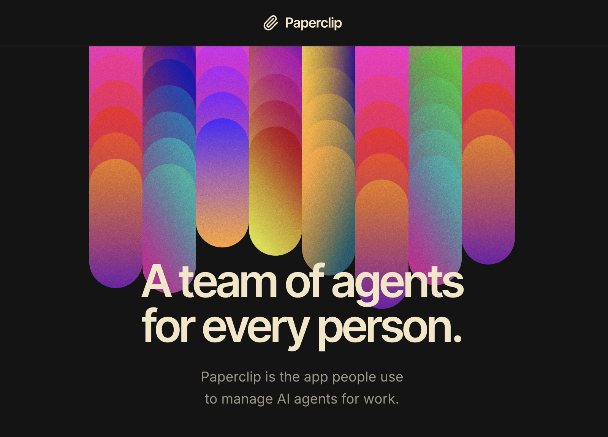

<p align="center">
  
</p>

<p align="center">
  <a href="#hızlı-başlangıç"><strong>Hızlı başlangıç</strong></a> &middot;
  <a href="https://docs.paperclip.ing"><strong>Belgeler</strong></a> &middot;
  <a href="https://github.com/paperclipai/paperclip"><strong>GitHub</strong></a> &middot;
  <a href="https://discord.gg/paperclipai"><strong>Discord</strong></a> &middot;
  <a href="https://x.com/papercliping"><strong>Twitter</strong></a> &middot;
  <a href="https://paperclip.ing"><strong>Web sitesi</strong></a>
</p>

<p align="center">
  <a href="https://github.com/paperclipai/paperclip/blob/master/LICENSE"></a>
  <a href="https://github.com/paperclipai/paperclip/stargazers"></a>
  <a href="https://discord.gg/paperclipai"></a>
  <a href="https://superagent.sh"><picture><source media="(prefers-color-scheme: dark)" srcset="https://www.superagent.sh/api/badge/paperclipai/paperclip/shield.svg?theme=dark&accent=teal&variant=scanned" /></picture></a>
</p>

<p align="center">
  <a href="https://www.star-history.com/paperclipai/paperclip"></a>
</p>

<br/>

<div align="center">
  <video src="https://github.com/user-attachments/assets/773bdfb2-6d1e-4e30-8c5f-3487d5b70c8f" width="600" controls></video>
</div>

<p align="center">
  <a href="https://paperclip.ing/waitlist/"><strong>Paperclip Cloud bekleme listesine katılın →</strong></a>
</p>

<br/>

<p align="center"><a href="README.md">English</a> · <strong>Türkçe</strong></p>

# Paperclip, iş için yapay zekâ ajanlarını yönetmenizi sağlayan uygulamadır.

Yapay zekâ ajanı ekipleri için açık kaynaklı orkestrasyon.

**OpenClaw bir _çalışansa_, Paperclip onun _şirketidir_.**

Paperclip, bir işi yürütmek üzere yapay zekâ ajanlarından oluşan ekibi koordine eden Node.js sunucusu ve React arayüzüdür. Kendi ajanlarınızı getirin, hedefler atayın, işleri ve maliyetleri tek panelden takip edin. Her ajan için model ve çalışma ortamı seçerken ekibin görevlerini, becerilerini, izinlerini ve geçmişini bir arada tutun.

Bir görev yöneticisi gibi görünür. Arka planda organizasyon şemaları, bütçeler, yönetişim, hedef uyumu ve ajan koordinasyonu bulunur.

**Pull request'leri değil, iş hedeflerini yönetin.**

| Adım | İşlem | Örnek |
| --- | --- | --- |
| **01** | Hedefi tanımlayın | “Bir numaralı yapay zekâ not uygulamasını geliştirip aylık yinelenen gelirini 1 milyon dolara çıkar.” |
| **02** | Ekibi kurun | CEO, CTO, mühendisler, tasarımcılar, pazarlamacılar; istediğiniz bot ve sağlayıcı. |
| **03** | Onaylayıp çalıştırın | Stratejiyi inceleyin. Bütçeleri belirleyin. Başlatın ve panelden izleyin. |

OpenClaw, Claude Code, Codex, Cursor ve Cursor Cloud, Gemini CLI, OpenCode, Pi, Hermes ve Hermes Gateway, Grok Build ve Kimi Code ile çalışır. **Çalışma sinyali (heartbeat) alabiliyorsa ekibe katılabilir.**

Özel süreçler, HTTP uç noktaları ve harici bağdaştırıcı paketleriyle desteği genişletin. Kurulum ve yetenekler için [bağdaştırıcılara genel bakışa](https://docs.paperclip.ing/reference/adapters/overview/) bakın.

## Paperclip kimler için uygun?

- ✅ **Özerk yapay zekâ kuruluşları** kurmak isteyenler
- ✅ OpenClaw, Codex, Claude ve Cursor gibi **farklı ajanları ortak bir hedefe yönlendirenler**
- ✅ Açık duran **20 Claude Code terminalinde** kimin ne yaptığını takip edemeyenler
- ✅ Ajanların **7/24 özerk çalışmasını**, gerektiğinde de işleri denetleyip müdahale etmeyi isteyenler
- ✅ **Maliyetleri izleyip bütçe sınırları uygulamak** isteyenler
- ✅ Ajanları **görev yöneticisi kullanır gibi** yönetmek isteyenler
- ✅ Özerk işletmelerini **telefonundan yönetmek** isteyenler

## Dört temel bileşen

Bir yapay zekâ ajanı kuruluşunun üretken olabilmesi için görevlerin, organizasyonun, eğitimin ve altyapının birlikte çalışması gerekir. Paperclip bu dört temel üzerine kuruludur.

| Bileşen | Kimler için? | Kapsam |
| --- | --- | --- |
| **Ajan destekli görev yöneticisi** — Niyetinizi belirtin. Ajanlar çalışsın. Çıktıyı doğrulayın. | Herkes, günlük kullanım | Görevler, onay ve inceleme aşamaları; proaktif ajan çalışma arkadaşları; denetlenebilir rutinler; farklar, ekran görüntüleri ve testlerle doğrulama |
| **Ajanlar için organizasyon şeması** — İnsan ve ajan rolleri, izinleri ve sınırları. | Yöneticiler | Karma ekipler, sorumluluklar, yetki devri, uzmanlaşma, yönetişim, kapsamı sınırlı gizli bilgiler ve şirket sınırları, bağlantı izinleri ve sorumlu kullanıcı kimlikleri |
| **Yapay zekâ çalışanlarının eğitimi** — Çalışanları tasarlayın, eğitin ve değerlendirin. | Ekibi geliştirenler | Skill Studio, ortak beceriler, değerlendirmeler, kayıtlı testler, aktif öğrenme döngüleri, kalite ölçütleri, performans incelemeleri, beceri sürümleri ve geri yükleme, ekip şablonları |
| **Ajan işletim sistemi** — İşleri çalıştıran altyapı. | BT ve platform ekipleri | Farklı sağlayıcılar, modeller ve ajanlar; yalıtım, entegrasyonlar ve MCP; SSO, GRC, RBAC ve maliyet kontrolleri; veri gizliliği, dahili izler, kişisel ve ortak uygulama bağlantıları, çalışma geçmişi ve isteğe bağlı izleme |

## Özellikler

- 🔌 **Kendi ajanınızı getirin:** İstediğiniz ajan ve çalışma ortamını tek organizasyon şemasında kullanın.
- 🎯 **Hedef uyumu:** Görevleri ve projeleri kuruluş hedeflerine bağlayın. Ajanlar işlerinin arkasındaki hedef bağlamını alır.
- 💓 **Çalışma sinyalleri:** Ajanlar atanmış işler, takip mesajları veya yapılandırılmış zamanlamalarla uyanır. İş devri organizasyon şemasında iki yönde ilerler.
- 💰 **Maliyet kontrolü:** Şirket, ajan ve proje [bütçeleri](https://docs.paperclip.ing/guides/day-to-day/costs/). Bildirilen harcamaları izleyin, eşik uyarıları alın ve belirlenen sınırlarda işi duraklatın.
- 🏢 **Birden fazla kuruluş:** Tek kurulumda her kuruluşun görevlerini, ajanlarını, izinlerini ve etkinlik geçmişini ayrı tutun.
- 🎫 **Görev konuşmaları:** Konuşmaları, planları, engelleri, dosyaları ve çalışma geçmişini işe bağlı tutun. İnsanlara veya ajanlara görev atayın.
- 🛡️ **Yönetişim:** [İnceleme ve onay aşamalarını](https://docs.paperclip.ing/guides/day-to-day/approvals/) yapılandırın, işe alımları onaylayın; gerektiğinde işi duraklatın, yeniden atayın veya durdurun.
- 📊 **Organizasyon şeması:** Hiyerarşiler, roller ve bağlılık ilişkileri. Ajanların yöneticisi, unvanı ve iş tanımı vardır.
- 📱 **Mobil kullanım:** Özerk işletmelerinizi her yerden izleyip yönetin.
- 🔗 **Uygulamalar ve bağlantılar:** GitHub, Notion, Railway gibi [hizmetleri bağlayın](https://docs.paperclip.ing/connectors/) veya kendi MCP sunucunuzu kullanın. Ağ geçidi işlemlerini İzin ver, Önce sor veya Kapalı olarak ayarlayın.
- 👥 **Ortak ajanlar, kişisel hesaplar:** [Bağlantıyı kimlerin ve hangi ajanların kullanacağını](https://docs.paperclip.ing/connectors/access-model/) seçin. Yönetilen GitHub işlemleri, işi yönlendiren kişinin hesabını kullanabilir.
- 🧠 **Beceriler ve Skill Studio:** [Ortak becerileri](https://docs.paperclip.ing/guides/org/skills/) kurun veya yazın; kayıtlı girdilerle test edin, sonuçları inceleyin ve önceki sürümlere dönün.
- 📅 **Zamanlanmış rutinler:** [Yinelenen işleri](https://docs.paperclip.ing/guides/projects-workflow/routines/) zamanlayın veya API/webhook ile tetikleyin. Her çalışmanın görevi, sorumlusu ve geçmişi vardır.
- 📎 **Çıktılar ve geri bildirim:** [Ajanların ürettiği dosya ve belgeleri](https://docs.paperclip.ing/guides/day-to-day/artifacts/) bulun. Desteklenen biçimleri önizleyip belgelerin belirli bölümlerine yorum yazın.
- 📦 **Hazır ekipler:** Rolleri, becerileri, projeleri ve rutinleri olan [ekipleri](https://docs.paperclip.ing/guides/org/team-catalog/) önizleyip kurun. Çalışma ortamlarını seçip kurulumu özelleştirin.

Deneysel **Agent Chat** ve **sohbet/e-posta bağlayıcıları**, Paperclip içinde ve Slack, Discord, Telegram, AgentMail gibi yapılandırılmış hizmetlerde ajanlarla konuşmayı sağlar. Denemek için ilgili kurulum ayarlarını etkinleştirin.

## Paperclip'in çözdüğü sorunlar

| Paperclip olmadan | Paperclip ile |
| --- | --- |
| 20 Claude Code sekmesinde kimin ne yaptığını takip edemezsiniz; yeniden başlatmada bağlam kaybolur. | İşler görevlere ayrılır, konuşmalar düzenli tutulur, oturumlar yeniden başlatmalarda korunur. |
| Bota ne yaptığınızı hatırlatmak için farklı yerlerden elle bağlam toplarsınız. | Bağlam görevden projeye ve şirket hedeflerine uzanır; ajan neyi neden yapacağını bilir. |
| Dağınık ajan ayarlarıyla görev yönetimini ve koordinasyonu baştan kurarsınız. | Organizasyon şeması, görev takibi, iş devri ve yönetişim hazırdır. |
| Kontrolsüz döngüler yüzlerce dolarlık token harcayıp kotayı tüketebilir. | Harcama takibi, bütçe uyarıları ve otomatik duraklatmalar maliyeti kontrol etmeye yardımcı olur. |
| Destek, sosyal medya ve raporlama işlerini elle başlatmayı hatırlamanız gerekir. | Rutinler, çıktıları ve geçmişi incelenebilen atanmış görevler oluşturur. |
| Depoyu bulup Claude Code'u açmanız ve başında beklemeniz gerekir. | Paperclip'e görev ekleyin. Kodlama ajanı tamamlayana kadar çalışır; yönetim işi inceler. |

## Paperclip'i özel kılanlar

- **Atomik görev üstlenme:** Tek sorumlu ve yürütme kilitleri, rakip çalışmaların aynı görevi üstlenmesini önler.
- **Kalıcı iş bağlamı:** Görevler, yorumlar ve belgeler korunur. Destekleyen bağdaştırıcılar kayıtlı oturumları sürdürür.
- **Çalışma anında beceri yükleme:** Ajanlar yeniden eğitilmeden iş akışlarını ve proje bağlamını öğrenir.
- **Geri alınabilir yönetişim:** Onay kapıları uygulanır, ayarlar sürümlenir ve hatalı değişiklikler geri alınabilir.
- **Sorumluluğu belirli bağlantılar:** İnsan erişimi, ajan uygunluğu ve ağ geçidi işlem izinleri ayrı denetimlerdir. Bir çağrıyı bir kez onaylayın veya kaldırılabilir bir kural kaydedin.
- **Hedefleri bilen yürütme:** Görevler ve projeler üst hedefleri taşır; ajan yalnızca başlığı değil amacı da görür.
- **Taşınabilir şirket şablonları:** Gizli bilgileri ayıklama ve çakışma yönetimiyle kuruluşları, ajanları ve becerileri dışa/içe aktarın.
- **Kuruluş sınırları:** Şirket kapsamlı erişim kontrolleri işleri, ajanları ve etkinlikleri ayırır.

## Arka planda neler var?

Paperclip yalnızca bir sarmalayıcı değil, tam bir yönetim katmanıdır:

- **Kimlik ve erişim:** Güvenilen yerel veya kimlik doğrulamalı kurulum; insan rolleri ve izinleri, ajan API anahtarları, kısa ömürlü çalışma JWT'leri, şirket üyelikleri ve davetler. Sorumlu kullanıcı bilgisi iş devrinde ve desteklenen yönetilen bağlantılarda korunur.
- **Organizasyon şeması ve ajanlar:** Roller, unvanlar, bağlılık ilişkileri, izinler ve bütçeler. Claude Code, Codex, Cursor/Gemini/bash gibi CLI ajanları, OpenClaw gibi HTTP/webhook botları ve harici bağdaştırıcılar.
- **İş ve görev sistemi:** Şirket/proje/hedef/üst görev bağlantıları; kilitli atomik görev üstlenme; engel bağımlılıkları, yorumlar, belgeler, ekler, çıktılar, etiketler ve gelen kutusu durumu. İşlerde arayın, belge sürümlerini inceleyin ve belirli bölümlere geri bildirim bırakın.
- **Çalışma sinyallerinin yürütülmesi:** Birleştirme destekli veritabanı kuyruğu, bütçe kontrolleri, çalışma alanı çözümleme, gizli bilgi sağlama, beceri yükleme ve bağdaştırıcı çağrıları. Çalışmalar günlük, kullanım kaydı ve oturum durumu üretir. Sınırlı kurtarma desteklenen hataları ele alır, insan müdahalesi gerekenleri gösterir.
- **Çalışma alanları ve ortamları:** Proje depoları, isteğe bağlı yalıtılmış alanlar (git worktree ve operatör dalları), geliştirme sunucuları ve önizleme URL'leri. Yalıtım sağlayıcıları çalışmayı yerel bilgisayarın ötesine taşır; kullanılabilirlik ortama ve bağdaştırıcıya bağlıdır.
- **Yönetişim ve onaylar:** Yönetim kurulu onay akışları, incelemeli yürütme politikaları, karar takibi, bütçe durdurmaları ve ajan duraklatma/sürdürme/sonlandırma. Görev incelemeleri tamamlanmayı, bağlantı onayları araç ağ geçidi çağrılarını yönetir.
- **Bütçe ve maliyet kontrolü:** Şirket, ajan, proje, hedef, görev, sağlayıcı ve model bazında token ve maliyet takibi. Uyarı eşikleri ve kesin sınırlar. Uygulama kayıtlı harcamaya dayanır; kullanım bildirimi ve devam eden işler durdurmayı geciktirebilir.
- **Rutinler ve zamanlama:** Cron, webhook ve API ile yinelenen görevler; eşzamanlılık ve kaçırılan işleri telafi politikaları. Her çalışma takip edilen bir görev oluşturur ve atanmış ajanı uyandırır.
- **[Eklentiler](https://docs.paperclip.ing/administration/plugins/):** Ayrı süreçlerde çalışan işçiler, yetenek kontrollü hizmetler, zamanlama, araçlar ve arayüz katkıları. Paperclip'i fork oluşturmadan genişletin.
- **Gizli bilgiler ve depolama:** Şirket ve kişi bazında gizli değerler, şifreli kimlik bilgileri, yerel veya S3 uyumlu depolama, ekler ve çıktılar. Başvurular, değerleri normal ajan ayarlarına kopyalamadan yetkili çalışmalara sağlar.
- **Etkinlik ve olaylar:** Değişiklikler, çalışma sinyali durumları, maliyet olayları, onaylar, yorumlar ve çıktılar kalıcı olarak kaydedilir; operatörler neyin neden olduğunu denetleyebilir.
- **[Şirket taşınabilirliği](https://docs.paperclip.ing/guides/power/export-import/):** Ajanlar, beceriler ve isteğe bağlı projeler, rutinler, görevler ve eklerle kuruluş paketleri oluşturun. Başvurulan gizli değerler çıkarılır; düz ortam değerleri ve yerel yollar kalabileceğinden paylaşmadan önce inceleyin. Paketler çalışma düzenini paylaşır; tam kurulum kurtarması yedeklerden yapılır.

## Paperclip ne değildir?

| | |
| --- | --- |
| **Yalnızca sohbet botu değildir.** | Konuşmalar görevlere, planlara, kararlara ve çıktılara bağlıdır. Deneysel Agent Chat işi atanmış görevlere devredebilir. |
| **Ajan geliştirme çatısı değildir.** | Ajanı nasıl kuracağınızı değil, ajanlardan oluşan şirketi nasıl yöneteceğinizi ele alır. |
| **Yalnızca iş akışı oluşturucu değildir.** | Rutinler roller, hedefler, bütçeler ve yönetişim içinde çalışır. |
| **İstem yöneticisi değildir.** | Ajanlar kendi istemlerini, modellerini ve ortamlarını getirir. Paperclip kuruluşu yönetir. |
| **Tek ajanla sınırlı değildir.** | Bir ajanla başlayıp ortak beceriler, iş devri ve incelemeyle ekip kurun. |
| **Yalnızca kod incelemesi için değildir.** | Kod ve PR incelemesinin yanında araştırma, operasyon, içerik ve diğer işler de desteklenir. |

## Hızlı başlangıç

Açık kaynaklıdır. Kendi sunucunuzda barındırılır. Paperclip hesabı gerekmez. İlk ajanınızı kurmak için [başlangıç kılavuzunu](https://docs.paperclip.ing/guides/getting-started/five-minute-path/) izleyin.

### Ajanınızdan kurmasını isteyin

[Kurulum kılavuzunu](https://docs.paperclip.ing/reference/cli/installation/) ajanınızla paylaşın.

### Kendiniz kurun

**Node.js 24.11 veya üzeri** kuruluysa:

```bash
npx paperclipai@latest onboard --yes
```

CLI npm önbelleğinden çalışır; kurulum ayarlarınız ve verileriniz yerelde kalıcı olarak saklanır. Yönetilen kurulumlar, sabitlenmiş sürümler, canary ve git-ref kurulumları, güncellemeler, geri alma, hizmet yönetimi ve kaldırma için [kurulum kılavuzuna](https://docs.paperclip.ing/reference/cli/installation/) bakın.

CEO ajanıyla hazırlanmış yalıtılmış bir elle test ortamı için `test-drive` kullanın. Ön planda kalır, hizmet kurmaz veya ilk görevi oluşturmaz; tarayıcıyı yalnızca başarılı kurulumdan sonra açar:

```bash
ANTHROPIC_API_KEY=... npx paperclipai test-drive
OPENAI_API_KEY=... npx paperclipai test-drive --harness codex
OPENROUTER_API_KEY=... npx paperclipai test-drive \
  --harness opencode \
  --model openrouter/anthropic/claude-sonnet-4.5
```

`--data-dir` belirtilmeyen her çalışma benzersiz, korunan bir geçici dizin kullanır; tam yolu başlangıçta yazdırılır. Aynı dizini kullanmak için `--data-dir`, tarayıcıyı açmamak için `--no-browser` verin. Bağlı bir Git worktree içinden çağrıldığında `test-drive`, o worktree'de görev yürütmeyi de etkinleştirir. Kimlik bilgileri ve yeniden kullanım için [test-drive kılavuzuna](https://docs.paperclip.ing/reference/cli/test-drive/) bakın.

> **Sorun giderme: özel npm kayıt deposu `.npmrc`**
>
> Genel `~/.npmrc` dosyasında GitHub Packages gibi özel bir kayıt deposu kullanıyorsanız `paperclipai` için `E404` hatası alabilirsiniz. `npx`, paketi genel npm yerine özel depoda arıyor olabilir.
>
> Kontrol edin:
>
> ```bash
> npm config get registry
> ```
>
> Bu komut için genel npm deposunu zorunlu kullanın (platformlar arası):
>
> ```bash
> npx --registry https://registry.npmjs.org paperclipai@latest onboard --yes
> ```

Hızlı başlangıç varsayılan olarak güvenilen yerel geri döngü modunu kullanır. Kimlik doğrulamalı/özel modda başlamak için bağlanma ön ayarını açıkça seçin:

```bash
npx paperclipai@latest onboard --yes --bind lan
# veya:
npx paperclipai@latest onboard --yes --bind tailnet
```

Paperclip zaten yapılandırılmışsa `onboard` mevcut ayarları korur. Düzenlemek için `npx paperclipai configure` kullanın.

Elle kurulum:

```bash
git clone https://github.com/paperclipai/paperclip.git
cd paperclip
pnpm install
pnpm dev
```

Arayüz ve API `http://localhost:3100` adresinde başlar. Gömülü PostgreSQL otomatik oluşturulur; ek kurulum gerekmez.

> **Gereksinimler:** Node.js 24.11+, pnpm 9.15+

Yerel Claude ve Codex abonelik girişi için Paperclip bilgisayarında Python 3 ve ilgili sağlayıcının CLI'si gerekir. Docker görüntüsü bunları içerir.

Kaynak geliştirmede etkinse yerel Paperclip Runner da derlenir (kendi sunucunuzda barındırmada varsayılan). Rust araç zincirini kurun veya `PAPERCLIP_RUNNER_BINARY` değerini uyumlu, önceden derlenmiş bir runner'a ayarlayın.

## Sık sorulan sorular

**Bu proje gerçekten geliştiriliyor mu?** [Paperclip ekibi](https://paperclip.ing) tarafından sürdürülüyor. [2.700'den fazla PR birleştirildi](https://github.com/paperclipai/paperclip/pulls?q=is%3Apr+is%3Amerged).

**Tipik kurulum nasıldır?** Yerelde tek Node.js süreci gömülü Postgres'i ve dosya depolamayı yönetir. Üretimde kendi Postgres'inizi kullanıp istediğiniz gibi dağıtın. Projeleri, ajanları ve hedefleri yapılandırın; gerisini ajanlar üstlenir. Uzaktan erişim için Tailscale gibi özel ağ bağlantısıyla kimlik doğrulamalı modu veya Docker'da kalıcı sunucuyu kullanın. [Kurulum modları](https://docs.paperclip.ing/reference/deploy/deployment-modes/) ve [Docker kılavuzu](https://docs.paperclip.ing/reference/deploy/docker/).

**Birden fazla şirket çalıştırabilir miyim?** Evet. Tek kurulum, şirket kapsamlı veriler ve erişim kontrolleriyle birden fazla kuruluş barındırabilir.

**OpenClaw veya Claude Code'dan farkı ne?** Paperclip bu ajanları kullanır; organizasyon şemaları, bütçeler, hedefler, yönetişim ve hesap verebilirlikle bir şirket halinde koordine eder.

**OpenClaw'u Asana veya Trello'ya bağlamak yerine neden Paperclip?** Görev üstlenme, oturum koruma, maliyet izleme ve yönetişim gibi koordinasyon ayrıntılarını Paperclip yönetir. Kendi görev sisteminizi kullanma desteği yol haritasındadır.

**Ajanlar sürekli çalışır mı?** Atanmış işlerde ve takip mesajlarında uyanırlar. İsteğe bağlı zamanlayıcı sinyalleri düzenli kontrol sağlar; rutinler kendi takvimlerinde görev oluşturur. Haricen çalışan OpenClaw gibi ajanları da bağlayabilirsiniz. Yalnızca bir ajandan söz etmek ona iş atamaz veya onu uyandırmaz.

## Geliştirme

```bash
pnpm dev              # API + arayüz, izleme modu
pnpm dev:once         # Dosya izlemesi olmadan tam geliştirme
pnpm dev:server       # Yalnızca sunucu
pnpm dev:mobile       # Hazır arayüzü telefon/tablet için :3101'de sunar (/api → :3100)
pnpm dev:both         # dev ve dev:mobile birlikte
pnpm build            # Tümünü derle
pnpm typecheck        # Tür denetimi
pnpm test             # Varsayılan test çalışması (yalnızca Vitest)
pnpm test:watch       # Vitest izleme modu
pnpm test:e2e         # Playwright tarayıcı testleri
pnpm db:generate      # Veritabanı geçişi oluştur
pnpm db:migrate       # Geçişleri uygula
```

`pnpm test`, Playwright'ı çalıştırmaz. Tarayıcı testleri ayrıdır; genellikle ilgili akışlarda çalışırken veya CI'da çalıştırılır. Ayrıntılar için [geliştirme kılavuzuna](doc/DEVELOPING.md) bakın.

## Yol haritası

- ✅ Eklenti sistemi (bilgi tabanı, özel izleme, kuyruklar vb.)
- ✅ OpenClaw / claw tarzı ajan çalışanlar
- ✅ companies.sh — kuruluşları dışa/içe aktarma
- ✅ Kolay AGENTS.md yapılandırması
- ✅ Beceri yöneticisi, Skill Studio ve beceri mağazası
- ✅ Zamanlanmış rutinler
- ✅ Gelişmiş bütçeleme
- ✅ Ajan incelemeleri ve onaylar
- ✅ Birden fazla insan kullanıcı
- ✅ Bulut / yalıtılmış ajanlar (e2b, Cloudflare, Daytona, Modal, Novita, boxd, kendi Kubernetes'iniz)
- ✅ Dosyalar ve iş çıktıları
- ✅ Ayrıntılı planlama (plan modu, sürümlü planlar, plan onayları)
- ✅ Sonuçların güvence altına alınması (izleyiciler, kurtarma işlemleri, inceleme kapıları)
- ✅ MCP araç ağ geçidi ve uygulamalar (denetimli araç erişimi)
- ✅ Ajan bazında erişimli gizli bilgi yöneticisi
- ✅ Etkinlik günlüğü ve işlem sorumluluğu
- ✅ Kendini onaran çalışmalar ve otomatik kurtarma
- ✅ Ajan değerlendirmeleri ve geri bildirim
- ✅ Bağlı uygulamalar
- ✅ Kişisel ve ortak yapay zekâ hesapları
- ✅ Ortak ajanların kişisel GitHub kimliklerini kullanması
- ✅ Beceri sürüm geçmişi ve geri yükleme
- ✅ Belge yorumları ve sürüm geçmişi
- ✅ Şirket genelinde arama
- ✅ Çok modelli ve farklı çalışma ortamlarını kullanan ekipler
- 🟡 Bellek / bilgi
- ⚪ MAXIMIZER MODE
- ⚪ İş kuyrukları
- ⚪ Kendi kendine örgütlenme
- ⚪ Otomatik kurumsal öğrenme
- 🟡 Ajan sohbeti
- 🟡 Bulut dağıtımları
- ⚪ Masaüstü uygulaması
- ⚪ Kendi görev sistemini kullanma (Asana / Linear / Jira ile başlama)

Bu kısa önizlemenin tamamı [ROADMAP.md](ROADMAP.md) dosyasındadır.

## Topluluk ve eklentiler

Eklentileri ve diğer kaynakları [awesome-paperclip](https://github.com/gsxdsm/awesome-paperclip) içinde bulun.

## Gözlemlenebilirlik

Paperclip sunucu için isteğe bağlı OpenTelemetry otomatik ölçümleme sunar (yalnızca izler). `OTEL_EXPORTER_OTLP_ENDPOINT` ayarlandığında etkinleşir. Standart `OTEL_EXPORTER_OTLP_PROTOCOL` değişkeniyle `grpc`, `http/protobuf` ve `http/json` desteklenir. `@opentelemetry/api` normal sunucu bağımlılığıdır; SDK, otomatik ölçümleme ve dışa aktarma paketleri isteğe bağlı eş bağımlılıklardır. Yalnızca izleme istiyorsanız kurun. Kurulum komutları ve ortam değişkenleri için [doc/observability.md](doc/observability.md) dosyasına bakın.

Sunucu ve tarayıcı için isteğe bağlı Sentry hata izleme de bulunur. Tarayıcı için `SENTRY_DSN_FRONTEND`, sunucu için `SENTRY_DSN_BACKEND` ayarlayın. İkisi de isteğe bağlıdır; eski `SENTRY_DSN` değişkeni her iki bileşen için yedek değer olarak çalışır. Desteklenen sunucu SDK'sı `@sentry/node@10.71.0` isteğe bağlı eş bağımlılıktır; yalnızca hata izleme istiyorsanız kurun. Tarayıcı SDK'sı `@sentry/browser` aynı sürüme sabitlenmiştir. Komut, gizlilik ayarları ve varsayılan toplanan veriler için [Sentry belgelerine](doc/observability.md#sentry-error-monitoring) bakın.

## Telemetri

Paperclip, kullanımını anlamak ve ürünü geliştirmek için anonim kullanım telemetrisi toplar. Kişisel bilgiler, görev içerikleri, istemler, dosya yolları ve gizli bilgiler hiçbir zaman toplanmaz. Özel depo başvuruları gönderilmeden önce kurulum başına farklı bir tuz değeriyle özetlenir.

Telemetri olaylarını değiştiren katkıcılar [telemetri veri sözleşmesini](packages/shared/src/telemetry/README.md) izlemelidir. Henüz üretilen sözleşmede bulunmayan birinci taraf olay önerileri için [telemetri iş akışını](doc/TELEMETRY_WORKFLOW.md) izleyin.

Telemetri **varsayılan olarak açıktır**. Şu yöntemlerden biriyle kapatılabilir:

| Yöntem | Nasıl? |
| --- | --- |
| Ortam değişkeni | `PAPERCLIP_TELEMETRY_DISABLED=1` |
| Standart tercih | `DO_NOT_TRACK=1` |
| CI ortamı | `CI=true` olduğunda otomatik kapanır |
| Yapılandırma dosyası | Paperclip ayarlarında `telemetry.enabled: false` |

## Katkıda bulunma

Katkılarınızı bekliyoruz. [Katkı kılavuzunu](CONTRIBUTING.md) inceleyin.

**[Ekibimize katılın](https://paperclip.ing/about/#careers)**

## Topluluk

- [Discord](https://discord.gg/paperclipai) — Topluluğa katılın
- [Twitter / X](https://x.com/papercliping) — Güncellemeler ve duyurular
- [GitHub Issues](https://github.com/paperclipai/paperclip/issues) — Hatalar ve özellik istekleri
- [GitHub Discussions](https://github.com/paperclipai/paperclip/discussions) — Fikirler ve RFC'ler

## Lisans

MIT &copy; 2026 [Paperclip Labs, Inc](https://paperclip.ing)

## Yıldız geçmişi

[Star History grafiğini görüntüleyin](https://www.star-history.com/?repos=paperclipai%2Fpaperclip&type=date&legend=top-left).

---

<p align="center"><sub>MIT lisansıyla açık kaynaklıdır. Ajanların başında beklemek yerine iş yapmak isteyenler için geliştirildi.</sub></p>
