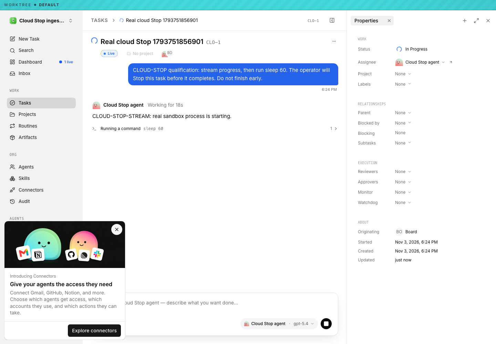
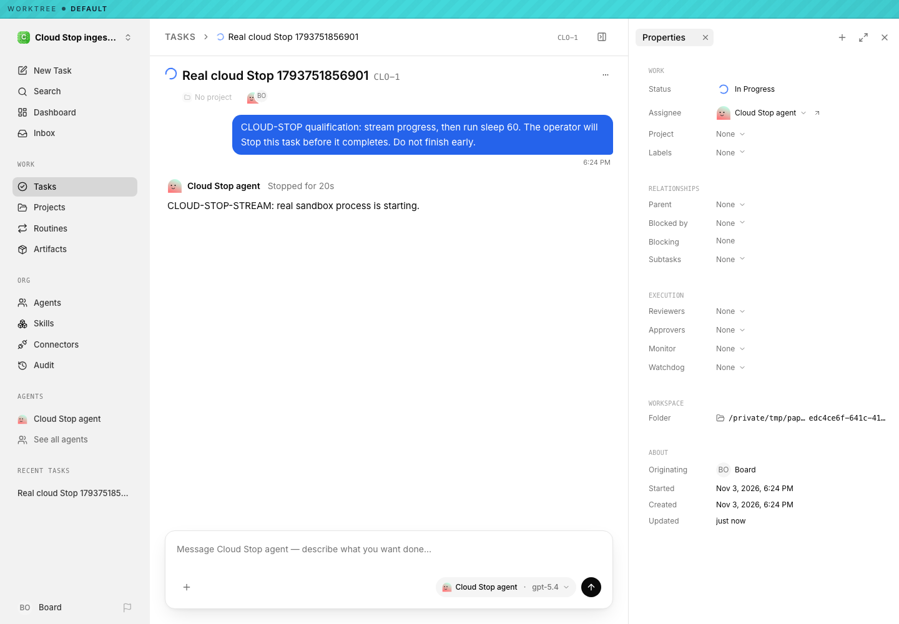

# Real cloud Stop acceptance (2026-11-03)

Fresh qualification passed on the production-built application at `914129afb141d81c0d6d8c5f0ea11c20bd69a3da`, after integrating the current upstream Stop finalizer and recovery changes. The ordinary task UI stopped a real Daytona sandbox running the current Runner and a deterministic Codex fixture with a real `sleep 60`. This is functional cloud lifecycle acceptance; the separate [live-provider journey](2026-11-03-native-event-ingestion-live.md) used a real model.

The [current proof](native-event-ingestion-2026-11-03/cloud-stop-ce33-914/qualification.json) records native acknowledgement, shared acknowledgement with `provider_termination_receipt`, the exact lease's successful release, and the matching stopped-provider receipt. Independent SDK observations confirmed the young process's birth identity before the UI click, child retirement with no forbidden effect, and the labelled sandbox's stopped state. Reload and direct PostgreSQL checks verified the cancelled run, 82 global rows, all 16 canonical hashes, current cursor marker, and no successor or accepted result.

All six task-owned sandboxes, including the historical attempts, were independently confirmed absent. The [cleanup and credential scan](native-event-ingestion-2026-11-03/cloud-stop-ce33-914/cleanup-and-scan.json), [executed helper hashes](native-event-ingestion-2026-11-03/cloud-stop-ce33-914/executed-helpers.json), [toolchain](native-event-ingestion-2026-11-03/cloud-stop-ce33-914/toolchain.json), and [manifest](native-event-ingestion-2026-11-03/cloud-stop-ce33-914/manifest.json) make the result inspectable. The current journey executed the corrected public cleanup helper whose SHA starts `753ea9b8`. See its [environment and reproduction notes](native-event-ingestion-2026-11-03/cloud-stop-ce33-914/README.md).

This is one functional sample, with no throughput, latency-distribution, deployed-production or live-LLM claim. Sparse source history and the existing raw-output recovery policy remain in force: ordinary wire ACKs do not universally establish database durability.

## Historical qualification

The earlier controller at `137501f595fd5ee13d395e26b4147ca8bc4d4eb6` also passed. Its [proof](native-event-ingestion-2026-11-03/cloud-stop/qualification.json), [four preceding harness failures](native-event-ingestion-2026-11-03/cloud-stop/attempts.json), [recipe and current cleanup helpers](native-event-ingestion-2026-11-03/cloud-stop/README.md), and [artifact manifest](native-event-ingestion-2026-11-03/cloud-stop/manifest.json) remain available. They are historical evidence; the fresh journey above qualifies the newer runtime.
