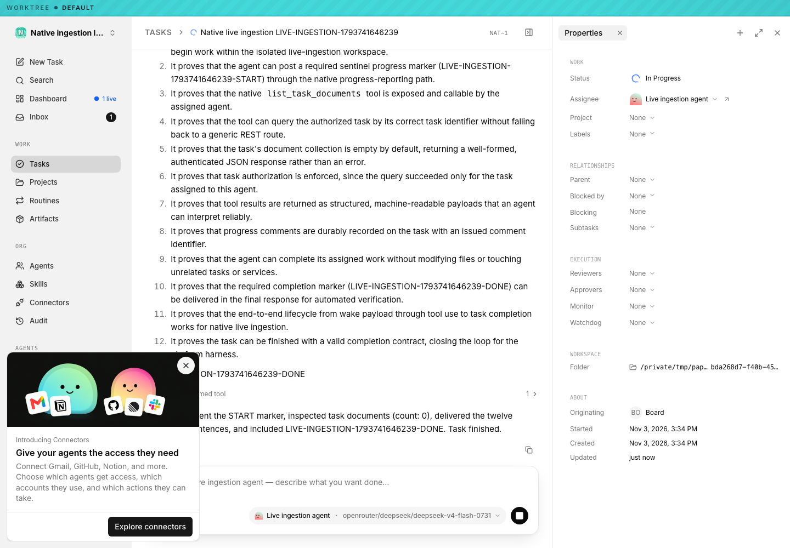
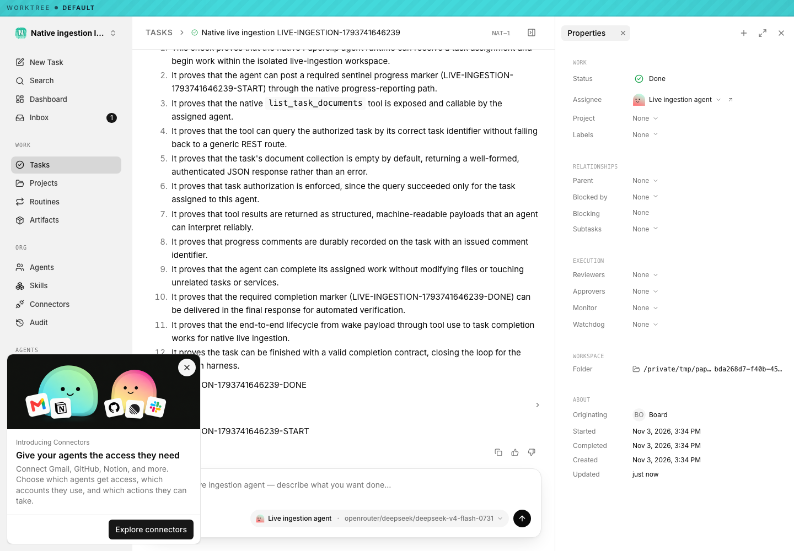
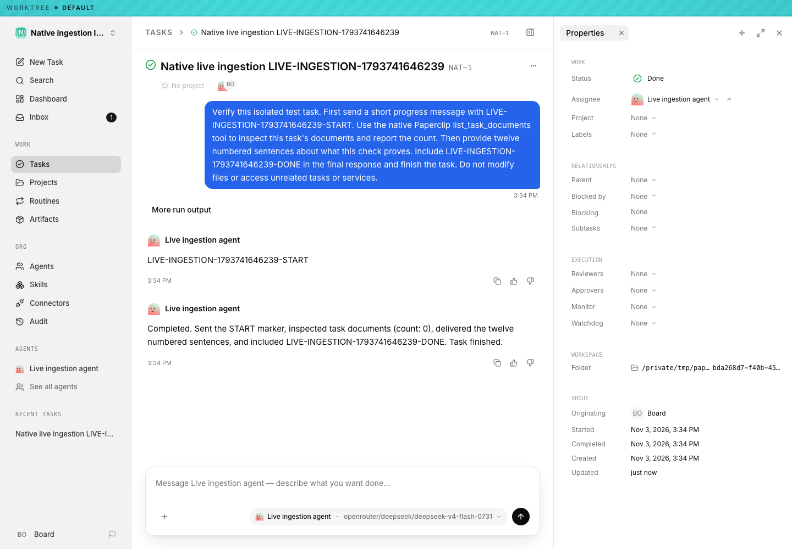
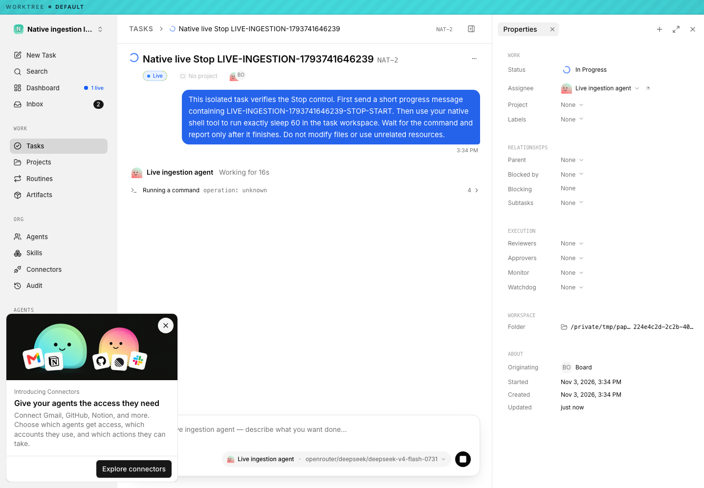
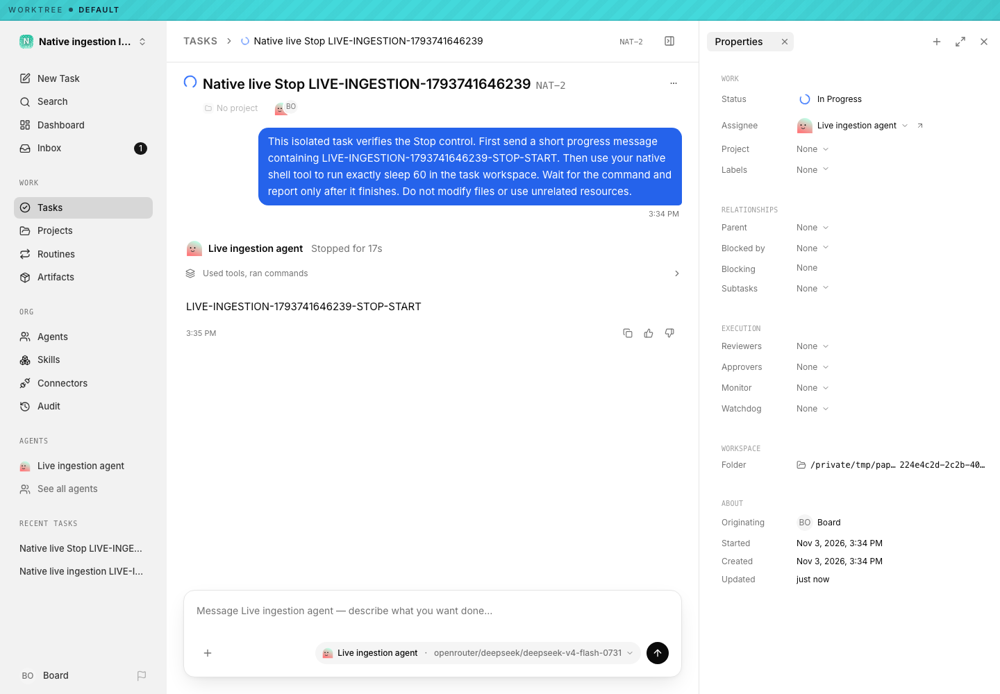

# Native ingestion live-provider verification (2026-11-03)

The ordinary native task flow and Stop journey passed against the compiled
application at `b9a66be242395a4bab671d512643e338fbac77fe`. This is functional
integration acceptance, separate from paired performance measurements.

The environment was macOS arm64, Node 26.4.0, embedded PostgreSQL 18.1,
OpenCode and the real provider model
`openrouter/deepseek/deepseek-v4-flash-0731`. The database and company were
isolated disposable fixtures. Server/UI build hashes and exact identifiers are
retained in [launch provenance](native-event-ingestion-2026-11-03/live/live-launch.json).

| Journey | Observed and independently checked outcome |
| --- | --- |
| Normal visible task creation | Ordinary assistant text rendered while the run was active; native `list_task_documents` completed; the result was accepted. |
| Reload | The completed transcript and result remained present. The run stored 33 `item.delta` events; an ordinary assistant delta was independently matched while active. |
| Stop | A second task executed native `bash` with `sleep 60`; clicking Stop produced canonical cancellation acknowledgement. Reload retained the stopped transcript without a second run. |
| Persistence | Direct PostgreSQL reads verified 126/69 global rows, company/run/source identities, all 101 canonical payload hashes and projection markers. Physical process settlement was independently recorded. |
| Cleanup | Owned server and PostgreSQL stopped, both ports independently closed, temporary credential-bearing directories removed. |

Success run: `e51fe504-e971-4ba1-a146-d91b5b8c92ae`.
Stop run: `9807b34f-4325-462d-bcd2-4addf66696e3`.
The stopped source's cursor remains at 24 before missing raw source sequences
25/26 and retained sequence 27. This preserves the sparse-source contract. A raw
wire acknowledgement does not universally imply ordinary transcript durability.

The observed Stop acknowledgement interval was 481 ms. It is one functional
sample; no performance comparison or tail-latency claim follows from it.

## Inspect the evidence

- [Browser journey outcomes and identifiers](native-event-ingestion-2026-11-03/live/live-provider-result.json)
- [Independent PostgreSQL proof](native-event-ingestion-2026-11-03/live/independent-database-proof.json)
- [Independent lifecycle and OS settlement proof](native-event-ingestion-2026-11-03/live/independent-lifecycle-process-proof.json)
- [Build receipt](native-event-ingestion-2026-11-03/live/build-receipt.json) and [command exit/helper hash receipts](native-event-ingestion-2026-11-03/live/execution-receipts.json)
- [Cleanup receipt](native-event-ingestion-2026-11-03/live/cleanup.json)
- [Credential scan](native-event-ingestion-2026-11-03/live/artifact-secret-scan.json) and [file SHA256 manifest](native-event-ingestion-2026-11-03/live/manifest.json)

The original artifact scan inspected 3,710 retained files and decompressed trace
entries and found zero exact qualification-credential matches. These selected
public files were scanned again before copying. No credential is committed.
The screenshots below supply the reviewable visual evidence. The video and
full trace remain optional local supplements.

## Reproduce

[The live-provider helpers and instructions](../../scripts/native-ingestion/README-live.md)
document the tested helper origins and follow-up review fixes. The journey used
the original helper bytes recorded in the B9 source tag and command receipts;
current helpers repair setup/observation false failures, with a separate nine-case
[red/green receipt](native-event-ingestion-2026-11-03/live/helper-review-regressions.json). The independent database
verifier is a reconstructed utility, now exercised against this live journey's
raw PostgreSQL rows. Its [exact command record](native-event-ingestion-2026-11-03/live/independent-database-verifier-command.json)
and aggregate proof are included. Its separate real-PostgreSQL qualification
also rejected persisted hash/cursor corruption. The owned live database was
removed after verification. The earlier 6afeba4 journey remains historical;
its different 84-digest proof did not use this newer verifier.

The earlier browser attempt failed observer qualification: it watched a tool
progress marker only in completed transcript bubbles and missed its live
presentation. The successful helper requires a matching ordinary delta visibly
rendered while the run is still active. The failed attempt remains excluded.
This work does not establish deployed production performance or a 10,000-agent
qualification.
