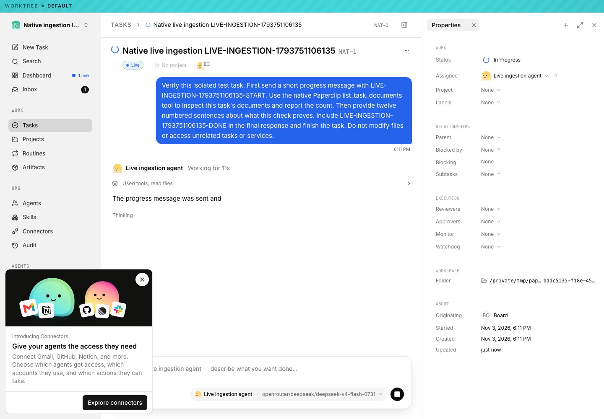
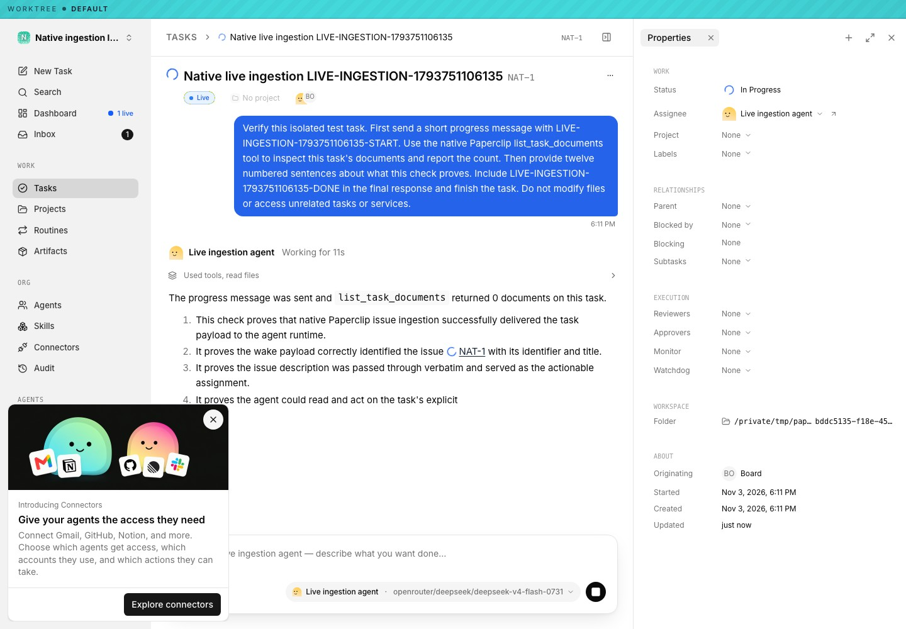
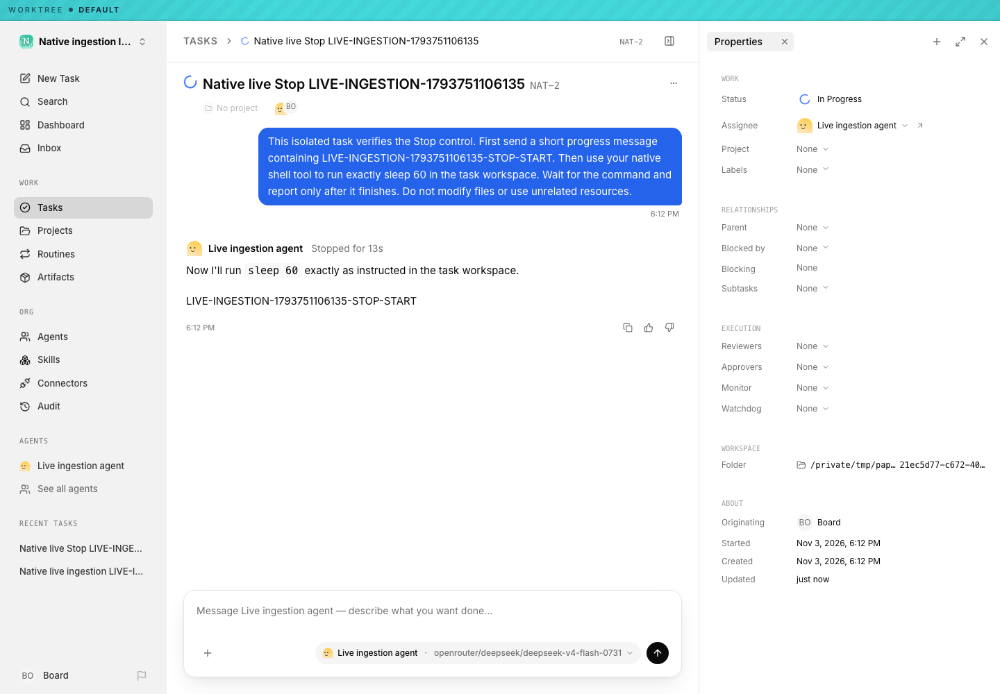

# Native ingestion live-provider verification (2026-11-03)

The ordinary task, tool, completed result, reload and Stop journeys passed on production-built application `914129afb141d81c0d6d8c5f0ea11c20bd69a3da`. OpenCode and `openrouter/deepseek/deepseek-v4-flash-0731` were real dependencies. The disposable environment used macOS arm64, Node26.4 and PostgreSQL18.1. This is functional integration evidence, separate from paired performance acceptance.

Original retained browser frames show text growing from a short partial phrase to numbered sentences before later ordinary deltas and the accepted result. The initial helper's chosen observation happened during `workspace_finalizing`; it proves only pre-terminal visibility. The [retained progressive evidence](native-event-ingestion-2026-11-03/live-ce33-914/retained-progressive-streaming-proof.json) supplies earlier unmodified frames, matching source identities, later emission/commit timestamps and the original selector's missed live interstitial. The earlier UI run response omitted native phase; this evidence does not invent a provider-active phase value.

The success run `688a6c34-f658-48ce-8ce6-61aeb2f72094` completed native `list_task_documents`, accepted its result and retained the transcript after reload. The Stop run `51ad4429-6d34-4df9-bdb9-a54b91842d5a` was stopped while a positively identified real Runner/provider/shell/sleep process chain was alive. All four captured OS birth identities were independently absent after settlement, with a durable `native.local_process_stopped` receipt and no successor after reload. The 372ms acknowledgement is one functional observation, not a performance comparison.

Read-only PostgreSQL verification checked 122/71 global rows, 99 canonical payload hashes, current projection markers, and the stopped source's correct cursor26 with pending range `[29,29]`. The owned controller, database, monitors and credential-bearing data were removed; exact ports independently closed and retained/decompressed evidence passed credential scanning. Ordinary wire ACKs retain their existing recovery policy and are not universally database receipts.

Inspect the [qualification](native-event-ingestion-2026-11-03/live-ce33-914/qualification.json), [independent database proof](native-event-ingestion-2026-11-03/live-ce33-914/independent-database-proof.json), [process proof](native-event-ingestion-2026-11-03/live-ce33-914/independent-birth-settlement-proof.json), [execution receipts](native-event-ingestion-2026-11-03/live-ce33-914/execution-receipts.json), and [manifest](native-event-ingestion-2026-11-03/live-ce33-914/manifest.json). The [README](native-event-ingestion-2026-11-03/live-ce33-914/README.md) distinguishes exact executed helpers, retained-trace review, future observer corrections and their offline checks. Future helper corrections were not retroactively executed in this journey. [Real cloud Stop](2026-11-03-native-event-ingestion-cloud-stop.md) is independently qualified.

## Historical qualification

The earlier B9 journey remains available in its [result](native-event-ingestion-2026-11-03/live/live-provider-result.json), [101-hash PostgreSQL proof](native-event-ingestion-2026-11-03/live/independent-database-proof.json), [process proof](native-event-ingestion-2026-11-03/live/independent-lifecycle-process-proof.json), and [manifest](native-event-ingestion-2026-11-03/live/manifest.json). The [live helper recipe](../../scripts/native-ingestion/README-live.md) records its original execution and subsequent setup/observer fixes. These historical results do not substitute for the newer runtime's qualification above. No journey establishes deployed performance or a 10,000-agent qualification.
