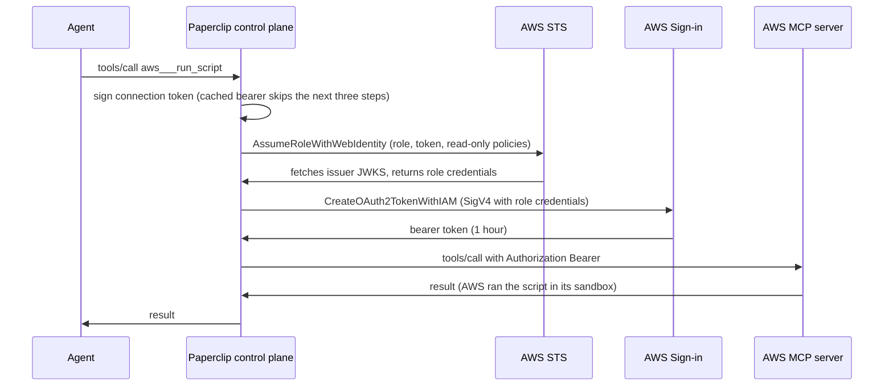

# AWS

The AWS connection lets agents work in an AWS account through AWS's hosted MCP
server (`https://aws-mcp.<region>.api.aws/mcp`). Paperclip stores no long-lived
AWS key for the role method. For each connection, the control plane mints a
one-hour bearer token at call time. Agents see the AWS tools like any other
connector's tools and never receive AWS credentials.

It is behind the `enableAwsConnector` experimental setting (off by default).
The design and the spike that proved it are in
[the AWS connector plan](../plans/2026-11-17-aws-connector-and-minted-credentials.md)
and [the workload identity issuer](../plans/2026-11-17-workload-identity-issuer.md).

## Vendor

- App key: `aws`
- App name: AWS
- Reuse classification: MCP-direct (AWS-hosted MCP server), with credentials
  minted by Paperclip.
- Security tier: S4
- Plugin needed? No

## Transport and auth

- Transport: `mcp_remote`. The endpoint is chosen from AWS's eight published
  regions. Tool calls need an initialized MCP session (`mcpSessionRequired`).
- Auth: the method declares `credentialMinter: "aws_mcp"`. Stored credential
  fields are inputs to the minter and are never sent as headers. The gateway and
  connection health checks resolve the `Authorization` header in
  `server/src/services/connectors/aws/mcp-credentials.ts`.
- **Role method (`aws-role`, recommended):** no stored keys.
  1. The connection proves itself with a 5-minute token signed by the company's
     workload identity issuer (`sub = connection:<id>`,
     `aud = sts.amazonaws.com`).
  2. STS `AssumeRoleWithWebIdentity` returns role credentials.
  3. AWS Sign-in `CreateOAuth2TokenWithIAM` (`client_credentials`, resource
     `aws-mcp.amazonaws.com`) returns the bearer token.

  This method needs a public HTTPS address that AWS can reach.
- **Access-key method (`aws-access-key`):** a dedicated IAM user's key, stored
  as this connection's vault secrets (`credentials.accessKeyId`,
  `credentials.secretAccessKey`). Read only uses `GetFederationToken`. Full
  access uses the key directly. With a role ARN, the minter uses `AssumeRole`.
  This method works on any instance, including local ones.
- **Access level** is set per connection:
  - `read_only` (the default) adds `ReadOnlyAccess` and
    `AWSMCPSignInOAuthAccessPolicy` as session policies, so AWS refuses changes
    even when the role allows them. Without the second policy, the token
    exchange fails.
  - `full` uses everything the role or key allows.
- **Caching:** the token is cached in memory for each connection and grant until
  about 55 minutes in. It is minted again when these change:
  - the saved settings;
  - the stored key references;
  - connection or grant status.

  When AWS answers 401, the gateway mints a fresh token and does not replay the
  call. The caller retries. Catalog discovery lists again automatically.
- **Revocation:** delete the connection, or remove the role's trust or the IAM
  user's key in AWS. Tokens already issued expire within the hour.

## Connection flow

- Issuer discovery: `GET /oidc/companies/<companyId>/.well-known/openid-configuration`
- Issuer keys: `GET /oidc/companies/<companyId>/jwks.json`
- Paperclip callback: none.
- Paperclip ID / Paperclip Connect involvement: none. The instance is its own
  OIDC issuer.

## Administrator setup

The role method takes two steps, because the role must trust a connection that
already exists. The setup screen walks through them:

1. Turn on **AWS connector** in Instance Settings, Experimental.
2. In Connectors, open AWS. Choose the endpoint region and the access level,
   then click **Connect**. There is no role ARN to enter yet: the role does not
   exist until the next step creates it.
3. Paperclip saves a draft without contacting AWS and publishes the company's
   issuer. The role is named after the connection (`paperclip-<connection id>`),
   and CloudFormation fills in the account, so nothing is typed by hand. The
   screen shows one thing by default:
   - **Set it up with your agent** copies a prompt for an agent (Claude Code,
     Codex) on a computer signed in to the AWS account. The agent checks which
     account the CLI uses, checks for an existing identity provider, deploys
     the template with `aws cloudformation deploy` and reports the stack's
     `RoleArn` output. For full access it asks which policy to attach. The
     prompt holds no AWS credential, but its progress token is a credential
     for this setup's checklist: give the prompt only to your own agent, not
     to a shared chat or public place. The token only updates that checklist
     and stops working after six hours.
   - While the agent works, the step shows its live checklist (it sets and
     ticks off its steps with the URLs and token in the prompt; see
     `docs/api/agent-setup-progress.md`), and its finish summary carries the
     role ARN.
   - Paste that role ARN into the Role ARN field.

   **Or do it by hand** shows the same setup without an agent:
   - **With CloudFormation.** Download the template, create a stack from it in
     the AWS account, set `CreateIdentityProvider` to `false` if the account
     already has an identity provider for this issuer, choose `AccessPolicyArn`
     for full access, and acknowledge that the stack creates IAM resources
     (`CAPABILITY_NAMED_IAM`). Copy `RoleArn` from the stack's outputs.
   - **In the IAM console or AWS CLI.** Add an OpenID Connect provider with the
     shown provider URL and audience, then create the role with the shown trust
     policy (replace `ACCOUNT_ID`), which trusts only `connection:<id>`. Attach
     `AWSMCPSignInOAuthAccessPolicy` and the agents' permissions. The CLI
     commands read the account ID themselves and print the role ARN.

   If the instance's address changed after the draft was saved, the screen
   shows no steps and asks you to go back and click **Connect** again, which
   saves the draft with the current address.
4. Click **Test connection**. Paperclip saves the role ARN, mints a token, lists the tools and
   finishes setup. If AWS refuses, the screen shows why, in place.

The screen reads `GET /api/tool-connections/{connectionId}/aws-setup`, which
returns the issuer, audience, subject, trust policy and template, and never a
secret. AWS hosts quick-create links only for templates stored in Amazon S3, so
Paperclip offers a download instead of a hosted template.

For the access-key method, create a dedicated IAM user with
`AWSMCPSignInOAuthAccessPolicy`, `sts:GetFederationToken` and the agents'
permissions. Then connect with the key. Setup lists the tools immediately.

**Verify:** the connection lists 8 tools. A test call of `aws___run_script` that
runs `ListBuckets` succeeds. With read-only access, a `CreateBucket` call is
refused by AWS with "no session policy allows".

## Tools and risk

Reviewed tool risk is declared in the app definition:

- **Writes:** `aws___run_script` (the only tool that calls AWS APIs) and
  `aws___get_presigned_url`.
- **Reads:** documentation search and read, skills, regions, regional
  availability and task status.
- **Unlisted tools:** treated as writes.

Read-only connections are enforced by AWS through the session policy, not by
hiding `run_script`.

## Failure codes

Each code appears on the connection's health with a plain message. AWS's own
error text is never shown, because it can contain account IDs and ARNs.

| Code | Health | Meaning |
|---|---|---|
| `aws_mcp_settings_invalid` | error | Saved settings are incomplete, or the URL is not AWS's endpoint for the saved region. |
| `aws_identity_unavailable` | error | The role method needs a stable public HTTPS address. |
| `aws_issuer_changed` | error | The instance's address changed since setup. Register the new issuer in AWS (and update the role's trust), then reconnect: reconnecting records the current address. |
| `aws_role_access_denied` | error | AWS refused the role: it is missing, or its trust does not match this connection. |
| `aws_access_key_invalid` | error | The access key is invalid or inactive, or the user cannot call `GetFederationToken`. |
| `aws_mcp_signin_denied` | error | The token exchange was refused. Attach `AWSMCPSignInOAuthAccessPolicy`. |
| `aws_unavailable` | degraded | AWS did not respond, or throttled the request. |

## Verification record

On 2026-11-18, the integrated path ran against the Paperclip dev AWS account.
It used Paperclip's own setup, catalog and gateway code, real STS and Sign-in,
and AWS's MCP server. The issuer was behind a temporary public tunnel.

- **Access key, read only:** 8 tools listed. `run_script` `ListBuckets`
  succeeded in 8.9 s (cold sandbox). `CreateBucket` was refused by the session
  policy.
- **Role:** the draft was saved without contacting AWS, and the issuer was
  published. After the IAM provider and a role trusting only that connection
  were created, resuming setup listed 8 tools. `ListBuckets` succeeded in
  12.8 s (cold sandbox). `CreateBucket` was refused by the role's own
  permissions.

All IAM users, keys, roles, providers and buckets were deleted afterwards.

Not live-tested yet: Paperclip Cloud staging, the CloudFormation template (not
built yet), and `AssumeRole` from an access key with a role ARN (covered by unit
tests only).
