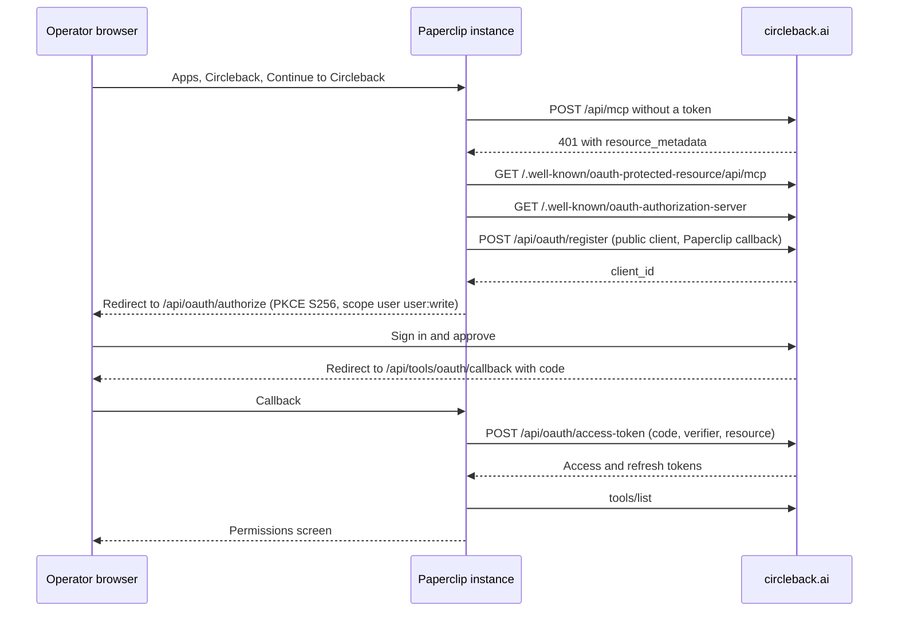

# Circleback

Updated: 2026-11-12. Status: catalog definition reviewed against official
documentation and live provider metadata; live account qualification
outstanding.

Circleback (`circleback.ai`) records meetings and writes notes, action items
and transcripts. Its hosted MCP server also searches the signed-in user's
calendar, connected email, people and companies, and manages action items,
tags, folders and sharing. It appears in Apps and uses Paperclip's shared
remote-MCP connection, vault, catalog, grants, policies, gateway, and audit
trail. It is a resource connection, not Paperclip sign-in. No plugin or
database migration is required. The only provider-specific runtime code is a
reviewed risk classifier (see [Capabilities and policy](#capabilities-and-policy)).

Paperclip connects to Circleback's hosted MCP server at
`https://circleback.ai/api/mcp` (Streamable HTTP) with one method:

- `mcp-oauth`: browser sign-in through Circleback's dynamic client
  registration. The connection acts as the user who signs in.

Circleback documents no API key for its MCP server, so there is no key
method.

This curated connection is the preferred route for Circleback. Composio also
lists a Circleback toolkit (`circleback_mcp`), but it exposes only read tools
and none of the meeting-card tools. Connection search returns the built-in
connection for Circleback requests and does not offer the Composio route
beside it (see [Connection search](./CONNECTION-SEARCH.md)). The same URL can
also be connected from **Connect your own MCP server**; see
[Connecting any remote MCP server](./GENERIC-REMOTE-MCP.md).

## Service involvement

Circleback hosts the MCP resource and the authorization server. Paperclip
stores the OAuth tokens as secret references, discovers tools with
`tools/list`, and sends the token on every governed call. Neither Paperclip ID
nor Paperclip Connect participates: dynamic client registration is
instance-local, and cloud and self-hosted instances use the same path.

## Connection flow

## Endpoints

| Purpose | URL |
| --- | --- |
| MCP resource | `https://circleback.ai/api/mcp` |
| Protected-resource metadata | `https://circleback.ai/.well-known/oauth-protected-resource/api/mcp` |
| Authorization-server metadata | `https://circleback.ai/.well-known/oauth-authorization-server` |
| Authorize | `https://circleback.ai/api/oauth/authorize` |
| Token | `https://circleback.ai/api/oauth/access-token` |
| Dynamic client registration | `https://circleback.ai/api/oauth/register` |
| Paperclip callback | `/api/tools/oauth/callback` |

`app.circleback.ai` serves the same paths with its own issuer and resource
(`https://app.circleback.ai/api/mcp`). The definition uses the documented
`circleback.ai` host; both hosts are in `urlPatterns`, so a pasted URL on
either host opens this connection.

The authorization server supports `authorization_code` and `refresh_token`,
PKCE `S256`, public clients (`token_endpoint_auth_method: none`), and Client ID
Metadata Documents. Redirect constraint: `https-or-loopback-http`.

## Scopes

Paperclip requests `user user:write`, Circleback's documented default and the
scope its unauthenticated 401 challenge names. `user` alone is read-only;
write tools then return an error asking the user to reconnect with write
access. This is recorded as an explicit review in
[`tool-method-permission-reviews.json`](./tool-method-permission-reviews.json).

## Administrator setup

Nothing needs to be registered: Paperclip registers its own public client the
first time someone connects. The instance needs an HTTPS or loopback origin.

1. In Paperclip, open **Apps → Browse → Circleback** and click
   **Continue to Circleback**. The screen lists the sharing warning first.
2. Sign in to Circleback and approve access.
3. On the connection's **Permissions** screen, set the share and delete
   actions to **Ask first** or **Off** if agents run unattended.

To verify, run a read action such as `SearchMeetings` from its **Test** button.
To disconnect, remove the connection in Paperclip.

## Capabilities and policy

Circleback documents these tools (checked against a live connection on
2026-11-12):

| Group | Tools | Risk |
| --- | --- | --- |
| Meetings and transcripts | `SearchMeetings`, `ReadMeetings`, `GetTranscriptsForMeetings`, `SearchTranscripts` | read |
| Action items, calendar, email | `SearchActionItems`, `SearchCalendarEvents`, `SearchEmails` | read |
| People, companies, workspace | `FindProfiles`, `FindCompanies`, `ListTeams`, `ListTags`, `ListFolders`, `ReadFolders`, `SearchSupportArticles` | read |
| Meeting cards | `DisplayMeetings`, `DisplayActionItems`, `DisplayCalendarEvents` | read |
| Edits | `CreateActionItem`, `UpdateActionItem`, `CreateTag`, `UpdateTag`, `CreateFolder`, `UpdateFolder`, `UpdateMeeting`, `UpdateCalendarEvent` | write |
| Outward-facing | `ShareMeeting`, `ShareFolder`, `SubmitFeedback` | write |
| Deletes | `DeleteActionItem`, `DeleteTag`, `DeleteFolder` | destructive |

The generic classifier reads `share` and `submit` as reads, so
`server/src/services/connectors/circleback/risk.ts` classifies Circleback by
exact tool name. Tools not in the list are writes until reviewed; a provider
`destructiveHint` still wins. New tools are not quarantined, matching other
MCP-direct catalog connections.

`ShareMeeting` and `ShareFolder` can share with other people, a team, the
whole workspace, or anyone with the link, and can remove access.
`SubmitFeedback` sends text to Circleback's team. The method warning and the
capability description tell operators to set share and delete actions to Ask
first.

### Meeting cards in chat

`DisplayMeetings`, `DisplayActionItems` and `DisplayCalendarEvents` render as
interactive cards in the task chat through the MCP Apps extension
(`io.modelcontextprotocol/ui`): meetings open in Circleback, action items form
a checklist, and calendar events show whether Circleback joins. A change made
from a card is a call to the matching write tool and follows that tool's
policy. Clients without MCP Apps receive the same results as text. See
[MCP Apps](./MCP-APPS.md).

## Transport and auth

- Transport: `mcp_remote`, Streamable HTTP.
- OAuth: DCR (or CIMD when the instance has a public HTTPS URL), public client,
  PKCE, scopes `user user:write`. Connects as the approving user.
- Credential owner: user-delegated; tokens stored as `company_secrets` refs.

## Resource filters

None. Circleback documents no query or header options that narrow the hosted
server. Access is bounded by the signed-in user's Circleback permissions;
narrow further with per-action policies.

## Manifest

| Field | Value |
| --- | --- |
| Slug | `circleback` |
| Category | `productivity` |
| Method | `mcp-oauth` (`dcr`, S3, scopes `user`, `user:write`) |
| Server URL | `https://circleback.ai/api/mcp` |
| URL patterns | `https://circleback.ai/*`, `https://app.circleback.ai/*` |
| Capability profile | `write`, with the share and delete warning |
| Console links | docs `https://circleback.ai/docs/support/platform/circleback-mcp` |

The definition source is
`scripts/app-definition-overrides/circleback.json`, with the research row in
`packages/shared/src/self-serve-mcp-research.json`. Regenerate with
`node scripts/ingest-app-definitions.mjs --definitions-only`.

## Wizard path

`/apps/connect?source=circleback` has one automatic OAuth method, so it opens
the direct sign-in screen. That screen repeats the method guidance and both
warnings before **Continue to Circleback**. Successful sign-in and tool
discovery lead to the connection's Permissions screen.

## Governance defaults

- Default profile and bindings: the standard connection profile; every
  discovered action starts Allowed under the current product default.
- Policies: operators narrow share, delete and feedback tools to Ask first or
  Off on the Permissions screen.
- Risk: the reviewed Circleback classifier above.
- Quarantine rules: the shared defaults.

## Brand provenance

Circleback's site links `https://circleback.ai/logos/circleback_square.png`, a
560×560 transparent PNG of its orange "c." mark. It is used unchanged in both
themes. The `apple-touch-icon.png` is the same mark on an opaque white
background, and `logos/circleback.svg` is the wide wordmark with an embedded
bitmap, so neither was used.

| File | Source | SHA-256 |
| --- | --- | --- |
| `ui/public/brands/apps/circleback.png` (560×560) | `https://circleback.ai/logos/circleback_square.png` | `dd858dae1efd29d95d46cb3b99a9e27603d50840bf9e3bdac109eb38dc80e3ac` |

## Validation hook

- Environment: definition review on 2026-11-12 against `origin/master`; no
  Circleback account was connected to Paperclip.
- Metadata probe: an unauthenticated `initialize` on `/api/mcp` returned HTTP
  401 with `resource_metadata` and `scope="user user:write"`; both
  `.well-known` documents returned the endpoints and scopes above, on both
  `circleback.ai` and `app.circleback.ai`.
- Deterministic tests: manifest shape, store visibility, artwork, URL
  recognition on both hosts, reviewed scopes, the direct sign-in screen with
  its warnings, risk classification, Browse showing one native card in place
  of the Composio listing, and connection search preferring the built-in
  connection.
- Connect evidence, catalog evidence, allowed read, governed write, denied
  case, revoke, audit: not run. The connection still needs the full live
  lifecycle with a Circleback account before it is considered qualified.
