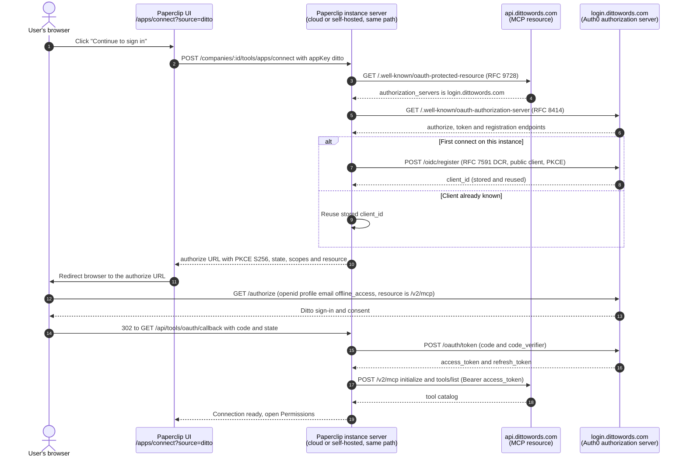

# Ditto

Updated: 2026-10-10. Status: catalog definition reviewed against official
documentation and live provider metadata; live account qualification
outstanding.

Ditto (`dittowords.com`) is a single source of truth for product copy: text
items, a reusable component library, variants and translations, and style
guides that agents must follow when they write UI text. It appears in Apps and
uses Paperclip's shared remote-MCP connection, vault, catalog, grants,
policies, gateway, and audit trail. It is a resource connection, not Paperclip
sign-in. No plugin or database migration is required. The only
provider-specific runtime code is a reviewed risk-classification rule.

Paperclip connects to Ditto's hosted MCP server at
`https://api.dittowords.com/v2/mcp` (Streamable HTTP) with two methods:

- `mcp-oauth`: browser sign-in through dynamic client registration on Ditto's
  Auth0 tenant. The connection acts as the Ditto user who signs in.
- `mcp-api-key`: a workspace API key stored as a Paperclip secret and sent as
  an `Authorization: token <key>` header. Ditto uses the `token` scheme, not
  `Bearer`.

Ditto also runs a separate documentation MCP server at
`https://developer.dittowords.com/mcp`. This connection does not use it.

This curated connection is the polished route: it provides branding, method
guidance, a delete and link warning, and the risk rule. The same URL can also
be connected from **Connect your own MCP server**. See
[Connecting any remote MCP server](./GENERIC-REMOTE-MCP.md).

## Service involvement

Ditto hosts the MCP resource, and Auth0 hosts its authorization server.
Paperclip stores the OAuth tokens or the key as secret references, discovers
tools with `tools/list`, and sends the credential on every governed call. No
Paperclip-operated vendor relay is involved; cloud and self-hosted instances
use the same path.

## Endpoints

| Purpose | URL |
| --- | --- |
| MCP resource | `https://api.dittowords.com/v2/mcp` |
| Protected-resource metadata | `https://api.dittowords.com/.well-known/oauth-protected-resource` |
| Authorization-server metadata | `https://login.dittowords.com/.well-known/oauth-authorization-server` |
| Authorize | `https://login.dittowords.com/authorize` |
| Token | `https://login.dittowords.com/oauth/token` |
| Dynamic client registration | `https://login.dittowords.com/oidc/register` |
| Paperclip connect (wizard) | `POST /api/companies/:companyId/tools/apps/connect` |
| Paperclip OAuth start | `POST /api/tools/oauth/:connectionId/start` |
| Paperclip callback | `GET /api/tools/oauth/callback` |

Redirect constraints: `https-or-loopback-http`. Dynamic client registration
needs no administrator setup: each Paperclip instance registers its own
client with its own callback URL.

The API-key method skips the authorization server: Paperclip sends
`Authorization: token <key>` directly to `/v2/mcp` for discovery and every
governed call.

The authorization server supports `authorization_code` and `refresh_token`,
PKCE `S256`, and public clients (`token_endpoint_auth_method: none`). It
advertises only identity scopes. Paperclip sends the MCP resource URL as the
`resource` parameter so Auth0 issues a token for the Ditto API.

## Scopes

Paperclip requests `openid`, `profile`, `email` and `offline_access`. Ditto
publishes no API scopes: the signed-in user's Ditto permissions control
access. `offline_access` is required because Auth0 issues a refresh token only
when a client asks for it; without it the connection expires with the access
token. The authorization server does not reject unknown scopes, so this list
is recorded as an explicit review in
[`tool-method-permission-reviews.json`](./tool-method-permission-reviews.json).

## Administrator setup

Browser sign-in:

1. In Paperclip, open **Apps → Browse → Ditto** and click
   **Continue to sign in**.
2. Sign in to Ditto and approve access.

API key:

1. In Ditto, open **Developers** (`https://app.dittowords.com/developers`).
   Enable developer integrations if the page asks. Under **API keys**, click
   **+ Create API key** and copy the key. It is shown only once. Use a separate
   key for Paperclip so it can be removed independently.
2. In Paperclip, open **Apps → Browse → Ditto**, open **Advanced**, choose
   **Use an API key**, paste the key, and click **Connect**.

After either method, set delete and link actions to **Ask first** or **Off**
on the connection's **Permissions** screen if agents run unattended.

To disconnect, remove the connection in Paperclip. For an API key, also delete
the key on Ditto's **Developers** page.

## Capabilities and policy

Both methods are risk tier S4, because the normal tool catalog includes
permanent deletes.

Ditto documents 41 tools in these groups:

- Style guides and rules: `get_styleguide_rules`, `suggest_edit` (checks text
  against the rules), and tools to list, create and update style guides and to
  create, update and delete rules.
- Text items: `search_ditto_text`, and tools to create, update, translate and
  delete text items and to link synced Figma text nodes.
- Library components: create, update, translate and publish components, and
  link or unlink text items.
- Component folders, projects, project blocks, variables and variants: list,
  create, update and delete.
- Workspace: `list_statuses`, `get_workspace_tags`.

Delete tools cannot be undone. Linking a text item to a library component
replaces its developer ID, so code that used the old ID stops matching.
Unlinking gives each text item a new developer ID. Translate tools replace
existing variant text.

Paperclip applies a reviewed Ditto risk rule in `classifyRisk`, because the
generic classifier reads `translate_*`, `link_*` and `unlink_*` as reads.
Only `list_*`, `get_*` and `search_*` tools, `suggest_edit`, and tools Ditto
marks `readOnlyHint: true` are reads. `delete_*` tools are destructive.
Everything else is a write. A `readOnlyHint: false` or `writeHint: true`
annotation always makes a tool a write.

## Transport and auth

- Transport: `mcp_remote`, Streamable HTTP.
- OAuth: DCR on Auth0, public client, PKCE, `resource` parameter, scopes
  above. Acts as the signed-in user.
- API key: `Authorization: token <key>`. Keys reach all data in the
  workspace, are not scoped, and act as the user who created them. Keys
  require developer integrations on the Ditto plan. Paperclip cannot narrow an
  issued key.

## Resource filters

None. Tools such as `get_styleguide_rules` take `projectIds` per call, but
Ditto documents no query or header option that narrows the hosted server.
Narrow with per-action policies.

## Manifest

| Field | Value |
| --- | --- |
| Slug | `ditto` |
| Category | `content` |
| Methods | `mcp-oauth` (`dcr`, S4); `mcp-api-key` (`customer`, S4) |
| Server URL | `https://api.dittowords.com/v2/mcp` |
| Credential | `authorization`, password, required |
| Key placement | header `Authorization`, prefix `token ` |
| Console links | keys `https://app.dittowords.com/developers`, docs `https://developer.dittowords.com/guides/connect-the-mcp` |
| Capability profile | `write` (shared by both methods, so no picker; its description, with the delete and link warning, shows before sign-in) |

The definition is generated from the `ditto` row in
`packages/shared/src/self-serve-mcp-research.json` and the `ditto` branch of
`specialMethodsFor` in `scripts/ingest-app-definitions.mjs`.

## Wizard path

`/apps/connect?source=ditto` defaults to **Sign in with Ditto** and shows the
capability description before sign-in. Under **Advanced**, **Use an API key**
shows the key field; **Connect** stays disabled until a key is entered. A
successful sign-in or key check and tool discovery lead to the connection's
Permissions screen.

## Governance defaults

- Default profile and bindings: the standard connection profile; every
  discovered action starts Allowed under the current product default.
- Policies: operators narrow delete, link and unlink tools to Ask first or Off
  on the Permissions screen.
- Risk: the reviewed Ditto rule in `classifyRisk` described above.
- Quarantine rules: the shared defaults; no Ditto-specific exceptions.

## Brand provenance

Ditto's site ships a 64px favicon and an abstract web-clip SVG that does not
read as the brand at tile size. The "D." mark on an orange tile is the avatar
of Ditto's official GitHub organization (`dittowords`, whose profile links
`https://dittowords.com`), published as a 460×460 opaque PNG. That file is
used unchanged in both themes.

| File | Source | SHA-256 |
| --- | --- | --- |
| `ui/public/brands/apps/ditto.png` (460×460) | `https://avatars.githubusercontent.com/u/68580354?v=4&s=512` | `dccbb9d5bd4130d48d8a7b16bdddf46745aa0efa58c3855c7994629db922e50c` |

## Validation hook

- Environment: definition review on 2026-10-10 against `origin/master`; no
  Ditto account was used.
- Metadata probe: an unauthenticated `initialize` on `/v2/mcp` returned HTTP
  401 with `resource_metadata`; the protected-resource and authorization-server
  documents returned the endpoints above; dynamic client registration
  succeeded for a loopback redirect; the authorize endpoint redirected to
  Ditto's sign-in page with the reviewed scopes and the `resource` parameter.
- Deterministic tests: manifest shape, store visibility, artwork, URL
  recognition, reviewed scopes, `token` header projection with the key kept
  out of connection config, risk classification of every documented
  read-looking write, and the connect form's sign-in default, pre-sign-in
  warning and API-key gating.
- Connect evidence, catalog evidence, allowed read, governed write, denied
  case, revoke, audit: not run. Both methods still need the full live
  lifecycle with a Ditto workspace before this connection is considered
  qualified. Confirm on that pass that Auth0 issues a refresh token and that
  the token is accepted by `/v2/mcp`.
