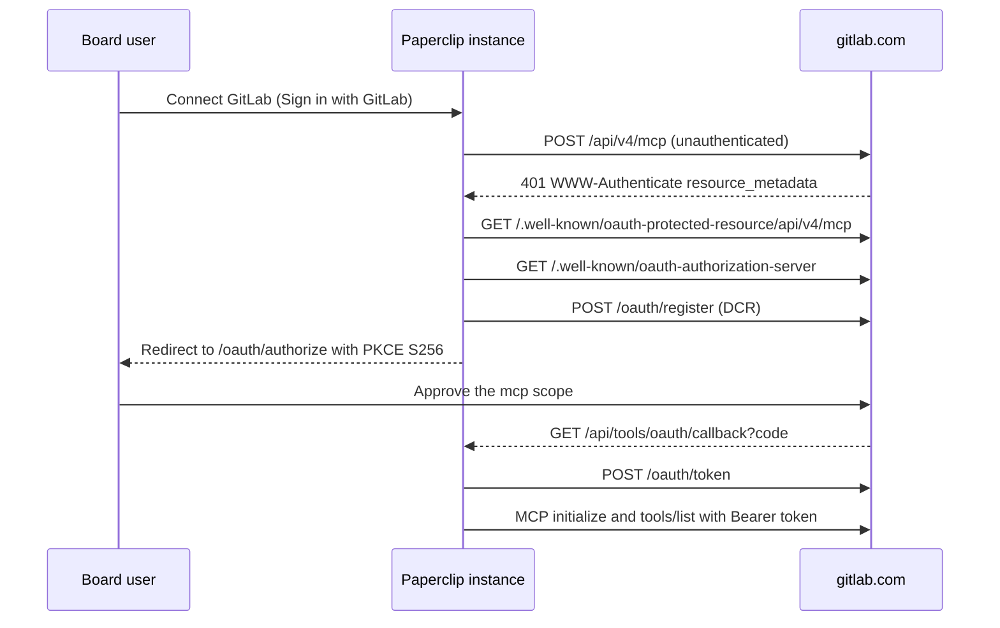

# GitLab connection

GitLab connects agents to the official
[GitLab MCP server](https://docs.gitlab.com/user/model_context_protocol/mcp_server/)
for projects, merge requests, work items, repositories, and CI pipelines. It is
a curated `AppDefinition` with no connector-specific runtime code. Sources:
`scripts/app-definition-overrides/gitlab.json` and the GitLab entries in
`tool-method-permission-reviews.json`.

## Vendor

- App key: `gitlab`
- App name: GitLab
- Reuse classification: MCP-direct
- Reason: GitLab hosts a generally available MCP server (GA in GitLab 19.5,
  Free tier since 19.2) at `https://<host>/api/v4/mcp` on GitLab.com,
  Self-Managed, and Dedicated.
- Security tier: S3. Default toolsets include tools that push commits, create
  branches, run pipelines, and merge merge requests.
- Plugin needed? No. Live status for cited merge requests and issues is a
  separate External Objects concern.

## Transport And Auth

| Method | Key | Endpoint | Auth | Ownership |
| --- | --- | --- | --- | --- |
| Sign in with GitLab | `mcp-oauth` | `https://gitlab.com/api/v4/mcp` | OAuth, RFC 7591 DCR, scope `mcp` | `dcr` |
| Use an access token | `mcp-access-token` | `https://{host}/api/v4/mcp` | Fine-grained personal access token as `Authorization: Bearer` | `customer` |

- The access-token method is the path for Self-Managed and Dedicated. The host
  field defaults to `gitlab.com` and accepts a hostname only; custom ports are
  not supported.
- GitLab rejects legacy personal, project, and group access tokens with
  `403 insufficient_scope`. The token needs the MCP tool resource and the
  Execute permission.
- Credentials are stored as company secret references. Revoking the OAuth
  authorization or the token in GitLab blocks further calls.

## Connection Flow (mandatory)

- Authorize: `https://gitlab.com/oauth/authorize`
- Token: `https://gitlab.com/oauth/token`
- Registration: `https://gitlab.com/oauth/register`
- Revocation: `https://gitlab.com/oauth/revoke`
- Discovery: `https://gitlab.com/.well-known/oauth-protected-resource/api/v4/mcp`
  (`scopes_supported: ["mcp"]`) and
  `https://gitlab.com/.well-known/oauth-authorization-server`
- Paperclip callback: `/api/tools/oauth/callback`
- Redirect constraints: `https-or-loopback-http`. GitLab requires the
  registered redirect URI to match exactly.
- Client type: GitLab advertises only `client_secret_basic` and
  `client_secret_post`, but its registration endpoint ignores the requested
  method and always creates a public client. The response carries
  `token_endpoint_auth_method: "none"`, no `client_secret`, and
  `grant_types: ["authorization_code"]`. Sign in with GitLab needs two
  registration behaviors: Paperclip accepts a provider that explicitly
  registers a public client in place of the requested method, and accepts an
  authorization-code-only grant set (#18589). Token exchange then sends
  `client_id` with the PKCE verifier and no secret. The access-token method
  does not use DCR and has neither dependency.
- Paperclip ID / Paperclip Connect involvement: none. DCR is instance-local;
  cloud and self-hosted use the same path.

## Administrator Setup (mandatory)

- Paperclip: nothing to register. Paperclip registers its own client.
- GitLab.com: a top-level group owner must allow the GitLab MCP server for the
  group.
- Self-Managed or Dedicated: an administrator must allow the GitLab MCP server
  for the instance. Each user then creates a fine-grained personal access token
  with the MCP tool resource and the Execute permission.
- DCR is rate-limited by GitLab to 10 registrations per hour per IP address.
- Verify: connect, confirm the discovered catalog lists tools such as
  `get_project` and `list_merge_requests`, then run `get_mcp_server_version`
  or `get_user` from the Test dialog.

## Resource Filters

- Required filters: none. GitLab enforces the user's project and group access.
- GitLab selects toolsets with the `X-Gitlab-Enabled-Mcp-Server-Toolsets`
  header. This entry does not set it, so GitLab's defaults apply: `meta`,
  `core`, `merge_requests`, `work_items`, `repository`, `ci`, and
  `duo_agent_platform` when available. `wikis`, `code_security`, and `orbit`
  are opt-in and are not requested.

## Actions

| Toolset | Read examples | Write examples |
| --- | --- | --- |
| core | `get_project`, `list_projects`, `search`, `get_user` | `save_project`, `save_note` |
| merge_requests | `get_merge_request`, `list_merge_requests` | `save_merge_request`, `save_merge_request_review`, `accept_merge_request` |
| work_items | `get_work_item`, `list_work_items` | `save_work_item`, `link_work_items` |
| repository | `get_repository_file`, `list_commits`, `list_branches` | `add_branch`, `add_commit`, `fork_repository` |
| ci | `get_pipeline`, `list_pipelines`, `get_job` | `save_pipeline` |
| duo_agent_platform | `list_duo_sessions` | `start_duo_session`, `send_duo_session_input` |

Actions follow the platform default: every active action is Allowed. Operators
should consider Ask first for `accept_merge_request`, `add_commit`,
`save_pipeline`, and `start_duo_session`.

## Wizard Path

- User path: Apps → GitLab → choose a method → Access → Connect.
- Sign in with GitLab opens GitLab consent for the `mcp` scope.
- Use an access token asks for the host and the token.
- Error states: a group or instance without MCP allowed, a legacy token
  (`403 insufficient_scope`), an unreachable or non-HTTPS host, and DCR rate
  limiting.

## Governance Defaults

- Default profile: platform default; all discovered actions Allowed.
- Rate limits: GitLab.com applies per-user MCP limits; Self-Managed uses an
  administrator-set instance limit. `429` responses carry `Retry-After`.

## Validation Hook

- Deterministic: `pnpm exec vitest run packages/shared/src/app-definitions.test.ts`
  and the brand asset checks in [Connector icons](./CONNECTOR-ICONS.md).
- Public metadata probed on 2026-11-09: unauthenticated `POST /api/v4/mcp`
  returns `401` with `resource_metadata`; the authorization server advertises
  `registration_endpoint` and S256 PKCE.
- Live proof on 2026-11-09 for `mcp-oauth` against gitlab.com, in a
  `local_trusted` dev instance with this entry, the public-client DCR change, and
  #18589's authorization-code-only grant change:

  | Scenario | Result | Evidence |
  | --- | --- | --- |
  | Setup and consent | pass | GitLab showed the `[Unverified Dynamic Application] Paperclip localhost-3100` consent page with read-write access to the MCP server. |
  | Authentication | pass | The connection stored `clientRegistrationSource: "dcr"`, `clientTokenEndpointAuthMethod: "none"`, scope `mcp`, callback `/api/tools/oauth/callback`, and only the `oauth.access_token` and `oauth.refresh_token` secret refs. |
  | Catalog | pass | `tool_app.oauth_connected` recorded 41 actions: 30 read and 11 write. All were Allowed by the platform default. |
  | Allowed read | pass | Agent runs called `list_projects` and `get_user` through the gateway (`tool_gateway.call_completed`, `tool_completed`). |
  | Governed write | not run | An agent run called `save_work_item`. The gateway allowed it and GitLab returned "Project not found or inaccessible", so no write completed on a disposable project. |
  | Disconnect and reconnect | pass | Disconnect archived the connection and revoked 1 grant and 2 secrets. Reconnect reused the connection and rediscovered 41 actions. |
  | Revoke in GitLab | not run | The OAuth authorization was not revoked from GitLab user settings. |
  | Secret handling | pass | The activity log and connection API responses contain no access token, refresh token, or client secret. |
  | Refresh | not run | Token refresh was not observed. GitLab issued a 2-hour access token with a refresh token. |

- `mcp-access-token` against a Self-Managed instance: not run.
