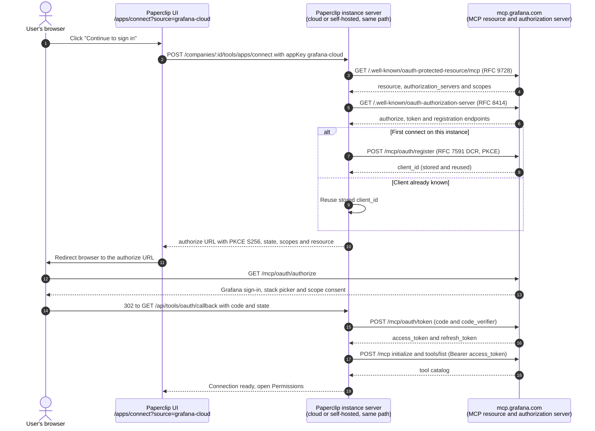

# Grafana Cloud

Updated: 2026-10-31. Status: catalog definition reviewed against official
documentation and live provider metadata; authenticated tool listing and live
account qualification outstanding.

Grafana Cloud MCP is Grafana's hosted MCP server for Grafana Cloud stacks.
Agents can search dashboards, query Prometheus, Loki, Pyroscope and Tempo,
read alerts, incidents and on-call data, and, with the write scope, change
dashboards, alerts and incidents. Grafana lists the server as public preview.
It appears in Apps and uses Paperclip's shared remote-MCP connection, vault,
catalog, grants, policies, gateway, and audit trail. It is a resource
connection, not Paperclip sign-in. No plugin or database migration is
required. The only provider-specific runtime code is a reviewed
risk-classification rule.

Paperclip connects to `https://mcp.grafana.com/mcp` (Streamable HTTP only; no
SSE) with two browser sign-in methods that differ only in the requested scopes:

- `mcp-oauth-read`: requests `grafana:read`. This is the default.
- `mcp-oauth-write`: requests `grafana:read`, `grafana:query` and
  `grafana:write`.

Both methods act as the Grafana user who signs in. Grafana has no API-key
route for this server, so there is no API-key method.

This server supports Grafana Cloud only. For self-hosted Grafana, run the
open-source `grafana/mcp-grafana` server and connect it from
**Connect your own MCP server**. See
[Connecting any remote MCP server](./GENERIC-REMOTE-MCP.md). The same applies
to the per-stack URL `https://mcp.grafana.com/mcp/<stack>.grafana.net` and to
the optional `X-Grafana-URL: https://<stack>.grafana.net` header, which skip
stack picking during sign-in. The curated connection uses the default URL, and
the user picks the stack on Grafana's consent screen.

## Service involvement

Grafana hosts both the MCP resource and the authorization server at
`mcp.grafana.com`. Paperclip stores the OAuth tokens as secret references,
discovers tools with `tools/list`, and sends the access token on every
governed call. No Paperclip-operated vendor relay is involved; cloud and
self-hosted Paperclip instances use the same path. Access tokens last one
hour. Refresh tokens last up to 30 days, then the user must sign in again.

## Endpoints

| Purpose | URL |
| --- | --- |
| MCP resource | `https://mcp.grafana.com/mcp` |
| Protected-resource metadata | `https://mcp.grafana.com/.well-known/oauth-protected-resource/mcp` |
| Authorization-server metadata | `https://mcp.grafana.com/.well-known/oauth-authorization-server` |
| Authorize | `https://mcp.grafana.com/mcp/oauth/authorize` |
| Token | `https://mcp.grafana.com/mcp/oauth/token` |
| Dynamic client registration | `https://mcp.grafana.com/mcp/oauth/register` |
| Paperclip connect (wizard) | `POST /api/companies/:companyId/tools/apps/connect` |
| Paperclip OAuth start | `POST /api/tools/oauth/:connectionId/start` |
| Paperclip callback | `GET /api/tools/oauth/callback` |

Redirect constraints: `https-or-loopback-http`. The authorization server
supports dynamic client registration (RFC 7591) and client ID metadata
documents, so no administrator setup is needed: each Paperclip instance
registers its own client with its own callback URL. It supports
`authorization_code` and `refresh_token`, PKCE `S256`, and the token endpoint
authentication methods `none`, `client_secret_basic` and `client_secret_post`.
An unauthenticated POST to `/mcp` returns HTTP 401 with a `WWW-Authenticate`
header that carries `resource_metadata`.

## Scopes

Grafana publishes three scopes. Paperclip requests them as recorded in
[`tool-method-permission-reviews.json`](./tool-method-permission-reviews.json):

| Scope | Grants | Who can consent |
| --- | --- | --- |
| `grafana:read` | Read dashboards, alerts, incidents, metrics, logs, traces and profiles | Editor and above |
| `grafana:query` | Raw SQL against ClickHouse, Snowflake, Athena and InfluxDB | Editor and above |
| `grafana:write` | Create and change dashboards, alerts, incidents, data sources and Assistant investigations; includes read and query | Administrator |

Raw SQL runs as written and can change data if the data source credentials
allow it. Clearing only the write scope on Grafana's consent screen still
allows raw queries. This is why the read method requests `grafana:read` only,
and why the read method is the default: an Editor cannot grant `grafana:write`.

## Administrator setup

1. Use a Grafana Cloud stack with Grafana Assistant available. The user who
   signs in needs the **Assistant Cloud MCP User** role or the permission
   `grafana-assistant-app.cloud-mcp:access`. Editors and above have it by
   default.
2. In Paperclip, open **Apps → Browse → Grafana Cloud**. Keep **Read only**
   for inspection, or open **Advanced** and choose **Read, query and write**.
3. Click **Continue to sign in**, pick the stack, review the scopes and
   approve.

After connecting, set raw SQL (`query_athena`, `query_clickhouse`,
`query_snowflake`, `query_influxdb`), `alerting_manage_*` and `ask_assistant`
actions to **Ask first** or **Off** on the connection's **Permissions** screen
if agents run unattended.

To disconnect, remove the connection in Paperclip and revoke the grant in
Grafana.

## Capabilities and policy

Both methods are risk tier S4, because the query scope can change data.

Grafana documents these tool groups. The list comes from documentation, not
from an authenticated listing.

- Dashboards and folders: `get_dashboard_by_uid`, `get_dashboard_summary`,
  `get_dashboard_property`, `get_dashboard_panel_queries`, `search_dashboards`,
  `search_folders`, `generate_deeplink`, `get_panel_image`; write:
  `update_dashboard`, `create_folder`.
- Data sources: `list_datasources`, `get_datasource`.
- Prometheus, Loki, Pyroscope, CloudWatch and Elasticsearch: `list_*` and
  `query_*` tools. Tempo tools are proxied dynamically and have no fixed list.
- Athena, ClickHouse and Snowflake: `list_*` and `describe_*` tools read
  schemas. `query_athena`, `query_clickhouse`, `query_snowflake` and
  `query_influxdb` run raw SQL.
- On-call and alerts: `list_oncall_*`, `get_oncall_shift`,
  `get_current_oncall_users`, `list_alert_groups`, `get_alert_group`.
  `alerting_manage_rules` and `alerting_manage_routing` read or write by
  argument.
- Incidents and investigations: `list_incidents`, `get_incident`,
  `list_investigations`, `get_investigation` and related read tools; write:
  `create_incident`, `add_activity_to_incident`, `create_investigation`,
  `ask_assistant`.
- Annotations and other: `get_annotations`, `get_annotation_tags`,
  `get_assertions`, `describe_infrastructure`, `get_query_examples`; write:
  `create_annotation`, `update_annotation`.

Paperclip applies a reviewed `grafana-cloud` rule in `classifyRisk`. The
generic classifier reads `query_*`, `alerting_manage_*`, `ask_assistant` and
`add_activity_to_incident` as reads. The rule makes those eight tools writes.
All other names use the generic classifier, so `update_*` and `create_*` are
writes. An unknown dynamic Tempo tool is classified by the generic rules.

## Transport and auth

- Transport: `mcp_remote`, Streamable HTTP.
- OAuth: DCR with PKCE, `resource` parameter, scopes above. Acts as the
  signed-in Grafana user, and Grafana permissions still apply.
- Stack choice: made on Grafana's consent screen. No tenant field exists in
  the definition.

## Resource filters

None. The per-stack URL and the `X-Grafana-URL` header narrow the stack, but
the curated definition has no field for them. Use **Connect your own MCP
server** to pin a stack.

## Manifest

| Field | Value |
| --- | --- |
| Slug | `grafana-cloud` |
| Category | `developer` |
| Methods | `mcp-oauth-read` (`dcr`, S4); `mcp-oauth-write` (`dcr`, S4) |
| Server URL | `https://mcp.grafana.com/mcp` |
| Credential | none; browser sign-in |
| Console links | docs `https://grafana.com/docs/grafana-cloud/ai-tools/mcp-servers/cloud-mcp/` |
| Capability profiles | `read` (default) and `full` |

The profile key `full` is deliberate. The setup flow recommends the method
whose profile key is `write` or `draft`. Using `full` keeps the read method as
the default, because a default that needs the administrator-only write scope
would fail for Editors.

The definition is generated from the `grafana-cloud` row in
`packages/shared/src/self-serve-mcp-research.json` and the `grafana-cloud`
branch of `specialMethodsFor` in `scripts/ingest-app-definitions.mjs`.

## Wizard path

`/apps/connect?source=grafana-cloud` defaults to **Read only** and shows its
description before sign-in. Under **Advanced**, **Read, query and write**
shows the raw SQL warning. A successful sign-in and tool discovery lead to the
connection's Permissions screen.

## Governance defaults

- Default profile and bindings: the standard connection profile; every
  discovered action starts Allowed under the current product default.
- Policies: operators narrow raw SQL, alerting management and Assistant tools
  to Ask first or Off on the Permissions screen.
- Risk: the reviewed rule in `classifyRisk` described above.
- Quarantine rules: the shared defaults; no Grafana-specific exceptions.

## Brand provenance

The mark is the Grafana icon `public/img/grafana_icon.svg` from the
`grafana/grafana` repository. Paperclip removed the XML declaration, the
generator comment and the `<style>` block, replaced the percentage gradient
coordinates with equivalent absolute values (`y1="109.5"`, `y2="361.35"`),
and kept the path data unchanged. The same file is used in both themes. The
Grafana name and logo are trademarks of Grafana Labs.

| File | Source | SHA-256 |
| --- | --- | --- |
| `ui/public/brands/apps/grafana-cloud.svg` | `https://raw.githubusercontent.com/grafana/grafana/main/public/img/grafana_icon.svg` (source file SHA-256 `50806d5a65779e79f746398570e0fc322d5de55e19f0be87a275963f0947bb5e`) | `a4da8c2a077c774eef97f353ad2d67216b0de12bef044ddfb662482c942dc356` |

## Validation hook

- Environment: definition review on 2026-10-31 against `origin/master`; no
  Grafana account was used.
- Metadata probe: the protected-resource document returned the resource
  `https://mcp.grafana.com/mcp`, the authorization server and the three
  scopes. The authorization-server document returned the endpoints above and
  advertised dynamic client registration and client ID metadata documents. An
  unauthenticated POST to `/mcp` returned HTTP 401 with `resource_metadata`.
- Deterministic tests: manifest shape, store visibility, artwork, URL
  recognition, reviewed scopes, the read-first default, risk classification of
  the documented tools, and the connect form's default and raw SQL warning.
- Authenticated tool listing, connect evidence, catalog evidence, allowed
  read, governed write, denied case, refresh after one hour, revoke, audit:
  not run. The tool names above come from Grafana's documentation. Both
  methods need the full live lifecycle with a Grafana Cloud stack before this
  connection is considered qualified.
