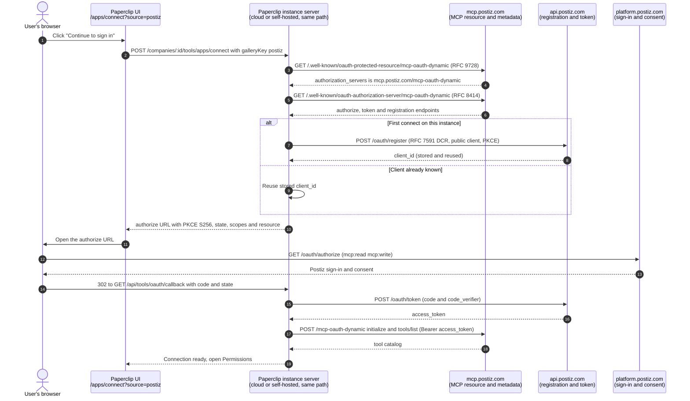

# Postiz

Updated: 2026-11-22. Status: catalog definition reviewed against official
documentation and live provider metadata. Browser sign-in completed the live
lifecycle on a local instance. The API-key method has no valid-key proof yet.

Postiz (`postiz.com`) schedules and publishes posts to social and chat
channels such as X, LinkedIn, Instagram, YouTube, TikTok and Discord. It also
holds a media library, reads channel and post analytics, and can generate
images and videos. It appears in Apps and uses Paperclip's shared remote-MCP
connection, vault, catalog, grants, policies, gateway, and audit trail. It is a
resource connection, not Paperclip sign-in. No plugin, database migration, or
provider-specific runtime code is required. The definition carries a reviewed
tool list for risk classification.

Paperclip connects to Postiz's hosted MCP server with two methods:

- `mcp-oauth`: browser sign-in through dynamic client registration, at
  `https://mcp.postiz.com/mcp-oauth-dynamic` (Streamable HTTP).
- `mcp-api-key`: the organization API key stored as a Paperclip secret and
  sent as an `Authorization: Bearer <key>` header, at
  `https://mcp.postiz.com/mcp` (Streamable HTTP).

Each connection reaches one Postiz organization. Sign-in uses the organization
that is active in Postiz when the user approves access. An API key uses the
organization that owns it.

This curated connection is the polished route: it provides branding, method
guidance, and a publish warning. The same URLs can also be connected from
**Connect your own MCP server**. A self-hosted Postiz uses that route with its
own `/mcp` address and API key. See
[Connecting any remote MCP server](./GENERIC-REMOTE-MCP.md).

## Service involvement

Postiz hosts the MCP resource and the authorization server. Paperclip stores
the OAuth token or the key as a secret reference, discovers tools with
`tools/list`, and sends the credential on every governed call. Neither
Paperclip ID nor Paperclip Connect takes part. Dynamic client registration is
instance-local: each instance registers its own client with its own callback.
Postiz does not accept every callback host. See
[Redirect constraints](#redirect-constraints).

## Endpoints

| Purpose | URL |
| --- | --- |
| MCP resource (sign-in) | `https://mcp.postiz.com/mcp-oauth-dynamic` |
| MCP resource (API key) | `https://mcp.postiz.com/mcp` |
| Protected-resource metadata | `https://mcp.postiz.com/.well-known/oauth-protected-resource/mcp-oauth-dynamic` |
| Authorization-server metadata | `https://mcp.postiz.com/.well-known/oauth-authorization-server/mcp-oauth-dynamic` |
| Issuer | `https://mcp.postiz.com/mcp-oauth-dynamic` |
| Authorize | `https://platform.postiz.com/oauth/authorize` |
| Token | `https://api.postiz.com/oauth/token` |
| Dynamic client registration | `https://api.postiz.com/oauth/register` |
| Paperclip connect (wizard) | `POST /api/companies/:companyId/tools/apps/connect` |
| Paperclip OAuth start | `POST /api/tools/oauth/:connectionId/start` |
| Paperclip callback | `GET /api/tools/oauth/callback` |

An unauthenticated request to the sign-in resource returns HTTP 401 with a
`WWW-Authenticate` header that names the protected-resource document. That
document names one authorization server, the path issuer above. Postiz also
serves metadata at the domain root for a different issuer that has no
registration endpoint. Paperclip does not select it, because the
protected-resource document does not name it.

The API-key method skips the authorization server: Paperclip sends
`Authorization: Bearer <key>` directly to `/mcp` for discovery and every
governed call.

The authorization server supports the `authorization_code` grant, PKCE `S256`,
and public clients (`token_endpoint_auth_method: none`). It advertises the
scopes `openid`, `email`, `mcp:read` and `mcp:write`. It does not advertise a
Client ID Metadata Document, a refresh grant, or a revocation endpoint.

## Scopes

Paperclip requests `mcp:read` and `mcp:write`, the two scopes that grant MCP
access. The identity scopes are not requested: the organization comes from the
Postiz session, not from a scope. This is recorded as an explicit review in
[`tool-method-permission-reviews.json`](./tool-method-permission-reviews.json).

## Token behavior

- Postiz access tokens do not expire. The token response carries no
  `expires_in` and no refresh token, so Paperclip never refreshes.
- The grant ends when the user revokes the app in Postiz, under
  **Settings → Apps → Approved Apps**. Postiz then rejects the token with
  HTTP 401. Reconnect to continue.
- Removing the connection in Paperclip deletes the stored token. It does not
  revoke the grant in Postiz, because Postiz has no revocation endpoint.

## Redirect constraints

Redirect constraints: `https-or-loopback-http`.

Postiz is stricter than that value in two ways:

- HTTPS: Postiz accepts an HTTPS callback only when its host is on the Postiz
  verified-domain list. Paperclip Cloud hosts (`*.paperclip.app`) must be on
  that list. A self-hosted Paperclip that uses its own HTTPS domain is not on
  the list: registration fails with `invalid_redirect_uri`, and Paperclip
  reports `oauth_dynamic_client_registration_failed`. Use the API-key method
  on such an instance. The capability description on the connect screen says
  this before sign-in.
- Loopback: Postiz accepts `localhost`, `127.0.0.1` and `[::1]` only. The
  Paperclip pre-check also passes `*.localhost` and the rest of `127.0.0.0/8`.
  Postiz rejects those hosts at registration.

## Administrator setup

Browser sign-in:

1. In Paperclip, open **Apps → Browse → Postiz** and click
   **Continue to sign in**.
2. Sign in to Postiz. Make sure that the organization shown in Postiz is the
   one that agents should use.
3. Click **Authorize**. Paperclip registers its own client, so no OAuth app
   and no callback registration are needed.

API key:

1. In Postiz, open **Settings → Agents / Dev**. In the **API Key** section,
   click **Reveal** and copy the key. Postiz shows this section on plans that
   include API access.
2. In Paperclip, open **Apps → Browse → Postiz**, click **Change**, choose
   **Use an API key**, paste the key, and click **Connect**.

After either method, set publish and delete actions to **Ask first** or
**Off** on the connection's **Permissions** screen if agents run unattended.

To disconnect, remove the connection in Paperclip. For sign-in, also revoke
the `Paperclip <instance host>` entry in Postiz under
**Settings → Apps → Approved Apps**. An organization has one API key. Rotating
it in Postiz disconnects every client that uses it, so rotate it only when the
key must stop working everywhere.

### Consent interaction

The Postiz consent screen shows the client name `Paperclip <instance host>`,
the access that the client gets, and the **Authorize** and **Deny** buttons.
**Authorize** is enabled as soon as the page loads; there is no intentional
delay. A signed-out user sees **Sign in to Postiz** first and returns to the
same consent screen. Paperclip opens the screen in a new window and keeps an
**Open sign-in in a new tab** link for browsers that block the window.

The screen also offers **Use self-hosted**. That option connects a self-hosted
Postiz through the hosted server: the user enters the address and API key of
their instance on the Postiz page. This path was not exercised.

## Capabilities and policy

Both methods are risk tier S4, because the normal tool catalog publishes to
external social channels and deletes posts.

The sign-in resource returned 26 tools on 2026-11-22. Paperclip classifies them
with the generic `classifyRisk` rules, which follow the annotations that Postiz
publishes on every tool:

| Risk | Tools |
| --- | --- |
| Read (11) | `integrationList`, `groupList`, `integrationSchema`, `postsListTool`, `mediaListTool`, `mediaStatusTool`, `uploadWidgetStatusTool`, `generateVideoOptions`, `videoFunctionTool`, `videoStatusTool`, `clippingStatusTool` |
| Write (8) | `integrationConnectTool`, `uploadFromUrlTool`, `uploadWidgetTool`, `uploadWidgetTicketTool`, `generateImageTool`, `generateVideoTool`, `clippingTool`, `clippingWidgetTicketTool` |
| Destructive (7) | `integrationSchedulePostTool`, `postSettingsTool`, `postAttachmentsTool`, `deletePostTool`, `triggerTool`, `integrationAnalyticsTool`, `postAnalyticsTool` |

- `integrationSchedulePostTool` creates a draft, schedules a post, or publishes
  a post immediately to the selected channels. Postiz marks it destructive
  because a public post cannot be recalled.
- `deletePostTool` deletes the Postiz record of one post, and the whole series
  of a repeating post. A post that is already published stays live on the
  social channel.
- `postSettingsTool` and `postAttachmentsTool` replace the settings or media of
  a post that is not published yet.
- `triggerTool` runs a platform helper, such as listing the channels of a
  Discord server. Postiz marks it destructive.
- `integrationAnalyticsTool` and `postAnalyticsTool` read analytics. Postiz
  marks them destructive, so Paperclip keeps that classification.
- `generateImageTool`, `generateVideoTool` and `clippingTool` use the AI
  credits of the Postiz plan.
- `integrationConnectTool` returns a link that is valid for one hour. A person
  must open it and sign in to the platform before a channel is added.
- The upload widget tools serve an MCP Apps view for hosts that render one.

`uploadWidgetTicketTool` and `clippingWidgetTicketTool` are marked
`visibility: ["app"]`. Only an MCP Apps view may call them, so Paperclip hides
them from agents. `uploadWidgetTool` and `clippingTool` declare a view. The
view path was not exercised in this review. See [MCP Apps](./MCP-APPS.md).

The API-key resource (`/mcp`) also registers the Postiz agent as one more
tool, `ask_postiz`. That tool sends a request to an agent that holds the
schedule, publish and delete tools, and it has no annotations. The generic
rule reads it as a read. This statement comes from the Postiz server source;
no valid key was used, so the tool was not observed in discovery.

The definition therefore carries a reviewed tool list (`reviewedTools`), as
Circleback does:

- The 11 tools in the Read row are reads.
- The 7 tools in the Destructive row and `ask_postiz` are destructive.
- Every other tool is a write, including a tool that Postiz adds later with a
  read annotation. Add it to the list after review.
- A provider annotation can raise a risk level and never lowers it.

## Transport and auth

- Transport: `mcp_remote`, Streamable HTTP.
- OAuth: DCR, public client, PKCE, scopes above. Acts for the organization
  that was active at consent.
- API key: `Authorization: Bearer <key>`. A key is bound to one organization,
  is not scoped, and carries no user identity. Paperclip cannot narrow an
  issued key.

## Resource filters

None. Postiz documents no query or header option that narrows the hosted
server. Each connection is already limited to one organization. Tools take a
channel or a customer group per call; narrow further with per-action policies.

## Manifest

| Field | Value |
| --- | --- |
| Slug | `postiz` |
| Category | `content` |
| Methods | `mcp-oauth` (`dcr`, S4, scopes `mcp:read` `mcp:write`); `mcp-api-key` (`customer`, S4) |
| Server URL | sign-in `https://mcp.postiz.com/mcp-oauth-dynamic`; API key `https://mcp.postiz.com/mcp` |
| Credential | `authorization`, password, required |
| Key placement | header `Authorization`, prefix `Bearer ` |
| Console links | keys `https://platform.postiz.com/settings`, docs `https://docs.postiz.com/mcp/introduction` and `https://docs.postiz.com/mcp/setup` |
| Capability profile | `write` (shared by both methods, so no picker; its description, with the publish, credits and sign-in notes, shows before sign-in) |
| Reviewed tools | 11 read, 8 destructive (7 annotated tools and `ask_postiz`), unlisted `write`, no quarantine |

The definition source is `scripts/app-definition-overrides/postiz.json`. The
`postiz` row in `packages/shared/src/self-serve-mcp-research.json` makes the
app connectable.

## Wizard path

`/apps/connect?source=postiz` defaults to **Sign in with Postiz** and shows the
capability description, with the publish warning, before sign-in. Under
**Change**, **Use an API key** shows the key field; **Connect** stays disabled
until a key is entered. A successful sign-in or key check and tool discovery
lead to the connection's Permissions screen.

## Governance defaults

- Default profile and bindings: the standard connection profile; every
  discovered action starts Allowed under the current product default.
- Policies: operators narrow publish, delete and media generation tools to Ask
  first or Off on the Permissions screen.
- Risk: the reviewed tool list in the definition, raised by the Postiz tool
  annotations where they are stricter.
- Quarantine rules: the shared defaults; no Postiz-specific exceptions.

## Brand provenance

The Postiz mark is the SVG that the Postiz application serves as its logo. The
file is used unchanged in both themes: the white card keeps the letter visible
on the dark frame.

| File | Source | SHA-256 |
| --- | --- | --- |
| `ui/public/brands/apps/postiz.svg` (145×160 viewBox) | `https://platform.postiz.com/postiz.svg` | `af6ce01646bd87a82095a6e3dc81475c170bce189e5b9da48b71ab881b4ff6d0` |

## Validation hook

Environment: local instance in `local_trusted` mode at
`http://localhost:3100`, embedded database, 2026-11-22, on `master` at
`558dbb013` plus this definition. The live calls ran before the reviewed tool
list was added; a unit test covers that list. A real Postiz organization on the hosted service was used.
The agent in the board Test calls was a placeholder that never ran.

| Scenario | `mcp-oauth` | `mcp-api-key` |
| --- | --- | --- |
| Setup and consent | Pass. The gallery card and `/apps/connect?source=postiz` opened the sign-in method; the consent screen named `Paperclip localhost-3100`. | Pass for the form: the key field and helper text render, and Connect stays disabled without a key. |
| Authentication | Pass. Discovery selected the path issuer, registration returned a public client, and the callback stored one `oauth.access_token` reference on the organization grant with `mcp:read` and `mcp:write`. | Not run with a valid key. A synthetic invalid key reached `/mcp` and Postiz answered HTTP 401. |
| Catalog and configuration | Pass. 26 actions: 11 read, 8 write, 7 destructive; all active. | Not run. |
| Allowed execution | Pass. `groupList` (read) returned in 1.1 s. `integrationConnectTool` (write) created a one-hour connect link that was not opened. Both were `allow_explicit_grant`. | Not run. |
| Denied execution | Pass. An agent of another company got HTTP 403, and that company listed no connections. Declared blocked or quarantined actions: not applicable, none are declared. | Not run. |
| Runtime delivery | Not run. The connection adds no gateway logic, so only board Test calls were made. | Not run. |
| Refresh and recovery | Pass for health check and catalog refresh: all 26 action versions were retained and the read succeeded again. Token refresh: not applicable, Postiz issues no refresh token. | Not run. |
| Revoke and reconnect | Pass for removal: the connection was archived with no secret references and the next call returned `tool_not_found`. Revocation in Postiz and reconnect after removal: not run. | Pass for failed setup: the draft connection was removed. |
| Activity and secret handling | Pass. Each call wrote a `policy_decision` and a `call_completed` event. No token value appeared in API responses or server logs. | Pass. The synthetic key value was absent from the API response, the server log, and the instance data directory outside the encrypted database. |

Limits of this evidence:

- No post was scheduled, published or deleted, and no media was generated.
  Execution of the destructive tools is unqualified.
- An HTTPS callback was not exercised. See [Redirect constraints](#redirect-constraints).
- The API-key method still needs connect, discovery, a read and removal with a
  valid organization key.
