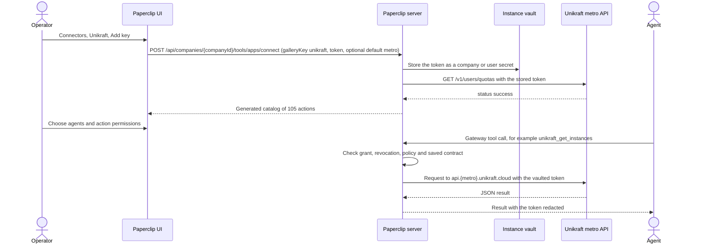

# Unikraft connection

Unikraft Cloud runs unikernel micro-VMs ("instances") across regional metros.
Its connection uses the normal Apps connection, selected personal/company
credential, agent installation, action policy, gateway, revocation and audit
paths. The API token stays in the instance vault. The connector does not borrow
`unikraft login` state, `UKC_TOKEN` environment variables, or another
connection's credential.

Sign-in tokens are never reused as resource tokens; id.paperclip.ing never
stores resource tokens; no connections hub on the ID service.

## Vendor

| Item | Value |
| --- | --- |
| Product | Unikraft Cloud (formerly KraftCloud) |
| API reference | https://unikraft.com/docs/api/platform/v1 |
| Specification | https://github.com/unikraft-cloud/openapi (`platform.json`, `plugins/sandbox.json`) |
| Metros | https://unikraft.com/docs/platform/metros |
| Tokens | https://unikraft.com/docs/sdks/overview#authentication |
| Console | https://console.unikraft.com |
| Hosted MCP server | None. Unikraft's MCP guides describe hosting your own MCP server on Unikraft. |

## Transport and auth

| Axis | Value |
| --- | --- |
| Transport | `rest_api`, executed by Paperclip's native provider bridge |
| Authentication | `api_key`, sent as `Authorization: Bearer <token>` |
| OAuth client ownership | Not applicable; Unikraft offers no third-party OAuth |
| Credential source | Paperclip vault |
| Grant identity | `organization` or `user` |

Unikraft Cloud has no global platform endpoint. Each metro serves its own API at
`https://api.<metro>.unikraft.cloud/v1/...`. The reviewed specification
publishes five metros: `dal`, `fra`, `sfo`, `sin` and `was`. Every action accepts
an optional `metro` argument limited to that list; actions that omit it use the
connection's default metro (Frankfurt unless changed under **Advanced**). The
token is never sent to any other host. Legacy `*.kraft.cloud` hosts, which
Unikraft documents as nearing end of life, are not reachable through this
connection.

The saved connection URL, `https://controlplane.unikraft.cloud/v1`, identifies
the connection only. Actions use the metro hosts above.

## Connection flow (mandatory)



Paperclip endpoints used: `GET /api/companies/{companyId}/tools/apps/unikraft/preflight`,
`POST /api/companies/{companyId}/tools/apps/connect`,
`POST /api/companies/{companyId}/tools/apps/{connectionId}/finish`,
`GET /api/tool-connections/{connectionId}/catalog`, and the run-bound tool gateway.
There is no OAuth handoff, so `GET /api/tools/oauth/callback` is not used.

## Administrator setup (mandatory)

1. Sign in to the [Unikraft Cloud console](https://console.unikraft.com) and
   create an API token for the organization agents should manage.
2. In Paperclip choose **Connectors → Unikraft → Add key**, choose who can use
   the credential, and paste the token.
3. Optional: under **Advanced**, change the default metro.
4. On the saved connection's **Permissions** screen, choose agents and set
   actions to Allowed, Ask first, or Off.

A token acts for its whole organization in every metro. Unikraft does not offer
narrower token permissions, so agent assignment and action permissions enforce
the capability boundary. Revoke a token in the Unikraft console, then remove or
reconnect the Paperclip connection.

## Resource filters

There are no provider-enforced resource filters. `requiredResourceFilters`
(`organization`, `metro`, `instance`) is reviewed metadata. The bridge enforces
only that requests go to a published metro and that path arguments cannot
traverse to another route.

## Actions

The catalog contains **105 actions** generated from Unikraft's published
specifications at commit `5dd107ea1cd8716b83cb86a83ed2a6ee46f99b5b`:
89 platform API operations and 16 sandbox plugin operations.

| Group | Examples | Classification |
| --- | --- | --- |
| Reads, logs, metrics, history and waits | `unikraft_get_instances`, `unikraft_get_instance_logs_by_uuid`, `unikraft_wait_instances`, `unikraft_sandbox_read_file` | Read |
| Creation, updates, start, attach, clone and pinning | `unikraft_create_instance`, `unikraft_update_service_group_by_uuid`, `unikraft_start_instances`, `unikraft_sandbox_write_file` | Write |
| Deletion, stop, suspend, detach, unpin, and sandbox command execution, signals and stdin | `unikraft_delete_volume_by_uuid`, `unikraft_stop_instances`, `unikraft_sandbox_run_command` | Destructive |

Platform actions keep Unikraft's operation names (`unikraft_<operation>`).
Sandbox plugin actions are `unikraft_sandbox_<operation>` and take an
`instance` (name or UUID); they call
`https://api.<metro>.unikraft.cloud/v1/instances/<instance>/plugins/sandbox`.
Many Unikraft operations select batch targets with a JSON body, including on
GET and DELETE; the bridge sends those bodies as published.
`unikraft_sandbox_wait_for_command_with_timeout` returns
`{ "status": "running", "timedOut": true }` when Unikraft reports that the
command is still running at the timeout (HTTP 408), so an agent can wait again.
The bridge lives in `server/src/services/connectors/unikraft/`.

The audit event stream (`GET /v1/audit`) is server-sent events, not a
request/response action. It is recorded in the generated inventory and not
advertised as a tool.

The specification sources and SHA-256 hashes are recorded in
`server/src/services/connectors/unikraft/operations.generated.json`. Regenerate with:

```sh
node scripts/generate-unikraft-tools.mjs
node --test scripts/generate-unikraft-tools.test.mjs
```

The generator pins a reviewed commit because the specification repository has
no tags or releases. Updating it requires explicit regeneration and catalog
review: saved connections quarantine new and changed actions until reviewed.

## Wizard path

The ordinary key wizard: **Access → Connect**. Setup asks only for the token.
The default metro is an optional select under **Advanced**. Setup completes when
`GET /v1/users/quotas` on the default metro confirms the token.

## Governance defaults

- Risk tier S4: the normal catalog includes deletion and arbitrary command
  execution inside sandboxes.
- Every discovered action is enabled when setup finishes, under the shared
  connection access rules; operators restrict actions on Permissions.
- New and changed actions after a catalog update are quarantined until reviewed.
- Agents cannot export the token; generic credential export rejects Unikraft.
- Responses and request bodies are bounded at 8 MiB. Each action has one caller
  deadline, capped at 30 seconds. Mutations are never retried automatically; a
  timed-out write can still complete at the provider.

## Manifest

Defined in `scripts/app-definition-overrides/unikraft.json` and generated into
`packages/shared/src/app-definitions/unikraft.json`: slug `unikraft`, category
`developer`, one method `api-token` (`rest_api`, `api_key`, `customer`), and a
`metro` select tenant field.

## Validation hook

Database-backed tests exercise company and personal vault ownership, real
run-scoped gateway reads, writes, deletions and sandbox commands, default and
per-call metros, rejection of unpublished metros and path traversal, Off
policies, revocation, stale-contract blocking, credential export denial, all
generated argument schemas, and bounded/sanitized errors. HTTP boundary tests
send GET and DELETE JSON bodies through the real pinned transport to a local
server. Generator tests cover streaming endpoints, shared parameter references,
unsigned integer formats and risk classification.

These fixtures do not qualify a real Unikraft account. Live provider proof is
pending an operator connecting a token and trying an allowed read and write
(`liveProof: not-run`).

## Brand

`ui/public/brands/apps/unikraft.svg` is Unikraft's gradient mark from the
official documentation site, copied from
`https://raw.githubusercontent.com/unikraft-cloud/docs/d8acfcefe8186badac84d5308d641a1c1b5b239e/public/unikraft.svg`
with editor metadata removed. One asset serves both themes. Unikraft publishes
no brand kit.

Provider research verified 2026-10-15.
