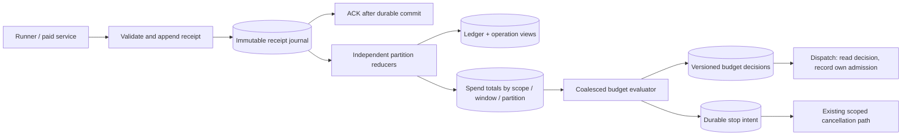

# Lock-free accounting and best-effort budgets

Date: 2026-11-03
Status: Target architecture proposed; preliminary admission optimization implemented locally
Scope: Accounting ingestion, settlement, budget projections and budget admission
Evidence: [Accounting contention investigation](2026-11-03-accounting-contention-and-budget-enforcement.md)

## Decision

Make the frequent accounting write path append-only. A receipt writes its own
immutable fact and commits. It does not lock or update the company, agent, run,
budget, aggregate counter, or worker checkpoint. Independent runs use independent
keys, including when they belong to the same company or agent.

Asynchronous workers derive operation state, ledger entries and partitioned spend
totals. Budget admission reads a recent view without making a synchronized debit
against a company balance. Threshold detection and cancellation may lag; durable
evidence, deterministic accounting and execution authorization remain required.

"Lock-free" here means no application mutex, advisory lock, or `SELECT FOR
UPDATE` in the receipt or budget-check path, and no shared accounting row written
for each receipt. It is not a formal nonblocking progress guarantee: PostgreSQL
still uses internal locks, unique-index arbitration, foreign-key checks and
transaction commit. In particular, two inserts with the same unique key can
wait for each other. See [PostgreSQL INSERT](https://www.postgresql.org/docs/current/sql-insert.html).

Background batches and infrequent policy changes use optimistic conditional
writes. Those also take database row locks internally. Moving a compare-and-swap
onto the same company counter for every receipt would fail this design.

Existing issue ownership, provider-dispatch fencing, manual Stop and resource
ownership are outside this lock-removal scope. Accounting cannot replace those
contracts with an eventually consistent spend view.

## Problem fit and first milestone

This design removes the identified company-wide accounting serialization point
if receipt ingestion, admission, settlement and shared counters all migrate.
It does not establish that accounting is the current main-loop CPU culprit or
that the resulting system supports 10,000 active agents. Those remain separate
claims requiring measurements.

The matched investigation sample contained 8,280 zero-policy exposure evaluations
out of 8,292. Those exposure evaluations returned almost immediately; the
surrounding admission path still read state and policies inside the accounting
transaction. This makes separating eligibility reads from reconciliation the
most directly supported first change. It does not show that large exposure
scans or a high receipt rate caused the sampled delays.

The 9,421 accounting transactions in that hour average about 2.6 per second
across the observed host. Burst rate, company distribution and actual lock hold
time are missing. The acquisition spans include database/network time and Node
scheduling, so their long tails alone do not prove PostgreSQL row-lock saturation.

| Problem | What this design changes | Remaining condition |
| --- | --- | --- |
| Eligibility checks enter a mutating company transaction | Read-only admission, separate reconciliation | Classify callers and preserve manual holds, resume behavior and execution fencing |
| Independent receipts serialize by company | Independent immutable inserts | Qualify actual receipt rate, index/FK waits and durable ingestion capacity |
| Repeated exposure work and shared counters limit growth | Coalesced evaluation and partitioned projections | Show less work per receipt and sufficient projection throughput |
| Main-loop CPU/event-loop contention | Some synchronous work leaves the request path | Same-process reducers still consume CPU; batching must reduce work or processing must move to another runtime |

The immutable identity model, closure changes and partition publication protocol
are target-architecture work, not prerequisites for the first latency improvement.
An asynchronous pipeline also adds backlog and recovery obligations: its stale
decision gate can become an admission outage if reducers cannot keep up. Merely
moving identical work behind an ACK would conceal latency without solving load.

Start with an independently shippable milestone: attribute admission calls and
transaction work, provide a pure eligibility read (including a no-policy fast
path), and move required reconciliation to its explicit owner. Retain the current
final admission/reservation authority during this initial behavior-preserving
step. Having no configured policy must not bypass manual company/project pauses,
existing holds, unknown-accounting restrictions or duplicate-dispatch protection.

Compare end-to-end dispatch latency, accounting transactions and queries per
dispatch, database waits, CPU and event-loop delay under the same workload.
Then qualify receipt coalescing and the remaining single-company bottleneck.
Use the full migration below when that evidence or the agreed capacity target
justifies it. The accounting rewrite does not cover the other independently
identified work in run-event persistence, recovery, snapshots or fanout.

## Architecture



The journal, reducers and evaluator can start in the existing server and
PostgreSQL deployment. Independent scaling is a module/runtime boundary, not a
requirement for Kafka, Redis, another service, or a separate database today.

## 1. Give every paid operation a stable identity

Use one accounting operation for each heartbeat run, browser invocation,
decision-model invocation, fast response, classifier invocation, or separately
reported charge. Record its company and attribution before paid dispatch.
Retries of the same external operation reuse its identity; a genuinely new paid
attempt has a distinct attempt identity beneath that operation.

An accounting operation's immutable identity is separate from mutable run state.
Receipts reference this identity, rather than acquiring foreign-key protection
on a busy mutable `heartbeat_runs` row. The existing journal directly references
that row, so removing the explicit lock alone does not eliminate this possible
wait. Use a company-scoped composite reference to the immutable identity; keep
company-boundary validation and the existing deletion/retention obligations.
Separate any nullable live-run pointer from retained original attribution.

Admitted accounting sources have durable identities and provenance. Controller
reconnection does not manufacture a new paid attempt. Source replacement must
retain the existing verified handoff/baseline semantics. A higher timestamp,
random UUID, or newly generated controller source ID is not proof of authority
over earlier billing evidence.

Source handoff remains an infrequent execution-authority operation. Ordinary
checkpoints do not mutate its ownership record. Existing authentication and
company access checks still apply. Authority to report a closing receipt after
Stop is accounting-only; it never grants authority to continue execution.

## 2. Receipt ingestion only appends evidence

Extend/generalize the existing `run_usage_receipts` contract. The conceptual
receipt contains:

| Field | Purpose |
| --- | --- |
| Company and operation IDs | Tenant boundary and accounting unit |
| Attempt and admitted source identity | Separate paid attempts from reconnect/replay |
| Stable source event ID and source sequence | Replay identity and ordering within that source |
| Receipt kind and normalization version | Partial usage, final usage, source handoff, closure, correction |
| Cumulative usage, price and provenance | Evidence; unknown price stays unknown |
| Payload fingerprint | Detect conflicting reuse of an identity |
| Server-assigned ingestion time and deterministic partition | Recovery, pending-work age and routing |

Provider event time remains separate. Freshness protection never trusts a caller's
timestamp. External charge callers need a stable request identity to obtain
idempotent retries; matching dollar amounts or payload similarity cannot prove
that two otherwise unidentified charges are the same purchase.

Within a small transaction, validate the admitted identity and input, register
the existing transaction-aware work signal, and insert the immutable receipt.
Enforce the logical identity with a unique constraint. On conflict, fetch the
committed existing receipt and compare its fingerprint; equal means replay,
different means a conflict requiring reconciliation. Do not use `DO UPDATE`
to replace receipt evidence. At read committed isolation, a conflict check may
need a subsequent statement to see the winning committed row.

Commit before ACK. An ACK means the evidence is durable, not that the spend view
has already incorporated it. Preserve legacy durable spooling and native
redelivery when the database write or its acknowledgement is uncertain.

There is no read-modify-write of `usageJson`, `spentMonthlyCents`, reservation
capacity, or a company-wide dirty flag here. The new receipt is itself durable
pending work. Mutable delivery metadata may be attached to it by the consumer;
its evidence fields are immutable.

Batch inserts with count/byte bounds when useful. Keep lifecycle, final, unknown
and conflicting evidence intact. Do not drop a receipt solely because its dollar
amount matches the previous one: it may change completeness or provenance.

## 3. Reduce independent partitions, then publish batches atomically

Route by a stable hash of **operation ID**, not company ID. For example, a
starting benchmark can use 64 virtual partitions per company. That number is a
test parameter, not a capacity claim. One company with 10,000 active runs spreads
over all partitions; one agent with many runs spreads too.

Persist the layout version and partition with the operation's admission. All its
receipts, closure and corrections follow that assignment. Changing partition
count requires an explicit migration; do not silently rehash active operations.

The minimal conceptual storage is:

| Record | Write frequency and ownership |
| --- | --- |
| Operation identity | Once per admitted operation; immutable attribution |
| Receipt journal | Append per receipt; unique identity; durable pending metadata |
| Operation view | Replaced by its partition reducer, at most once per operation per batch |
| Scope/window/partition totals | Updated in a bounded batch, never by receipt ingestion |
| Partition publication head | One conditional generation advance per batch |
| Budget policy and decision | Policy edits and coalesced evaluations; independent of receipt acceptance |
| Ledger, adjustments, incidents, stop intent | Existing domain records, adapted to operation identities and idempotent writes |

Some records can extend existing tables. Separate immutable identities from
mutable projections; do not add a table for each timer or delivery stage.

For a reducer batch:

1. In one repeatable-read snapshot, capture partition generation `g`, a bounded
   set of unprocessed receipt IDs, and their prior operation views.
2. Reduce those operations and compute replacement contributions outside the
   publishing transaction. No provider calls or filesystem work occurs during
   publication.
3. In one short transaction, conditionally advance the partition head from `g`
   to `g + 1`, bulk-write operation views and aggregate deltas, insert any
   qualified ledger settlement, and mark exactly the consumed receipt IDs.
4. If the conditional advance loses, roll back and retry from a fresh snapshot.
   Use bounded retries with scheduler backoff under contention.

All writers of those views, including repairs, follow this publication protocol.
A normally assigned reducer avoids duplicate work; overlapping workers or an
old worker after failover remain safe because publication requires the captured
generation. No durable exclusive lease is needed for correctness of this batch.

An input arriving during computation remains pending. Never advance a global
`last_seen_id` or timestamp past all smaller values: sequence allocation and
transaction commit order differ. An earlier allocated receipt that commits
later must still be discoverable. Retain an indexed pending predicate.

This has bounded coordination per partition **per batch**. It cannot stall
receipt ACKs behind the calculation, and different partitions do not write the
same aggregate rows. Shared company/agent/project totals are sums of these
partition contributions, not counters incremented by every producer.

## 4. Define canonical money without depending on arrival order

The reducer preserves current normalization and source-ownership rules as a
versioned pure function over admitted evidence. Within a source, order by the
producer sequence, not database arrival time. Across sources, follow verified
handoff/continuation provenance rather than arbitrarily choosing a winner.

Cumulative reports replace earlier reports for the same accounting component.
Reports of $2, $3 and $5 represent $5, not $10. Distinct paid attempts contribute
separately; session-cumulative counters require their established baseline.
An incomplete/unknown report cannot erase known partial exposure. Final prices
and audited corrections may legitimately reduce earlier estimates.

Each operation view owns mutually exclusive contribution categories:

```text
unsettled:   ledger = 0;     live = known observed amount; hold = max(estimate, live)
settled:     ledger = final; live = 0;                     hold = 0
```

This is a contribution model, not a declaration that unknown exposure is zero.
Carry unknown-price, pending-terminal and unresolved-dispatch counts separately
and apply their configured restrictions. Hosted browser work remains a separate
paid operation from its parent run.

Settlement and that operation's replacement contribution publish atomically.
Company/agent/project views sum one contribution per operation. A reader sees
the old or new contribution, never both the live estimate and its final charge.
UTC-month and lifetime attribution, unsettled carryover, credits, backdated
charges and corrections need explicit reducer rules matching the selected
product contract; do not assign costs to the month in which a worker ran.

### Finalization requires closure, not merely a "complete" checkpoint

The governing execution coordinator supplies immutable closure evidence only
after the operation cannot start another ordinary paid attempt. It references
the admitted attempts/sources and the final usage evidence or unresolved debt.
An adapter's `complete` usage flag alone does not establish that boundary.

A closure record must prove the final cumulative coverage it names. The current
native `sourceSeq` includes non-accounting events, so gaps between usage receipts
are not automatically lost usage. Use explicit final references/coverage, or a
dedicated accounting sequence if the producer contract is extended. Do not
invent a contiguous usage sequence from today's sparse source sequence.

Publish a settlement certificate and its ledger components in one transaction,
with one base settlement per `(company_id, operation_id)` and a verified content
fingerprint. A different closure for an already-settled operation is a conflict
or an explicit correction, not a second base settlement.
Only the transaction that inserts that certificate inserts its components; a
replay verifies the existing certificate. Ledger IDs and component keys are
stable across retries. Unknown external outcomes remain unresolved.

Late evidence within the declared closure coverage is replay/recovery. Evidence
beyond it remains durable and creates a reconciliation obligation or an explicit
correction; it cannot silently reopen the same final charge or disappear because
the run was marked terminal. Corrections use immutable adjustment identities.
Existing mutable correction/reporting APIs need an adapter to this ledger model.

## 5. Budget checks read; they do not reserve a shared balance

For dispatch, read current company/agent/project controls and applicable budget
decisions in one bounded read from the authoritative database, rather than an
unbounded-lag replica or cache. A policy without a current decision must
be evaluated or treated as pending; it is not implicitly unlimited. The decision
records policy revision, budget window, projection generations, status and
freshness evidence.

If applicable decisions allow work, record this operation's own admission with
the decision versions and estimated cost. Preserve duplicate-dispatch fencing
in the execution subsystem. An admission receipt is not proof that an external
provider call occurred exactly once; existing unknown-outcome recovery remains.

There is no atomic decrement of company remaining budget. Estimate-fit checks
can use the same snapshot, and admitted estimates can enter the asynchronous
exposure view. Two dispatches can see the same remaining money and both start.
That race is accepted by this best-effort contract. Reservations become recorded
estimates/obligations, not exclusive claims on a shared spending allowance.

New snapshots after a committed budget block deny additional work. Admissions
already in flight can still race that block. Manual Stop, pause, permissions,
issue ownership and dispatch authority retain their existing final gates.
Keep provider-enforced cost caps where supported.

## 6. Coalesce budget decisions and preserve stop authority

The evaluator reads the applicable scope/window partition totals in one
consistent snapshot, rather than scanning ledger and receipt history on each
checkpoint. Capture the policy's configuration revision and prior decision
revision in that same snapshot.

Publish with a conditional update against both captured revisions. A policy
edit advances its configuration revision and invalidates the previous decision.
An older evaluator cannot overwrite a newer decision or a changed policy. A
losing evaluator recomputes; it never retries publication using a fresh version
number attached to stale calculated totals.

Publish the decision, any incident/approval transition, and durable stop intent
in the same transaction. Generate idempotency identities from the winning
transition; losing or repeated evaluations produce no duplicate side effects.
Only actual state transitions need notification/audit effects. Cancellation
delivery remains at least once, scoped and recoverable. Already-committed
per-run Stop obligations survive later policy changes. Resuming a budget hold
cannot clear a manual hold.

These occasional policy-row updates can contend with one another. Producers
and admission readers do not wait on that row to record receipts or debit money.
Do not replace them with per-receipt policy updates.

## 7. Bound lag and recover work without an idle polling loop

Retain the proposed healthy-load targets from the investigation: roughly
one-second coalescing and a five-second p99 target from durable priced receipt
to stop intent. Provider reporting and shutdown delay are additional. Targets
require a workload qualification; none is a guarantee on final billed dollars.

For scopes with spending limits, reject additional paid admissions if an
unrepresented accounting change has been waiting over fifteen seconds. This
check considers pending journal inputs **and** reduced contributions not yet
covered by the decision's projection generations. Carry their oldest pending
time through publication. Consuming the journal must not hide evaluator lag.
An old decision with no subsequent relevant changes remains fresh while idle.
Policy edits and UTC-window changes are explicit new evaluation obligations.

Durable pending rows are truth; notifications are hints. Reuse the existing
delivery coordinator for local coalescing, finite retries, actual deadlines,
drain and restart. No unconditional per-company timer scans empty queues.

The current DB work signals are process-local by default, with optional
commit-bound PostgreSQL notifications. Separate reducers therefore require
qualified cross-process wake delivery, subscribed before the startup scan and
reconciled after reconnect. `NOTIFY` alone is not durable storage or a way to
wake stopped compute. See the [existing signal implementation](../../packages/db/src/work-signals.ts)
and [PostgreSQL notification behavior](https://www.postgresql.org/docs/current/sql-notify.html).
Do not claim distributed recovery or host sleep until the actual notification,
startup, disconnect and external-wake paths are qualified.

Receipt acceptance continues while budgets are blocked. Otherwise stopping spend
would also stop the evidence needed to settle it.

## Failure cases the design must pass

| Event/race | Required outcome |
| --- | --- |
| Same receipt delivered twice | One logical receipt; equal fingerprint accepted as replay |
| Same identity, different content | Conflict retained/reported; no silent overwrite or second charge |
| Sequence 8 arrives before 7 | Correct cumulative state; 7 cannot rewind it |
| Earlier allocated receipt commits after a batch | It remains discoverable as pending work |
| Producer loses ACK after commit | Safe redelivery with the same identity |
| Reducer dies before or during publication | All batch effects commit together or remain replayable |
| Two reducers compute from generation 12 | One publishes generation 13; the other recomputes |
| Final receipt races partial receipt | Closure and canonical reduction determine one contribution, independent of arrival order |
| Final bill is lower than live estimate | Correct signed adjustment/replacement; no double counting |
| Source changes during recovery | Verified handoff retains prior debt; no guessed new baseline |
| Policy is lowered during evaluation | Old policy revision cannot publish a decision |
| Manual Stop races budget resume | Manual execution hold remains authoritative |
| Evaluator stops while receipts continue | Evidence accumulates durably; stale-view admission protection activates |
| No new accounting work | Reducers and evaluator become quiet |

## Implementation and migration

These steps implement the full target after the first milestone above; they are
not required as one change to improve today's eligibility path.

1. Add immutable operation identities and the journal acceptance boundary,
   initially alongside the existing authoritative path. Preserve existing native
   and legacy receipts; adapt source/closure evidence before removing their
   current completion fences.
2. Implement deterministic operation reduction, idempotent settlement and
   partition publication. Run it in shadow mode with isolated projections and
   no production ledger, stop, or incident side effects. Compare at a common
   receipt/closure boundary after draining, not at arbitrary wall times.
3. Implement versioned budget decisions, freshness, read-only admission and
   transition-based stop delivery. Replace shared monthly/runtime counters with
   partitioned projections and update all report, repair and integrity consumers.
4. At a controlled cutover, fence the old settlement/evaluation authority, drain
   committed inputs, seed verified ledger/adjustment baselines, and select one
   authoritative writer path. Resume admission only with current decisions.
   Continue accepting/replaying durable receipts through this transition.
5. Rollback similarly requires reconciliation and an authority handoff. Do not
   let old and new settlement writers charge the same operation independently.

Owning modules are usage receipts/native usage delivery, run-cost accounting,
costs/reconciliation/integrity, budgets and the existing enforcement worker.
Dispatch consumes a narrow decision contract; provider normalization remains
with adapters. Update DB/shared/API/UI contracts and the budget guarantees in
`doc/SPEC.md`, `doc/SPEC-implementation.md` and contributor guidance before enabling
the change. The earlier per-run-lock design is not this target's hot path.

Qualification uses real PostgreSQL and multiple independent processes, both one
large company and many companies, overlapping scope budgets, ledger-history
growth, duplicate/reconnect bursts and the races above. Verify producer SQL has
no shared counter/head/policy writes and no company/run `FOR UPDATE`. Audit
foreign-key, trigger and uniqueness behavior too; string searches cannot prove
absence of contention.

Measure sustained receipts and bytes per second, ACK/admission/settlement latency,
projection backlog age, stop latency, database waits and event-loop load. Ten
thousand agents at one receipt per second would create 864 million receipts per
day before batching/retention effects. Eliminating serialization does not remove
database, WAL, index, storage or provider-capacity limits. Start with bounded
batches and measured retention; introduce a different log substrate only when
its need is demonstrated.

Design validation in this chat: inspected the existing journal, budget incident,
enforcement and work-signal contracts and checked PostgreSQL concurrency and
notification semantics. This is an architecture document, not a prototype or
load-test result. Implementation details and capacity remain to be qualified.
