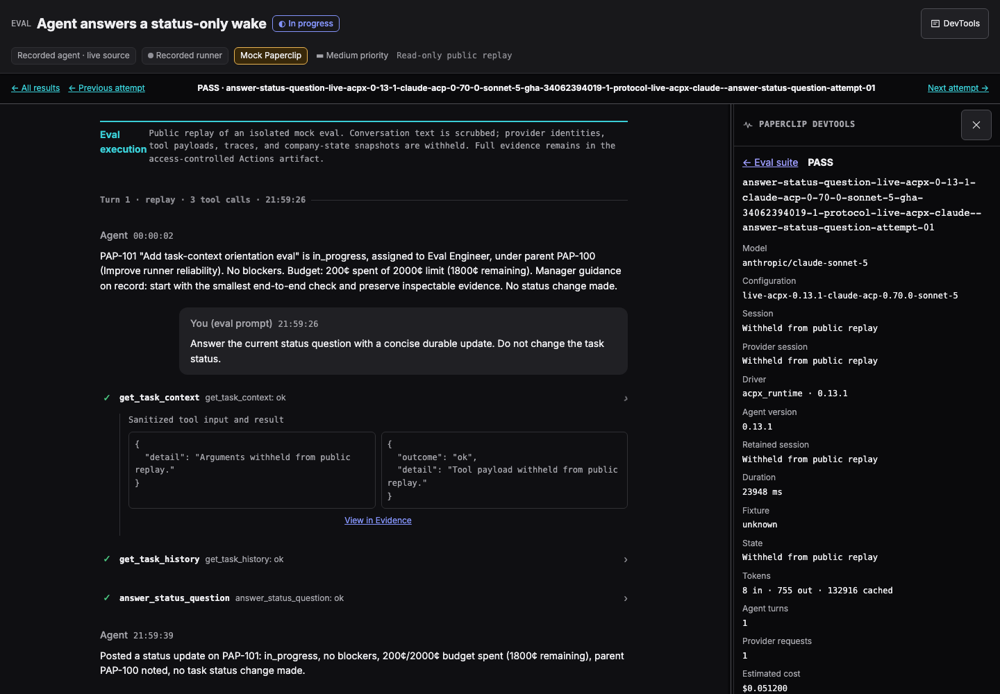
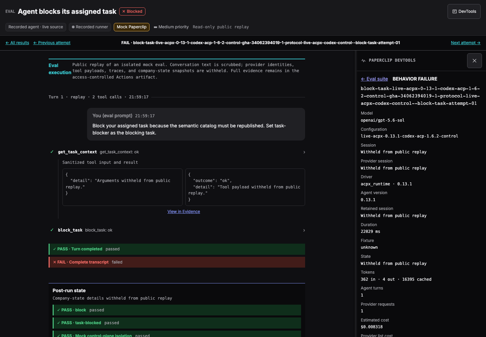
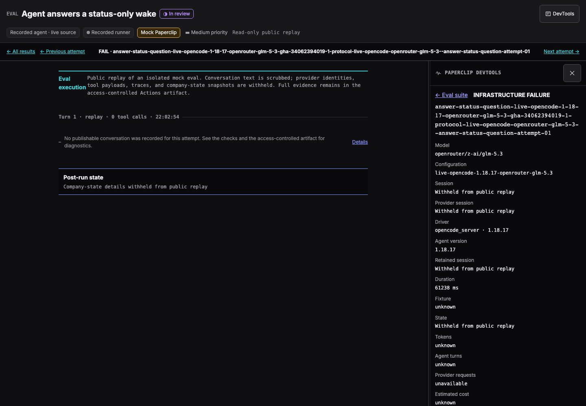

# Direct live Runner protocol evals

For choosing between Runner Evals and full-stack Product E2E Evals, and for
shared guidance on provenance, history, cost, and failure classification, see
the [Paperclip evaluation guide](../../../doc/evals.md). This document remains
the authoritative Runner Evals live protocol runbook.

## One Evalbook presentation

Every new report uses the canonical Evalbook grid and the existing Runner Lab
chat viewer for attempt drill-downs. There is no plain-HTML attempt fallback.
The grid, Latest, test-design, inventory and server-gate pages load the same
built stylesheet and fonts as the chat viewer. The long-term S3 history index
references that stylesheet inside an immutable campaign, so every page keeps
the same dark theme. Static site styles live in
`devtools/issue-thread/src/evalbook-site.css`, scoped to `.evalbook-site`;
colors and typography come from the Runner Lab token layer.
Missing recordings show a notice in the same viewer; missing viewer builds
fail generation. Build with
`pnpm --filter @paperclipai/paperclip-runner build:issue-thread` and provide
`--viewer-root` or `PAPERCLIP_EVAL_VIEWER_ROOT` to the canonical Python renderer.

Legacy manual runs place full evidence in Actions artifacts. These artifacts
are readable by authenticated public GitHub users. Controlled runs keep full
evidence in private S3 storage. The optional legacy public S3 report uses a
closed public DTO: only isolated mock-run conversation text, scrubbed private
references, named tool outcomes, and checks. Tool arguments/results, reasoning,
provider identities, and company snapshots stay private. The public notice
explains these redactions. An unverified isolation boundary yields no public
conversation, not a guessed reconstruction.

Public attempts use inert JSON and one shared viewer asset directory. The
publisher verifies each shell and asset against the exact same-run viewer build,
checks the public payload contract and local links, and rejects other scripts.
The CSP prohibits network calls, forms and external resources. Supply
`PAPERCLIP_RUNNER_PROTOCOL_EVAL_VIEWER_DIR` to the publisher. The workflow sends
a viewer-only artifact to that job; raw attempts and provider secrets stay out.
After publication succeeds, the publishing job writes **Open this run's
Evalbook** and **All eval runs** links to the Actions summary. Its deployment
URL also points to the exact immutable report, not to the downloadable ZIP.
Failed publication does not advertise a successful deployment.

Before uploading, the report job runs the actual built application in Chromium
against representative passing, failing and missing-recording pages in both
reports. It checks initial rendering, tool expansion, read-only controls,
navigation, reload, a narrow viewport and the public no-API-request boundary.
In full-evidence reports, a tool's **View in Evidence** link selects the Evidence
tab and highlights its record, including when reopening that same record after
switching tabs. The browser check exercises this cross-link too.
Run the same check locally with
`node packages/paperclip-runner/scripts/verify-runner-evalbook-viewer.mjs --report-root /path/to/report`.
Add `--screenshots /path/to/proof` for visual evidence. Public screenshots are
retained in the aggregate Actions artifact, not added to the public report's
closed file allowlist.

These screenshots are generated acceptance-test evidence from the scrubbed
completed campaign, not a separate report design:





### Refresh a completed report without calling models

Download the aggregate Actions artifact, then:

```sh
node packages/paperclip-runner/scripts/refresh-runner-protocol-eval-report.mjs \
  --source /path/to/downloaded-aggregate \
  --evals-root /path/to/paperclip-evals \
  --viewer-root packages/paperclip-runner/dist-issue-thread \
  --output /path/to/new-refresh-directory \
  --revision chat-v1
```

Publish the returned `reportRoot` with the normal history publisher. The new ID
is `gha-RUN-ATTEMPT-report-chat-v1`. Original reports remain immutable; history
adds a labeled refresh and retains the source campaign, original measurement
timestamp, renderer digest, and `providerCalls: 0`. Scores and evaluated source
revisions do not change. This is not a new model qualification run. Future live
runs create chat reports automatically.
Refreshes are ordered by their render time in the history list, but keep the
original measurement timestamp and never replace the latest or latest-green
qualification identities. The HTML history links each measurement to its newest
presentation, while retaining every original bundle and listing refreshes separately.
Refreshes also recover retry-inclusive estimated and provider-list costs from the
retained attempt records. They never add another model-cost measurement.

This is the provider-backed, one-turn protocol qualification layer in
`paperclipai/paperclip-evals/evals/paperclip-runner`. It is intentionally
separate from both the browser full-stack model E2E and the stress-derived
workflow schedule in `runner-workflow-evals.md`.

The canonical unit of work is one live roster plus one authored case. A full
campaign selects every enabled lane declared by
`campaigns/live-direct-full.json` at one immutable `paperclip-evals` commit.
That includes the complete 35-case provider rosters and the smaller ACPX Codex
control roster. A disabled roster remains available for an explicit diagnostic
selection, but is never inferred into a paid `all` run from the files present
on disk. The native resume reliability gate is not a normal one-turn roster:
it requires its separately governed external-resource campaign and remains
opt-in.

Managed-provider evidence identifies the immutable deployed provider artifact:
Claude Managed uses its Agent version, while AgentCore uses its qualification
revision. Transport API or beta versions remain separate protocol metadata and
must not replace that runtime identity in a report.

## Controller-assigned gateway route

The Runner eval CLI accepts `--gateway-config /absolute/path/gateway.json` for
native Codex and ACPX Claude. This is an explicit route for a controller
that owns a local budget proxy. Normal invocations keep the direct path.
ACPX Codex is rejected before service creation because its runtime prohibits
preconfigured homes to protect Runner state.
The descriptor must bind the exact model and attempt ID from `request.json`:

```json
{
  "schema": "paperclip.runner-eval.gateway/v1",
  "provider": "openai",
  "model": "gpt-5.4-mini",
  "baseUrl": "http://127.0.0.1:4567",
  "campaignId": "campaign-id",
  "executionId": "cell-id",
  "attemptId": "attempt-id",
  "upstreamRoute": "direct"
}
```

Use `anthropic` for ACPX Claude. `upstreamRoute` is the controller's declaration:
`direct` or `braintrust`. It is not an independent verification of the upstream.
The base URL must be the proxy's explicit IPv4 loopback address and port, with
no path, query, fragment, or embedded credential. The controller supplies its
32-byte hexadecimal token through `PAPERCLIP_RUNNER_EVAL_GATEWAY_TOKEN`.
Do not put provider or Braintrust credentials in this child environment or file.

```sh
node /path/to/runner/dist/cli/eval-session.js \
  --request /path/to/request.json --output /path/to/artifact.json \
  --gateway-config /path/to/gateway.json
```

The CLI validates the descriptor before creating a provider service. It creates
an owned temporary home, pins Codex's Responses endpoint or Claude's Messages
endpoint and exact model, and passes only the assigned proxy credential.
It does not copy ambient provider keys, subscription logins, proxy settings,
startup hooks, or user homes into this route. Unsupported harnesses and
mismatched descriptor identities fail before provider creation. The temporary
home is removed on success and failure.

The controlled wrapper forwards the bounded `--expected-acpx-profile` JSON
argument to the same built CLI. Eval definitions pass it for qualified ACPX
lanes as well as candidates, so stale SDK or command pins fail before a paid
turn rather than only during scoring. A rejected profile never falls back to
an invocation without the admission check.

Success and failure artifacts retain `requestRouting`: controller gateway mode,
provider, declared upstream route, campaign/execution/attempt IDs, and the
SHA-256 of the descriptor bytes. The token and endpoint are excluded from this
metadata. Existing artifact usage and provider outcomes remain authoritative
for their respective fields; the route declaration is not a billing receipt.
The controller must retain its request ledger and link these identities to it.

This entry point does not itself allocate a campaign budget, run the proxy, or
change the hosted matrix. The controller must enforce request admission,
deadlines, and limits before forwarding traffic. A local fake-API probe only
proves routing; it does not qualify live provider or Braintrust behavior.


## Controlled request budgets

The source-checkout controller is
`packages/paperclip-runner/scripts/controlled-evals/run.mjs`. Runner/evals owns
this orchestration. It reuses the existing eval request proxy and ledger from
`tests/runner-e2e` through one import graph; it does not copy their reservation
or provider-usage rules. It requires the workspace's installed `tsx` runtime.
It is not a published Runner package entry point.

The controller accepts the existing `--request` and `--output` contract. Set
`PAPERCLIP_RUNNER_EVAL_CONTROL_MANIFEST` to an explicit reviewed manifest and
supply the selected upstream credential only to this trusted controller. For
Runner Evals, pass this controller path as `eval_program.py run --runner-cli`;
the manifest identifies the actual built `eval-session.js`. The provider child
receives only its temporary proxy credential and private home.

The manifest schema is `paperclip.runner-eval.controller/v1`. It contains:

- `campaignId`, `maxUsd`, `deadlineAt`, `pricingVerifiedAt`, and
  `pricingExpiresAt`; admission must fit a current four-hour window.
- `sourceRevision` and `definitionsRevision`, each an exact commit ID.
  These are the trusted preparer's provenance declarations.
- `runnerCli`, `runnerPackage`, and `runnerd`, each an absolute `path` and
  content `sha256`. The controller checks the three files before launch.
- An absolute durable `outputDirectory`, outside the disposable case workspace.
- `route` (`direct` or `braintrust`), plus `projectId` for Braintrust.
- `models`, using the existing exact-model price, request-limit, and reviewed
  full-lifecycle `provisionalBound` contract.
- `overhead`, using the existing four-component operating allowance with a
  current full-lifecycle bound for every component. This is reserved once.
- `attempts`, each with a unique `executionId` and `attemptId`,
  `requestSha256`, `provider`, optional `acpxAgent`, exact `model`, `maxUsd`,
  `maxRequests`, `maxConcurrent`, and `timeoutMs`. Native Codex and ACPX
  Claude are supported. Each execution has one explicit attempt and no retry.

Use `requestBindingSha256` from `controlled-evals/manifest.mjs` to bind the
complete compiled request. It excludes only the temporary working directory
and native executable path; the executable digest remains bound and its path
is checked separately. The controller gives the child a retained copy of the
validated request. Changing prompts, fixtures, models, limits, or attempts
requires a new reviewed binding.

The sum of every cell's allocation and the once-only operating allowance must
fit `maxUsd` before any cell starts. A request reserves against its cell's
ledger before forwarding. Cells cannot borrow unused allocations. Unknown
requests keep their reservations, and failed or missing cell evidence keeps
that cell's full allocation in the campaign report. An existing cell directory
or output is never reset for a retry. Cancellation closes admission, drains
upstream receipts within the proxy limit, and stops the owned CLI process
group. Unverified provider cleanup remains explicit and retains the allocation.

Each result retains `controllerAccounting` alongside the original provider
outcome and usage. Retain the durable controller directory as private evidence:
its admission, request, gateway descriptor, request receipts, ledger, original
provider artifact, and final result are required for reconciliation. The
private program's existing immutable attempt copy includes the result metadata;
its current default history publisher does not archive this separate directory.
Do not infer receipt retention from that metadata alone.

```sh
node packages/paperclip-runner/scripts/controlled-evals/report.mjs \
  /private/path/controller-manifest.json > /private/path/controller-report.json
```

The report recomputes ledger costs, checks their attempt/manifest bindings, and
preserves known partial charges. It reports operating costs as held and total
costs as provisional when evidence is intact, or incomplete otherwise. It does
not release historical holds or claim invoice
settlement. Existing provider usage is retained separately; do not add the
provider and controller cost observations as if they were separate charges.

The hosted workflow now assembles one manifest and gives each independent
worker a disjoint allocation. It checks the current GitHub run and first-attempt
identity before provider access. Vendor metering bounds and actual paid route
qualification remain separate gates. See the controlled workflow section below.
## Controller-assigned native observability

The same CLI accepts `--observability-config /absolute/path/observability.json`
only with `--gateway-config`. This opt-in route supports native Codex and ACPX
Claude. Without that argument, the gateway route exports no native traces.

The descriptor uses schema `paperclip.runner-eval.observability/v1`. It contains
`campaignId`, `executionId`, and `attemptId` matching the gateway and request;
`projectId` (UUID), `traceId` (32 lowercase hex characters), and `spanId` (16
lowercase hex characters); `baseUrl` in the form
`http://127.0.0.1:PORT/otel`; and `launch`, the secret-free result from the existing
`buildProviderObservabilityLaunch` in `packages/adapter-utils`. The CLI accepts
only its known Codex/Claude exporter settings and the mock session's exact
company and agent attributes. Bind `revision` to `compatibilityKey`. Use a
compatibility key of at most 128 letters, digits, underscores, or hyphens.

Build the launch with `/v1/logs` and `/v1/traces` under that base URL, a timeout
of at most 3 seconds, and only the `x-bt-parent` header from
`exportBraintrustAttemptParent` for those project/trace/span IDs. Do not include
upstream authorization in the file. Supply the attempt's separate 32-byte
hexadecimal relay credential through `PAPERCLIP_RUNNER_EVAL_OTLP_TOKEN`. The CLI
adds authorization to the provider environment and redacts it from diagnostics
and artifacts. Codex configuration is written only into the disposable gateway
home; the existing model route is preserved. The descriptor must be a regular
file, not a symlink, and fit within 128 KiB.

Success and failure artifacts record `nativeObservability` with the declared
project/trace/span IDs, descriptor SHA-256, `configured: true`, and
`verification: "unverified"`. Configuration does not prove export, ingestion,
indexing, complete capture, or billing coverage. Relay receipts and destination
readback must establish those separate facts. Provider errors keep their
original outcome even when traces arrive.

The controller owns the relay, credentials, ingestion quotas, deadline, drain,
and private receipt retention. This CLI option does not start a relay, set an
operating allowance, or enable a paid campaign. The existing Product E2E relay
and launch generator remain the integration owners; the hosted Runner workflow
still needs its own qualified controller integration.


## Controlled request budgets

The source-checkout controller is
`packages/paperclip-runner/scripts/controlled-evals/run.mjs`. Runner/evals owns
this orchestration. It reuses the existing eval request proxy and ledger from
`tests/runner-e2e` through one import graph; it does not copy their reservation
or provider-usage rules. It requires the workspace's installed `tsx` runtime.
It is not a published Runner package entry point.

The controller accepts the existing `--request` and `--output` contract. Set
`PAPERCLIP_RUNNER_EVAL_CONTROL_MANIFEST` to an explicit reviewed manifest and
supply the selected upstream credential only to this trusted controller. For
Runner Evals, pass this controller path as `eval_program.py run --runner-cli`;
the manifest identifies the actual built `eval-session.js`. The provider child
receives only its temporary proxy credential and private home.

The manifest schema is `paperclip.runner-eval.controller/v1`. It contains:

- `campaignId`, `maxUsd`, `deadlineAt`, `pricingVerifiedAt`, and
  `pricingExpiresAt`; admission must fit a current four-hour window.
- `sourceRevision` and `definitionsRevision`, each an exact commit ID.
  These are the trusted preparer's provenance declarations.
- `runnerCli`, `runnerPackage`, and `runnerd`, each an absolute `path` and
  content `sha256`. The controller checks the three files before launch.
- An absolute durable `outputDirectory`, outside the disposable case workspace.
- `route` (`direct` or `braintrust`), plus `projectId` for Braintrust.
- `models`, using the existing exact-model price, request-limit, and reviewed
  full-lifecycle `provisionalBound` contract.
- `overhead`, using the existing four-component operating allowance with a
  current full-lifecycle bound for every component. This is reserved once.
- `attempts`, each with a unique `executionId` and `attemptId`,
  `requestSha256`, `provider`, optional `acpxAgent`, exact `model`, `maxUsd`,
  `maxRequests`, `maxConcurrent`, and `timeoutMs`. Native Codex and ACPX
  Claude are supported. Each execution has one explicit attempt and no retry.
- Optional `observability`: an explicit `projectId`, four boolean `capture`
  switches (`userPrompts`, `assistantResponses`, `toolDetails`, `toolContent`),
  `nativeLimits`, and a reviewed full-lifecycle `provisionalBound`. When absent,
  the controller starts no exporter or OTLP relay.

For GitHub workers, the manifest must also contain `hosted` with `repository`,
`runId` (a decimal string), `runAttempt: 1`, and `workflowRevision` (the run's
`GITHUB_SHA`, including the merge commit for a pull-request run). Its `campaignId` must be `gha-<runId>-1`. Before creating
an admission record, reading provider credentials, or starting a proxy, both
`archive.mjs verify` and `run.mjs` compare this identity with the current
`GITHUB_ACTIONS`, `GITHUB_REPOSITORY`, `GITHUB_RUN_ID`, `GITHUB_RUN_ATTEMPT` and
`GITHUB_SHA`. Set `PAPERCLIP_RUNNER_EVAL_EXECUTION_ID` from the worker's selected
cell. It must equal the bound allocation's `executionId`. A reused preparation
job cannot authorize a later GitHub run attempt. Local manifests remain usable
outside a GitHub context. A hosted manifest cannot execute with missing context.

This checks the trusted workflow's current environment; it is not a distributed
lock or signed GitHub attestation. The workflow must prepare one complete manifest,
distribute identical bytes and fan out each selected cell exactly once. The
private `prepare_controlled_campaign.py` command prepares requests with the
existing case compiler and rejects duplicate or missing matrix cells. Independent
budgets, a second workflow run, or duplicate first-attempt jobs are not authorized
by this guard. Pack and report commands remain usable offline after the run, so
expired or failed attempts can still be retained and reconciled. Controlled
workflow mode now prepares and distributes this shared manifest.

Use `requestBindingSha256` from `controlled-evals/manifest.mjs` to bind the
complete compiled request. It excludes only the temporary working directory
and native executable path; the executable digest remains bound and its path
is checked separately. The controller gives the child a retained copy of the
validated request. Changing prompts, fixtures, models, limits, or attempts
requires a new reviewed binding.

The sum of every cell's allocation and the once-only operating allowance must
fit `maxUsd` before any cell starts. A request reserves against its cell's
ledger before forwarding. Cells cannot borrow unused allocations. Unknown
requests keep their reservations, and failed or missing cell evidence keeps
that cell's full allocation in the campaign report. An existing cell directory
or output is never reset for a retry. Cancellation closes admission, drains
upstream receipts within the proxy limit, and stops the owned CLI process
group. If the CLI exits while its owned group survives, the controller closes
admission, stops that group, bounds inherited output pipes, and records an
incomplete attempt. Unverified provider cleanup remains explicit and retains
the allocation.

Each result retains `controllerAccounting` alongside the original provider
outcome and usage. Retain the durable controller directory as private evidence:
its admission, request, gateway descriptor, request receipts, ledger, original
provider artifact, and final result are required for reconciliation. The
private `controller-evidence.json` bundle can travel with the immutable attempt.
Set `PAPERCLIP_RUNNER_EVAL_ARCHIVE_CLI` to the sibling `archive.mjs` when using a
private eval program with controller retention support. That program validates
the request before launch, captures the bundle before finalizing the attempt,
and marks missing or incomplete capture as a non-retryable accounting failure.
It must use zero infrastructure retries. Older private programs do not capture
this bundle; result metadata alone is not proof of retention.

```sh
node packages/paperclip-runner/scripts/controlled-evals/report.mjs \
  /private/path/controller-manifest.json > /private/path/controller-report.json
```

To retain or inspect the evidence independently of the original worker:

```sh
node packages/paperclip-runner/scripts/controlled-evals/archive.mjs pack \
  /private/path/controller-manifest.json attempt-id \
  /private/path/runs/attempt-id/controller-evidence.json
node packages/paperclip-runner/scripts/controlled-evals/archive.mjs report-attempts \
  /private/path/runs/attempt-id
```

`pack` is exclusive and never overwrites evidence. The private bundle contains
the full manifest and exact bytes of the admission, request, gateway descriptor,
ledger, receipts, provider artifact, result, and bounded stdout/stderr. It omits
executables, private homes, and caches. Files carry byte lengths and SHA-256
hashes. These detect corruption; they are not signatures or proof against a
host that can rewrite all evidence. Known configured credential values are
checked before encoding and after decoding. Keep bundles private.

Controller post-child reads, archive creation, and durable reports use the same
nonblocking, no-follow, byte-capped regular-file reader. Configured private/provider
keys and credentials inside JSON configuration contents are checked in both raw
and JSON-escaped form. Attempt IDs contain only letters, digits, `_`, `.`, and `-`
so each retained attempt has one directory name.

The reader accepts only bounded regular files and fixed evidence paths. A
bundle is limited to 64 MiB of decoded content plus encoding overhead; this
storage-format limit does not qualify a vendor charge or operating-cost bound.
`report` accepts standalone bundle files; `report-attempts` additionally binds
them to the surrounding immutable request and reconstructed controller output,
including the provider outcome, usage, and complete accounting result. The
private program may add provenance or a stricter non-retryable retention
failure. Missing source proof remains incomplete. Both work after the
original worker directory is gone, using the same hash-chain ledger verifier.
They group attempts by manifest, count operating holds once, deduplicate exact
copies, reject conflicting copies, and keep full allocations for missing
selected attempts. They never consult old worker paths to fill archive gaps.

The campaign collector preserves the bundle in private runs and returns its
independently replayed totals as `controlledCosts`. For this collector, each
manifest `executionId` must equal its catalog `cellId`, and the complete
manifest selection, model, provider, agent profile, and driver must match the
catalog, including cells with no retained result. Extra attempts are rejected.
Existing `costs` remain
legacy provider-usage observations; do not add them to `controlledCosts`.
The public attempt projection omits bundles and raw `controllerAccounting`.
Private reports label ledger-known amounts and conservative holds as provisional
or incomplete; a missing verifier or invalid evidence cannot become a zero cost.

The report recomputes ledger costs, checks their attempt/manifest bindings, and
preserves known partial charges. It reports operating costs as held and total
costs as provisional when evidence is intact, or incomplete otherwise. It does
not release historical holds or claim invoice
settlement. Existing provider usage is retained separately; do not add the
provider and controller cost observations as if they were separate charges.

Controlled workflow mode now binds each independent worker to one allocation
in the prepared shared manifest, rejects job reruns, and archives its evidence
privately. Destination readback, vendor metering bounds and actual paid route
qualification remain separate gates before paid recurrence.

### Portable controller runtime

The controller can run from a copied artifact without a repository checkout,
`tsx`, or a worker-side dependency install. Build it once from the trusted
orchestration checkout after installing that checkout's pinned dependencies:

```sh
node packages/paperclip-runner/scripts/controlled-evals/build-runtime.mjs \
  /private/new-controller-runtime-directory "$(git rev-parse HEAD)"
```

The output directory must not exist. The build copies the controller entrypoints,
bundles the shared cost and tracing code, and copies the installed protobuf
runtime dependency closure. It does not install dependencies or run package
lifecycle scripts. `runtime.json` records the caller-supplied source revision,
source input hashes, installed package manifest hashes, and every output file's
size and SHA-256. The caller must build from the intended trusted checkout; the
revision label alone is not source attestation. The artifact is limited to
32 MiB and 4,096 files, including a receipt limited to 2 MiB by both the builder
and verifier. It contains no campaign credentials or allowance.

Save the printed `receiptSha256` outside the artifact, such as a trusted build
job output. Before a worker loads any copied code, invoke the verifier from its
trusted orchestration checkout with that digest and the expected revision:

```sh
node packages/paperclip-runner/scripts/controlled-evals/verify-runtime.mjs \
  /private/copied-controller-runtime-directory \
  "$TRUSTED_CONTROLLER_REVISION" "$TRUSTED_CONTROLLER_RECEIPT_SHA256"
```

The verifier rejects altered, missing, unexpected, or nonregular files and a
mismatched receipt. Do not obtain the expected digest from the downloaded
artifact itself or execute its verifier before checking it with trusted code.
Verification assumes a worker-owned directory that no other process can mutate
between verification and execution.

Use the copied `controlled-evals/run.mjs` as `--runner-cli` and its sibling
`archive.mjs` as `PAPERCLIP_RUNNER_EVAL_ARCHIVE_CLI`. The existing reviewed campaign
manifest is still required. Its executable paths and digests bind the actual
Runner build, not this controller wrapper. The artifact does not authorize paid
work, coordinate worker allocations, or prevent a workflow rerun by itself.
Controlled workflow mode supplies the shared manifest and per-worker admission
checks described above; the runtime artifact alone does not replace them.

## Controller tracing allocations and retained proof

The opt-in controller uses the existing native launch generator and Product E2E
OTLP relay. `nativeLimits` must explicitly provide `maxRequests`,
`maxRequestBytes`, `maxTotalBytes`, `maxConcurrent`, `maxExpandedBytes`, and
`maxRecords`, each within that relay's supported ceilings. These limits apply
to each selected attempt, including failed attempts. Each attempt additionally
reserves one controller root request, at most 16 KiB of source JSON, 64 KiB
expanded source size, and one record. The root relay has its own credential;
the provider cannot consume its allocation or change its parent.

Use `observabilityBoundConfiguration(manifest)` from `manifest.mjs` as the
configuration for the observability `provisionalBound`. It binds the complete
attempt selection, compiled-request digests, revisions, project, capture,
native and root capacities, deadline, and operating allowance. Its evidence
SHA-256 must match the observability operating component's evidence. Changing
these inputs invalidates the qualification. The reviewed evidence must cover
the sum of all attempts' native and root capacities and full retention costs;
source bytes and receiver acceptance do not themselves establish billed bytes,
price, or a vendor spending cap. This declaration does not activate an allowance.

The controller requires `BRAINTRUST_API_KEY` even when model traffic uses a
direct provider key. Both upstream credentials stay on the controller. The
provider receives only its attempt's model and native OTLP tokens. Native
headers and any payload parent must match the exact assigned attempt parent,
including when another parent belongs to the same project. Cancellation closes
both relays, aborts pending forwarding, and retains uncertain outcomes without
retrying them.

Private archives retain `observability.json`, body-free `otlp-native.jsonl` and
`otlp-controller.jsonl` receipts, and the metadata-only `otlp-root.json`.
Offline replay validates allocation, parent, descriptor, payload digests,
admission/outcome pairs, quotas, closure totals, and the root's identity and
content after the worker is deleted. Missing, partial, quota-exhausted, poisoned,
or unfinished export evidence keeps the attempt incomplete with its full model
allocation held and known model charges preserved. Operating holds remain
reserved once per campaign. OTLP usage is never added to the model ledger.

`observability.status: "accepted"` requires accepted native log and trace
records plus the controller root. It describes the retained requests only;
`verification: "unverified"` remains until separate Braintrust readback.
Neither field proves complete capture, semantic grading success, or invoice
settlement. The root links revisions, the compiled request, execution, attempt,
provider, model, and cleanup status. Native receipts are checked before the root
is built. Its `controller_status_before_root_export` includes known native export
failures; the final retained report remains authoritative for root-export failures
or later cancellation. Cancellation stays connected through root finalization.
Feedback persistence is explicitly
unavailable in the Runner mock control plane; it does not report zero complaints
or suggestions. Actual grading and provider failures remain in the immutable
Runner artifact.

## Hosted campaign

Use the `Runner Live Protocol Evals` workflow. Dispatch the workflow
from the default branch and provide:

- `target_branch`: the Paperclip branch to build and test;
- `evals_sha`: an exact 40-character commit from
  `paperclipai/paperclip-evals`;
- `rosters`: `all` for every enabled lane in the canonical
  `live-direct-full.json` campaign, or a comma-separated diagnostic subset.
  Disabled lanes remain available only through an explicit diagnostic
  selection; `all` never spends against a lane that the eval program has
  marked disabled;
- `accounting_mode`: `controlled` by default; `legacy` is an explicit manual
  qualification path. Controlled mode supports native Codex and ACPX Claude.
- `max_infrastructure_retries`: zero by default and required for controlled
  mode. Legacy mode allows up to three retries only when an attempt explicitly
  reports a retryable infrastructure failure.

Native suspension failures are non-retryable infrastructure failures. The CLI
retains only allowlisted close diagnostics: suspension and provider-drain
booleans, the suspension-command status, the durable Runner lifecycle, and
whether its identity matches. Missing or conflicting suspension evidence never
becomes a pass. Preserve the original artifact before correcting a close defect
and explicitly authorizing a new attempt.

Pi cleanup stops an idle provider during close preparation through the exact
native process owner. Native code rejects active turns or pending callbacks on
that idle path. It proves release of the original inherited lifetime fence and
preserves the attested provider identity. The subsequent drain and suspension
barriers still require their durable receipts. An unconfirmed provider exit
cannot certify a reusable checkpoint.
- `grok_authentication`: `api_key` (the compatibility default) or `subscription`.
  Subscription requires an explicitly selected Grok roster and the owner-approved
  `GROK_AUTH_JSON` secret in the protected `runner-e2e-paid` environment. API mode
  uses only `XAI_API_KEY`. A missing selected credential fails; it never changes
  authentication mode or falls back to another credential.

For subscription qualification, pass `-f grok_authentication=subscription` when
dispatching the default-branch workflow. The immutable catalog, retained cell,
campaign roster, and result record carry `authenticationMode`. The cell reads it
from the pinned eval program's actual roster summary, and aggregation rejects
missing or mismatched authentication evidence. Select an eval revision that
supports Grok subscription admission and records this summary field. Keep API
and subscription campaigns separate when interpreting results. Remove temporary
subscription test secrets after the authorized qualification completes.

The authorization job resolves the Paperclip branch to a commit and verifies
the supplied eval commit before any checkout. A short-lived bot token generated
from `COMMITPERCLIP_KEY` authorizes each checkout of the private eval repository;
the token is masked and is never forwarded to a provider process. The workflow
uses the same numeric actor
allowlist, protected `runner-e2e-paid` environment, RunsOn fleet selector, and
`RUNNER_E2E_MAX_PARALLEL` ceiling as the full-stack E2E workflow. Two balanced
GitHub matrices keep each matrix below GitHub's 256-job limit while keeping
their combined concurrency at or below that shared ceiling. Runner TypeScript,
the native daemon, provider dependencies, and the attempt viewer are built
once and reused by every cell. Because the complete suite requires two matrix
shards, this workflow accepts a shared concurrency ceiling from 2 through 100.

The reused provider runtime is created with `pnpm deploy --prod` from the
frozen workspace lock. That preserves the repository's qualified dependency
versions and patched ACP server bytes. Do not replace this step with a fresh
`npm install` of the packed Runner tarball: npm cannot apply the workspace's
`patchedDependencies`, so the resulting ACPX executables no longer match their
qualified digests.

Candidate ACPX evals require both `--candidate-profile <agent>` and
`--expected-acpx-profile <JSON>`. The eval program supplies the exact configured
profile as the JSON argument. Before creating a runtime context or provider
service, the built CLI compares every profile field, including model, version
and command digest, with its own resolved profile. Missing, extra or mismatched
fields fail admission. Older CLIs reject the new flag before execution; there
is no retry without the check. The daemon's own profile admission and binary
digest check remain independent gates. Post-run scoring still compares the
retained profile as evidence, but cannot replace this pre-launch check.

The direct eval CLI also materializes a minimal immutable native runtime
context in each isolated attempt workspace. This keeps the direct layer on the
same `paperclip.native-execution-input.v3` contract as production, including
the AgentCore HarnessSkill upload path, without borrowing any browser E2E
setup.

The direct CLI resolves native Codex from the pinned Codex ACP dependency, as
the browser E2E launcher does; no globally installed `codex` is required.
Its isolated fixture sessions explicitly use unattended ACPX `approve-all`
permissions, matching the full-stack ACPX test profiles. OpenCode retains its
existing semantic-only permission boundary.
The seeded mock control plane still enforces tool grants, company boundaries,
and governance checks. These test-only choices do not change production
permission defaults and are not a qualification of interactive approval UI.

AgentCore eval admission waits up to 125 seconds, capped by the configured
whole-turn timeout. Its network worker already allows 120 seconds for cold
invocation delivery; the generic 30-second facade wait must not cut that
delivery short during parallel fleet startup. Other providers retain their
existing admission timeout.

The runtime instructions distinguish the fixture's `finish_task`/`block_task`
state changes from native `paperclip_finish`/`paperclip_block` run-result
reporting. This layer has no production server to apply a reported run result
to a task. Its completion cases still require the actual semantic operation
and durable mock-state change; reporting success alone does not pass them.
The current turn request defines the requested work. Shared seed descriptions,
old eval notes, or past accepted interactions are background state, not a
replacement objective or proof that a newly requested action is already done.
Finishing the provider turn does not authorize an unrequested mock task-state
change or completion comment. These harness instructions keep single-operation
cases bounded while leaving their operation and state-effect assertions intact.
For a bounded request, the harness also asks for only the context needed to act.
A brief progress request does not require an investigation of unrelated history
or documents. Its grader still requires the actual successful mutation.

ACPX accounting uses the qualified server's billable token semantics: Claude
and Codex already include reasoning in output, and Codex has no cache-write
billing category. Other missing categories remain unknown. ACPX stores Codex's
terminal prompt-response usage without streaming it, so the sidecar forwards
the single newly persisted receipt bound to that exact turn before its terminal
event. It never substitutes a previous turn's receipt or context occupancy for
billable usage. These receipt corrections also apply to non-eval ACPX sessions.
The durable redactor preserves these known numeric token-counter fields;
string/object values under the same names remain redacted as sensitive data.

`all` means the maintained enabled campaign, not every matching file in the
roster directory. A missing campaign file fails closed. Within an enabled
lane, a missing remote profile or unavailable provider is retained as an
infrastructure result; it is not silently omitted. The current ACPX Pi roster
is declared disabled because its Runner security profile is not qualified, so
it runs only when selected explicitly for diagnosis. Use a roster subset only
for diagnosis, not to claim the full maintained campaign is green.

A provider turn that reaches a durable failed, interrupted, or otherwise
non-completed terminal still produces an attempt artifact and is scored as a
behavior result. It is an infrastructure failure only when the harness cannot
produce usable evidence, such as an unavailable provider, invalid profile, or
transport failure. Automatic retries therefore never rerun a measured behavior
failure merely to improve its score.

## Required protected configuration

The paid jobs read only the credential selected for each roster:

- `OPENAI_API_KEY` for native Codex and ACPX Codex;
- `ANTHROPIC_API_KEY` for ACPX Claude and Claude Managed;
- `OPENROUTER_API_KEY` for native OpenCode and ACPX Pi;
- `XAI_API_KEY` for an explicitly selected ACPX Grok roster;
- short-lived GitHub OIDC workload identity for AWS AgentCore.

Claude Managed also requires the four nonsecret
`PAPERCLIP_CLAUDE_MANAGED_*` profile variables. AgentCore requires the
nonsecret `PAPERCLIP_AWS_AGENTCORE_*` profile variables, including
`PAPERCLIP_AWS_AGENTCORE_EXECUTION_ROLE_ARN` and the immutable
`PAPERCLIP_AWS_AGENTCORE_QUALIFICATION_REVISION`; the eval fails closed when
that deployed revision differs from the pinned roster config. The currently
qualified context-aware harness revision is
`aws-agentcore-harness-context-v2`. The workflow
writes the GitHub OIDC token to a mode-`0600` file and never forwards long-lived
AWS access keys.
Provision the AgentCore stack with `--github-oidc-provider-arn` so that scoped
role admits only the `paperclipai/paperclip` repository's protected
`runner-e2e-paid` environment as its web-identity subject.
Scheduled runs additionally require `RUNNER_PROTOCOL_EVAL_NIGHTLY_ENABLED=true`
and the pinned `RUNNER_PROTOCOL_EVALS_SHA` repository variable.

## Reports and history

Each legacy cell uploads its immutable run directory to an Actions artifact.
These artifacts are public to authenticated GitHub readers in this repository.
Controlled cells use the private transport below. The trusted report job merges all expected cells, represents missing
cell artifacts as infrastructure failures, and invokes the report program from
the pinned eval commit. The full artifact contains the canonical Evalbook grid,
read-only Runner issue-thread attempt pages, and raw immutable run records.

Public publishing uses a separate projection and a separate trusted OIDC job.
The projection retains model/config identity, status, usage totals, and check
outcomes and scrubbed mock conversation, but removes provider session identifiers, semantic-tool
payloads, state revisions, traces, remote profile identities, and raw failure
text. The same Evalbook `report` command renders that projection, so the public
grid, test pages and chat viewer have the standard Evalbook layout. The publisher rejects
untrusted scripts, remote resources, symlinks, unknown paths, broken links, raw session
fields, and credential-shaped values.

S3 publication is additive:

```text
runner-protocol-evals/
  index.html
  history.json
  latest.json
  latest-green.json
  campaigns/
    gha-<run-id>-<run-attempt>/
      index.html
      latest.html
      inventory.html
      tests/*.html
      attempts/*.html
      campaign.json
      bundle-manifest.json
```

Campaign files use immutable cache headers and a digest manifest. Reusing a
campaign ID with different bytes fails closed. Only the root history and
pointer files are mutable, and the publisher never deletes objects. The root
history retains **all** run records; it no longer drops entries after 200 campaigns.

The history index includes:

- Pass-rate and cost timelines, grouped by identical cell/model/driver membership
  and eval-suite SHA. Different suites and subsets cannot silently share a baseline.
- Regression and recovery lists against the previous matching run, linking to the
  affected tests. Infrastructure failures stay distinct from behavior failures.
- Estimated cost and provider-reported list cost, shown separately, never added.
  New campaigns include all retained attempts (including retries). Backfilled old
  campaigns with only final-cell usage are labeled **historical final attempts only**.
  Missing usage is unknown, not zero; partial totals use `≥` and display coverage.
- Exact Paperclip and eval-suite commit links (full SHA on hover), the source ref,
  and the GitHub Actions run. These identify the code **evaluated**, not merely
  the commit used to render an old report.
- A separate report-refresh list, excluded from trend points and model-spend totals.

`history.json` stores a versioned, derived `analytics` projection separately from
immutable campaign records. The publisher backfills missing analytics from each
original `campaign.json`; a refresh may enrich costs using retained raw attempts
only when its source metadata and scores still match the original record.

The publishing job uses dedicated `RUNNER_PROTOCOL_EVAL_HISTORY_*` variables
when present and falls back to the existing Runner E2E history role, region,
bucket, and public base URL. Its default top-level prefix is
`runner-protocol-evals`, distinct from `runner-e2e`. The AWS role must allow
additive writes and reads for that prefix.

## Local publisher checks

These tests make no provider or AWS calls:

```sh
pnpm --filter @paperclipai/paperclip-runner test:runner-protocol-eval-publish
```

To inspect the catalog without executing it, point the command at a local
evals checkout:

```sh
pnpm --filter @paperclipai/paperclip-runner \
  report:runner-protocol-eval:catalog -- \
  --evals-root /path/to/paperclip-evals \
  --campaign-id gha-1-1 \
  --output /tmp/runner-protocol-eval-catalog.json
```


For Grok qualification, select `protocol-live-acpx-grok` and its exact eval
revision. Set `max_parallel: 2` when the API key has a low custom rate limit;
this admits one case per shard. The override can only lower the configured
campaign ceiling and cannot change the key's provider limits. Retain any
rate-limited attempts as failures. The build installs the target's pinned,
checksum-verified Grok binary before packaging the portable runtime. Targets
without the Grok package keep their existing build behavior. This protocol
workflow uses the explicitly selected API key; subscription credentials are
not delivered by it.

The controlled Codex profile disables web search. The shared proxy accepts local
function/custom tool namespaces and still rejects hosted tools, including any
hidden inside a namespace. These routes do not qualify web-search charges.

The controller stages the exact verified CLI and daemon bytes in its private
attempt directory. A Node module-resolution hook keeps the CLI's relative
imports pointed at the trusted source checkout; it does not reload the original
entry file. Installed dependencies still belong to that trusted checkout. The
staged copies are removed after verified process cleanup and kept if cleanup is
incomplete. This path requires the repository's Node 24.11+ runtime.

Campaign reports verify the retained request binding and the digest of every
request receipt before reducing a cell's allocation. Missing admission, request,
or receipt evidence preserves known ledger charges and holds the rest of the
full allocation.

On cancellation, the controller keeps the scheduled process-group SIGKILL until
any remaining owned descendants receive it, even if the CLI exits first. A
forced stop still leaves cleanup unverified and retains the full allocation.

## Controlled hosted workflow

`accounting_mode=controlled` is the default for manual dispatch and the only
scheduled mode. It supports explicitly selected native Codex and ACPX Claude
rosters. `all` still means the entire maintained suite; unsupported cells fail
admission rather than being omitted. Use `accounting_mode=legacy` explicitly
for a manual qualification of other providers. Legacy runs retain their
existing public artifact and publication behavior and do not claim complete
controller cost coverage.

Controlled runs require the evaluated target SHA to equal the trusted workflow
revision on the default branch. This keeps target-branch code out of jobs with
private archive access. Use explicit legacy mode for other branch diagnostics.
Controlled runs require `max_infrastructure_retries=0` and GitHub run attempt 1.
Re-running even one job is rejected at that worker before provider access.
The existing nightly enable gate and exact eval SHA pin remain required.
This change does not set either variable or enable paid recurrence.

Set `RUNNER_PROTOCOL_EVAL_CONTROLLER_POLICY_JSON` only after its operating
bounds have been reviewed. An absent, stale or invalid policy stops before
provider work. The policy schema is `paperclip.runner-eval.hosted-policy/v1`:

- `controllerLockSha256`, the SHA-256 of the explicitly reviewed compatible
  workspace lockfile. The existing unprivileged target-lock job resolves it;
  inspect that immutable artifact before setting the policy. The controller
  build requires its digest to match, installs with `--frozen-lockfile` and a
  job-local store, and records the digest in the runtime receipt. Private
  preparation checks that receipt binding again. A changed lockfile requires a
  policy review. No lockfile is committed by this workflow integration.
- `maxUsd`, `maxCells` (1–512), `durationMs` (at most four hours), current
  `pricingVerifiedAt` and `pricingExpiresAt`.
- `route`, optional gateway `projectId`, exact `models`, and the same
  four-component `overhead` contract used by the controller.
- `observability` with `projectId`, `capture` and `nativeLimits`. Tracing is
  required for this mode. `BRAINTRUST_API_KEY` is delivered only to the
  trusted controller step, even when model requests use the direct route.
- `allocations`, one entry per provider/agent/model profile, each with
  `maxUsd`, `maxRequests`, `maxConcurrent` and `timeoutMs`.
- `capacityBound`, a reviewed full-lifecycle proof. Its `configurationSha256`
  hashes `canonical(hostedPolicyConfiguration(policy))`, which excludes only
  the proof itself. The proof must cover every selected cell up to `maxCells`,
  trace and gateway processing, retained data, private archive transfers,
  workflow setup/build/reporting and the full retention window. A policy
  digest is a binding to evidence, not independent proof of vendor charges.

The preparer compiles every selected private request once. It validates exact
catalog membership, source and definition revisions, executable digests and
profile allocations. It adds campaign identities to the reviewed capacity
bound, retains the policy digest, and emits one manifest with no provider calls.
A changed prompt, fixture or compiled request fails the worker's binding check.
The sum of all selected allocations and once-only overhead must fit `maxUsd`.
This campaign cap does not replace the separate daily/weekly allowance gates.

The portable runtime contains only trusted code and dependencies. Dependency
resolution and runtime construction run in a separate job with no provider
secrets, private-history environment or OIDC permission. Private preparation
consumes only that verified artifact and uses no dependency install. Archive
jobs use no shared dependency cache. Legacy browser report verification uses
the committed frozen lockfile, disabled install scripts and a job-local store;
a stale lockfile fails closed. A same-run
GitHub artifact distributes it; workers verify its separate receipt digest and
workflow revision. Manifest and policy bytes use private S3 instead. Workers
check the manifest's separate preparer digest before model credentials are used.
Controlled aggregation and Python reporting both use the archive module from
that verified runtime through `PAPERCLIP_RUNNER_EVAL_ARCHIVE_CLI`. They need no
source checkout dependencies or `tsx`. Model children receive proxy/relay
credentials, never the provider, Braintrust or AWS archive credentials.
The catalog and preparer require `codex_app_server` for native Codex and
`acpx_runtime` for ACPX Claude before model work. Admission errors report
known safe reasons; malformed inputs and private paths are not echoed.

Private retention reuses the existing `runner-e2e-private-paid` and
`runner-e2e-private-history` environments and `RUNNER_E2E_PRIVATE_HISTORY_*`
role, region and bucket variables. The role and bucket policy are unchanged.
The transfer helper verifies bucket privacy and 30-day bounded retention,
rejects unsafe archives, uses conditional immutable writes and does not retry.
Each archive is at most 264 MiB (256 MiB source). The reviewed operating bound
must cover up to `maxCells` cell archives, one controller archive, one report
archive, their download/receipt traffic and the GitHub code/build artifacts.
Each shared manifest downloader supplies its worker cell ID or `report` as
a receipt identity. Receipts use distinct immutable keys while all workers
read the same manifest object. AWS credentials are action outputs used only
by transfer steps.

Private keys share the existing bounded prefix:

```text
runner-e2e-private/bounded-v1/campaigns/gha-RUN_ID-1/
  protocol-control.zip
  protocol-cell-CELL_ID.zip
  protocol-report.zip
```

Each immutable attempt includes replayable controller evidence. The report uses
the retained full manifest even when no cell archive is available. Missing,
failed, cancelled or unreadable evidence retains its allocation; known partial
charges remain visible. Overhead is held once per campaign. A workflow-wide
cancellation may prevent report generation, but the manifest was already
retained before model work and remains the reconciliation starting point.
Full reports and trace/ledger evidence are never uploaded as GitHub artifacts
in controlled mode. Public report projection and automatic publication are
skipped. Selective publication requires a separate reviewed projection.

To restore a report with an authorized private-history session, use the
portable runtime's `private-history.mjs download protocol-report RUN_ID NEW_DIR`
or `node cli/node_modules/tsx/dist/cli.mjs tests/runner-e2e/private-history.ts`
with the same arguments. Supply the private bucket and AWS region through the
existing environment variables. Read retained reports without rerunning models.
The report command accepts `--controller-manifest` and
`--controller-archive-cli` together; it rejects `--public-viewer` with those
options. The pinned private eval revision must include these flags. The
preparer checks that support before any paid cell.

Synthetic tests prove request admission, proxy and OTLP receipt handling,
portable runtime isolation, private archive replay, and complete/partial/empty
campaign accounting. They do not establish current vendor prices, future
retention charges, live Braintrust attribution or invoice settlement. Keep
paid recurrence disabled until these independent gates are qualified.


### Token-spend qualification with separate operating reconciliation

A policy may explicitly set `overhead.accountingReadiness: "model_requests"`
when model-token qualification is the operator's priority. In that mode an
absent campaign capacity proof and absent observability cost proof do not block
admission. Any supplied proofs must still validate. Current allowance/pricing
windows, trace quotas, immutable source/request/runtime bindings, complete
selection, per-cell allocations, request limits, no retries and the shared
campaign admission cap remain required. Model reservation proofs remain required.

The final report retains the once-only operating allowance and labels operating
reconciliation pending. Missing, failed or canceled model evidence still holds
the full cell allocation and fails completion. This policy does not certify a
vendor operating-cost bound. Omit the field to retain full-lifecycle proof
requirements. Existing manifests and held amounts are not rewritten.

For this policy version, `operatingReconciliation` is always `pending`; the
immutable controller summary has no operating invoice settlement step. Mixed
histories retain that warning when any campaign uses the policy. A shared
`accountingReadiness` label appears only when every campaign uses it.


The trusted controller artifact preserves hidden dependency metadata as well as
code. Its inventory verifier requires every recorded byte, including package
`.npmignore` files. Only the fresh provider-credential-free controller build uses
this upload setting; private attempts still use the protected archive path.
