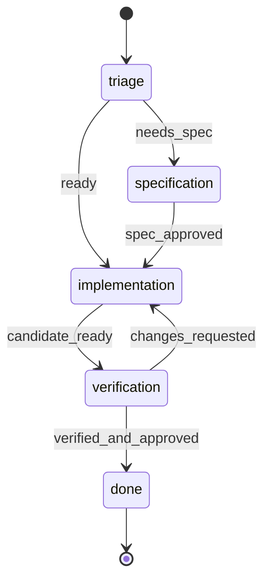

# Cases

Cases are agent-owned work records for durable outputs such as blog posts,
research packets, release notes, incidents, QA runs, or generated asset sets.
They are company-scoped and live beside issues: issues coordinate work, while
cases preserve the structured object an agent is producing.

Cases are experimental and must be enabled with `experimental.enableCases`.
If a route returns `403 Cases are disabled`, stop and report that the operator
must enable cases before the skill can use this surface.

## Core Model

A case has:

- `identifier`: server-assigned display id such as `PAP-C42`
- `caseType`: skill-owned type such as `blog_post`, `image_assets`, or `incident`
- `key`: optional deterministic upsert key inside `(companyId, caseType)`
- `title` and optional `summary`
- `status`: `draft`, `in_progress`, `in_review`, `approved`, `done`, or `cancelled`
- `fields`: JSON object owned by the skill using the case
- `parentCaseId`: optional parent case for child work
- `workIssueId`: optional primary workflow task; later handoffs reuse it
- `phase` and `handoffVersion`: current applied phase and observed routing revision
- documents, attachments, issue links, labels, and events

Use deterministic `caseType` + `key` when a skill may be retried. Repeating
`POST /api/companies/:companyId/cases` with the same `caseType` and `key`
upserts the same case instead of creating a duplicate.

## Upsert Semantics

`POST /api/companies/:companyId/cases` creates or upserts a case.

Request:

```json
{
  "caseType": "blog_post",
  "key": "launch-announcement",
  "title": "Launch announcement",
  "summary": "Draft launch post for operators.",
  "status": "draft",
  "fields": {
    "slug": "launch-announcement",
    "target_audience": "operators"
  }
}
```

Response:

- `201` when a new case was created
- `200` when an existing `(caseType, key)` case was updated

Field behavior on upsert:

- `title` is required and replaces the previous title.
- `projectId`, `summary`, `status`, `fields`, and `parentCaseId` replace the
  previous value when present.
- Omitted optional values preserve the previous value during upsert.
- `fields` is replaced as a whole object when provided. It is not deep-merged.
  Send the complete desired JSON object each time.
- Concurrent retries with the same `(caseType, key)` converge to one case.

Do not use a random `key` for retryable skills. Use a stable content slug,
external id, source URL hash, or parent-derived request key.

## Start And Hand Off Work

Native `create_case` always creates a case and starts its first ordinary task.
`kickoff` and `workflow_document_text` are required; omitting either is rejected
before any records are created. Provide the first agent, phase, instructions,
the full workflow description, and optional initial task documents:

```json
{
  "idempotencyKey":"csv-export-kickoff-1",
  "caseType":"software_change",
  "title":"Add a CSV export",
  "workflow_document_text":"Agent ownership: triage=<triage-agent-uuid>, implementation=<implementation-agent-uuid>, verification=<verification-agent-uuid>. Transition ready: triage saves clear scope and research, then hands the same task to implementation; ask material questions and wait for answers first. Transition candidate_ready: implementation saves changes and check results, then hands off to verification. Transition changes_requested: verification saves concrete defects and returns to implementation; after two failed correction rounds ask for human direction. Transition verified_and_approved: checks and required human approvals are accepted; request handoff to done and complete the same task normally.\n\n```mermaid\nstateDiagram-v2\n    [*] --> triage\n    triage --> implementation : ready\n    implementation --> verification : candidate_ready\n    verification --> implementation : changes_requested\n    verification --> done : verified_and_approved\n    done --> [*]\n```",
  "kickoff":{"toAgentId":"<triage-agent-uuid>","phase":"triage","instructions":"Research the request, then hand this same task to implementation."},
  "initialDocuments":[{"key":"brief","title":"Export brief","body":"Export the filtered rows as CSV. Preserve the current column order."}]
}
```

The harness saves `workflow_document_text` verbatim as the ordinary task document
`workflow`, titled **Workflow**, in Markdown format. It creates the primary task
and all seeded documents in the same transaction before delivery. Documents do not belong to
the case. Keys follow ordinary task document rules (trimmed/lowercased,
1–64 characters); duplicate keys and the reserved `workflow` key are rejected in
`initialDocuments`. A kickoff accepts up to 20 additional documents, with at most
200,000 body characters including the workflow text. There is no pending document
seed storage on the case. Read `read_document({"key":"workflow"})` before deciding
what to do or where to hand off. The harness supplies its reference; it does not
repeat the entire body in every prompt. Update the workflow through ordinary task
document revision tools when authorized; do not resend it on later handoffs.

Recommend both a fenced Mermaid `stateDiagram-v2` map and prose explaining
every transition. Include the objective, phase owners (actual agent IDs), expected
outputs, transition conditions, human waits, correction limits, and completion
criteria. For example:



Follow the map with prose that defines its named outcomes:

| Transition | Prose definition |
| --- | --- |
| `triage → specification` (`needs_spec`) | Scope or acceptance criteria need a specification. Save findings and unresolved questions, then assign the named specification agent. |
| `triage → implementation` (`ready`) | Scope, inputs and acceptance criteria are clear. Save the research and give the named implementation agent its evidence and constraints. |
| `specification → implementation` (`spec_approved`) | The required approval for the saved spec revision is accepted. While pending, use the normal review wait; resume only after approval. |
| `implementation → verification` (`candidate_ready`) | Save the candidate, artifacts and actual check results. Give the named verification agent the read paths and acceptance criteria. |
| `verification → implementation` (`changes_requested`) | Persist concrete defects and failing evidence before returning to the implementation agent. Allow at most two correction rounds, then ask for human direction. |
| `verification → done` (`verified_and_approved`) | Evidence satisfies acceptance criteria and required reviews/approvals are accepted. Request `to: "done"` and complete the same task through its normal gates. |

Use stable state IDs matching agent phase names and map every active phase to its
actual agent ID. Define each transition's trigger, evidence, destination and any
wait/resume, correction or escalation rules; a diagram alone is insufficient.
Arrow labels are not executable guards. Paperclip stores this document as
task data and does not parse or enforce its graph. Human waits use existing
question/review/approval mechanisms, and `done` still requires accepted normal
task completion. See [Mermaid state diagrams](https://mermaid.js.org/syntax/stateDiagram.html).

Alternatively use native `handoff_case` or
`POST /api/companies/:companyId/case-handoffs`:

```json
{
  "idempotencyKey": "launch-triage-1",
  "case": {
    "create": {
      "caseType": "software_change",
      "title": "Add a CSV export",
      "summary": "Deliver the requested export with verification and review."
    }
  },
  "toAgentId": "<triage-agent-uuid>",
  "phase": "triage",
  "workflow_document_text": "Agent ownership: triage=<triage-agent-uuid>, implementation=<implementation-agent-uuid>, verification=<verification-agent-uuid>. Transition ready: triage saves clear scope and evidence, then sends the same task to implementation; wait for answers to material questions first. Transition candidate_ready: implementation saves changes and actual check results, then sends the task to verification. Transition changes_requested: verification saves concrete defects before returning to implementation; after two failed correction rounds request human direction. Transition verified_and_approved: checks and required approvals are accepted; hand off to done and complete normally.\n\n```mermaid\nstateDiagram-v2\n    [*] --> triage\n    triage --> implementation : ready\n    implementation --> verification : candidate_ready\n    verification --> implementation : changes_requested\n    verification --> done : verified_and_approved\n    done --> [*]\n```",
  "instructions": "Research the request. Ask material questions or hand this same task to the implementation agent."
}
```

The harness creates the initial ordinary task and assigns it. For an existing
case, send `case: {"id": "<case-uuid>"}`, `expectedHandoffVersion`, and
`expectedIssueStatusVersion` from fresh authorized context. The existing primary
task is reused automatically. A passive case may explicitly bind an existing
ordinary task with `bindIssueId` and its observed status version.
New-case API creation also requires top-level `workflow_document_text`. Starting
the first new task of an older passive case requires it too. New-case binding
creates the bound task's `workflow` document only if that key is absent; an
existing workflow key conflicts rather than being overwritten. Later primary-task
handoffs omit workflow text. The agent-handoff input accepts `initialDocuments` only when
it creates the first primary task, including for an existing passive case.
Existing-task handoffs, task binding and `to: "done"` reject initial documents;
use ordinary task document tools to revise existing work.

Save findings, documents, and artifacts before handing off. Include the next
phase's objective, relevant evidence, remaining work, and any constraints in
`instructions`. Reuse a stable idempotency key when retrying the same operation;
different content under that key is a conflict. Reload on a version conflict.
The source run is provenance; a later run can recover the same principal's receipt.

After an accepted self-handoff, end the turn without marking the task done. The
harness keeps the recipient waiting until your execution and workspace settle.
`202` means intent accepted; `delivered` means the ordinary wake queue accepted
it. Neither is proof the recipient ran. Handoff to the same agent is also a new
phase/turn. Each returning agent may resume its own task session.

Separate work uses ordinary task creation plus a case link. It does not replace
the primary task. Human clarification, specification approval, code review, and
final approval use existing interactions. A phase called `review` is not a verdict.
Ordinary task completion leaves case status unchanged. To finish the case as
part of completing its primary task, hand off to the terminal destination:

```json
{
  "idempotencyKey": "launch-finished-1",
  "case": { "id": "<case-uuid>" },
  "to": "done",
  "instructions": "Implementation and verification are complete; saved evidence is in the case documents.",
  "expectedHandoffVersion": 4,
  "expectedIssueStatusVersion": 7
}
```

This records an intent to close an existing case with a primary task; it does
not create work, transfer assignment, or satisfy completion criteria. The
receipt has `callerMustYield: false` and `state: awaiting_completion`. Finish
the same task normally, including any required review, human answer or approval.
Once task completion is accepted, its transaction closes the case, sets phase
`done`, and settles the terminal handoff as `completed`. If the task was already
done, closing is immediate. Pending review or user input keeps the case open.
Do not change case status separately. An accepted terminal request survives
restart; Stop, task cancellation or reassignment cancels it. Cancelling the
request leaves the task untouched. A replay returns the original receipt.

History is at `GET /api/cases/:id/handoffs?limit=20&cursor=...`. Authorized task
controllers can POST to `/api/cases/:id/handoffs/:handoffId/retry` or `/cancel`.
Retry delivers the same intent; cancellation never reverses an applied assignment.

Cases retain task/project permission boundaries, including copied run output.
An inaccessible or deleted source cannot be bypassed by unlinking it. For an
existing private passive case, select an agent who already qualifies for those
source permissions. Handoff does not grant unrelated task/project access.

### Example factory instructions

Use the supplied company agent IDs for triage, specification, implementation,
and verification. Operate on the case's primary task throughout:

1. Triage researches the request and saves findings on the case. Clarify material
   ambiguity through the normal question interaction. Park work that should not
   proceed; otherwise hand off to specification or implementation.
2. Specification saves a revisioned `spec` document and requests normal human
   confirmation. After acceptance, hand the task to implementation.
3. Implementation builds the approved work, registers artifacts/PR references,
   records checks, and hands the task to verification.
4. Verification checks the actual result and saves its report. Return concrete
   defects to implementation on the same task. After two unsuccessful correction
   rounds, request human direction rather than starting an unbounded loop.
5. Follow existing code-review and human-approval requirements before completion
   or shipping. The final agent calls `handoff_case` with `to: "done"`, the
   existing case and current versions, then completes the same task normally.
   Monitoring may create a new case for a new incident.

Routing belongs in these instructions. Paperclip does not require a pipeline or
preconfigured phase graph to execute them.

## Read And Search

Native runner agents have production case tools in standard work mode
when cases are enabled:

| Tool | Use |
| --- | --- |
| `create_case` | Create a case and start its first task with required `kickoff` and `workflow_document_text`, plus optional `initialDocuments`. |
| `read_case` | Read current case facts, fields, versions, document references, or a selected document body. |
| `update_case` | Change title, summary or fields; fields replaces the entire object. |

Omit `caseId` to use the current task's primary workflow case, or pass an
authorized standalone case UUID. These tools do not operate on pipeline cases.
`update_case` cannot change status, phase, assignment or access. Use
`handoff_case` for routing and completion. New documents belong to tasks. Use
`read_document({key})` and `write_document` for the active task, with its current
`baseRevisionId` when revising. Case detail includes `taskDocuments` references
with their owning task and authenticated read path. For a linked task document,
use `read_case` with `section: "document"`, its `documentKey` and owning
`documentIssueId`. Omit `documentIssueId` for a historical case-owned document.
This works when generic API tools are disabled. The selected task must still be
the primary task or linked to the case, and its current permissions must allow
the read. The ordinary task document tools operate on the active task;
`read_case_document` and `write_case_document` are not live tools.

For example, read a linked task's research document:

```json
{
  "section": "document",
  "documentKey": "research",
  "documentIssueId": "<task-uuid-from-taskDocuments>"
}
```

The result uses bounded `readPage.text` JSON pages. Keep the document selector
and returned `snapshot` on every continuation. Pass
`offsetBytes: readPage.nextOffsetBytes` until it is null, then concatenate the
text and parse the selected document JSON. Every page checks current case and
source-task access. A changed document revision or routing snapshot returns 409;
restart from offset zero without the old snapshot. Unlinking a source task or
losing access prevents further reads. System and quarantined documents remain
unavailable through this path. This operation reads saved data; it does not grant
new document editing authority or turn document content into system instructions.

Writes require `idempotencyKey`. Reuse the key with identical input after a lost
response in the same admitted run, even if the provider uses a new tool-call ID.
`update_case` receipts are run-scoped; after a restart into a different run, read
current state and document revisions before deciding whether another write is
needed. An uncertain outcome requires inspection rather than blind replay.
`create_case` and `handoff_case` share the principal-scoped
handoff replay contract. Kickoff retries do not duplicate tasks or initial
document revisions. Reuse the original key and exact input to recover the
accepted kickoff receipt after response loss, including from a later run.

The task prompt identifies its primary case, current phase, incoming handoff
and authenticated read path. Native resumed turns use verified session context
to send changed case facts and new handoff instructions without repeating
unchanged facts. Fresh or incompatible sessions receive the full bounded
snapshot. Persisted session history can still contain earlier snapshots;
`read_case` and ordinary task document reads provide current authoritative data.

Get a case by UUID or identifier:

```http
GET /api/cases/PAP-C42
```

List cases for a company:

```http
GET /api/companies/:companyId/cases?type=blog_post&status=active&q=launch
```

Useful filters:

- `type`: exact `caseType`
- `status`: exact lifecycle status, or `active` for non-terminal cases
- `projectId` / `project`: project UUID
- `labelId` / `label`: label UUID
- `q`: identifier, title, summary, or key search
- `limit`: 1-200, default 100

## Task Documents And Legacy Case Documents

Use ordinary task documents for new drafts, briefs, reports and plans. Seed them
through first-task `initialDocuments`, then use native `read_document` and
`write_document` on the active task. Case detail surfaces their owner and revision
references; it does not copy their bodies or create a second revision history.

The following REST endpoints remain compatible for historical case-owned
documents. They are not the new-work document workflow:

```http
PUT /api/cases/:caseIdOrIdentifier/documents/body
Content-Type: application/json

{
  "title": "Launch announcement body",
  "format": "markdown",
  "body": "# Launch announcement\n\nDraft copy...",
  "changeSummary": "Initial draft"
}
```

Updating an existing case document requires `baseRevisionId`:

```json
{
  "baseRevisionId": "latest-revision-uuid",
  "body": "Updated body"
}
```

If you get `409 stale_base_revision`, refetch the case detail, read the latest
document revision id, merge intentionally, and retry with that `baseRevisionId`.

## Fields

Each skill owns the schema of `fields` for the `caseType` it creates. Keep fields
small, typed, and stable enough for other agents to inspect.

Examples:

```json
{
  "slug": "launch-announcement",
  "target_audience": "operators",
  "publish_url": "https://example.com/blog/launch-announcement"
}
```

Patch fields or status with:

```http
PATCH /api/cases/:caseIdOrIdentifier
Content-Type: application/json

{
  "status": "in_review",
  "fields": {
    "slug": "launch-announcement",
    "target_audience": "operators",
    "publish_url": "https://example.com/blog/launch-announcement"
  }
}
```

Remember: `fields` replaces the whole object when present.

## Issue Links

Link cases to issues explicitly when needed:

```http
POST /api/cases/:caseIdOrIdentifier/links
Content-Type: application/json

{
  "issueId": "issue-uuid",
  "role": "reference"
}
```

Roles:

- `origin`: the issue/run that created the case
- `work`: an issue/run that changed the case
- `reference`: related issue context

Agent run writes auto-link the run's issue when Paperclip can resolve it from
the run JWT or `X-Paperclip-Run-Id`. Creation/upsert writes use `origin`; later
document, patch, and attachment writes use `work` when no link already exists.
You do not need to manually link the current issue before writing the case.

## Child Cases

Create child cases by setting `parentCaseId` to the parent case UUID.

```json
{
  "caseType": "image_assets",
  "key": "launch-announcement:hero-images",
  "title": "Hero images for launch announcement",
  "parentCaseId": "parent-case-uuid",
  "fields": {
    "required_assets": ["hero", "social-card"]
  }
}
```

Use child cases when the output has independently inspectable pieces or when
another agent can work on a bounded part without editing the parent case body.

## Attachments

Attach generated files with multipart form data:

```http
POST /api/cases/:caseIdOrIdentifier/attachments
Content-Type: multipart/form-data

file=@hero.png
```

The server records an asset and adds an `attachment_added` case event.

## Lifecycle

Use the lifecycle consistently:

- `draft`: case exists but useful work has not started
- `in_progress`: an agent is actively producing or revising it
- `in_review`: ready for reviewer, board, or downstream approval
- `approved`: accepted but not finally shipped or archived
- `done`: complete and no further action remains
- `cancelled`: intentionally abandoned

Terminal statuses are `done` and `cancelled`; setting either records
`completedAt`. Moving back to a non-terminal status clears `completedAt`.

## Worked Blog Post Example

Create or upsert the parent blog post:

```http
POST /api/companies/:companyId/cases
Content-Type: application/json

{
  "caseType": "blog_post",
  "key": "paperclip-cases-launch",
  "title": "Introducing Paperclip Cases",
  "summary": "Blog post explaining the cases surface for agent outputs.",
  "status": "in_progress",
  "fields": {
    "slug": "paperclip-cases-launch",
    "target_audience": "AI company operators",
    "publish_url": null
  }
}
```

Start drafting on the case's first task and seed its body document:

```json
{
  "idempotencyKey": "paperclip-cases-launch-draft",
  "case": {"id": "<blog-case-uuid>"},
  "expectedHandoffVersion": 0,
  "toAgentId": "<writer-agent-uuid>",
  "phase": "draft",
  "instructions": "Finish the draft on this same task, then hand it to editorial review.",
  "initialDocuments": [{"key":"body","title":"Introducing Paperclip Cases","body":"# Introducing Paperclip Cases\n\n..."}]
}
```

Send this input to `handoff_case`. The writer uses ordinary task document tools
for subsequent revisions; the case page rolls up that same document.

Create the child image-assets case:

```http
POST /api/companies/:companyId/cases
Content-Type: application/json

{
  "caseType": "image_assets",
  "key": "paperclip-cases-launch:image-assets",
  "title": "Image assets for Introducing Paperclip Cases",
  "parentCaseId": "parent-case-uuid",
  "status": "in_progress",
  "fields": {
    "slug": "paperclip-cases-launch",
    "required_assets": ["hero", "social-card"],
    "publish_url": null
  }
}
```

Attach generated assets to the child, then patch both cases as they move through
review:

```http
PATCH /api/cases/PAP-C42
Content-Type: application/json

{
  "status": "in_review",
  "fields": {
    "slug": "paperclip-cases-launch",
    "target_audience": "AI company operators",
    "publish_url": "https://example.com/blog/paperclip-cases-launch"
  }
}
```

If the same skill retries the example with the same keys, it updates the parent
and child cases rather than creating duplicates.
